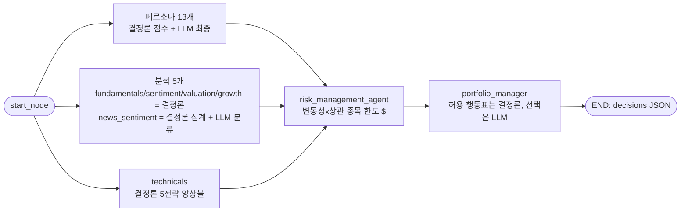
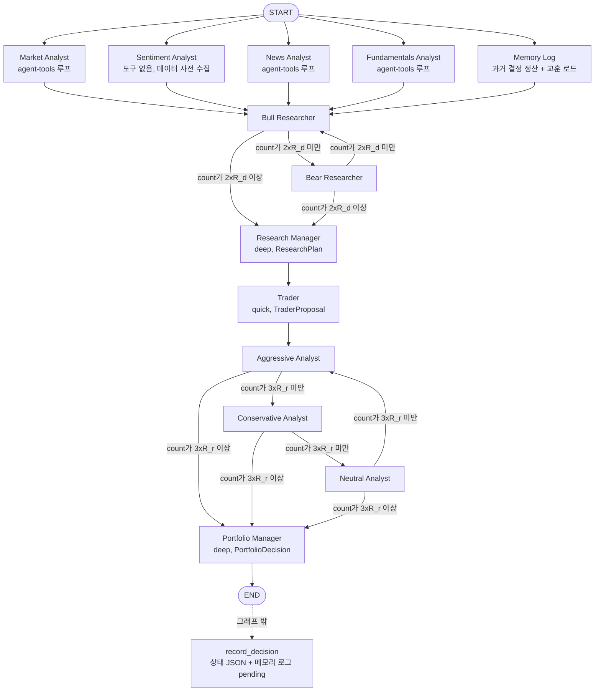
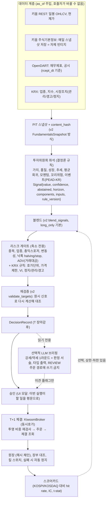

# 01. 멀티에이전트 주식 분석·매매 저장소 역분석: ai-hedge-fund, TradingAgents (+ FinRobot)

작성일 2026-11-15. 한국 주식(KRX) 자동매매 웹앱(FastAPI 백엔드의 결정론적 규칙 코어 + 선택적 LLM 레이어, React 프론트, 실행은 나중에 키움증권 REST API)을 만들기 전에 한 사전 조사다.

## 0. 요약과 범위

### 0.1 분석 대상과 스냅샷

| 저장소 | 분석 스냅샷 | 성격 | 라이선스 | 로컬 사본 (scratchpad/research-src/) |
|---|---|---|---|---|
| virattt/ai-hedge-fund **v1 (legacy)** | 태그 `v2026.7.10`, 커밋 `09dd331` (2026-07-10) | LangGraph 그래프: 애널리스트 19개 → 리스크 매니저 → LLM 포트폴리오 매니저. FastAPI + React Flow 웹앱, 일 단위 백테스터 | MIT (Copyright (c) 2024 Virat Singh) | `ai-hedge-fund-legacy/` |
| virattt/ai-hedge-fund **v2 (HEAD)** | `v2.7.2`, 커밋 `5c553b5` (2026-11-09) | `hedge_fund/` 패키지로 다시 쓴 엔진. AlphaModel/Signal 계약, 결정론적 포트폴리오 구성과 리스크 클램프, T 결정·T+1 체결, 비용 모델, 해시 체인 원장, 킬 스위치, Textual TUI | MIT | `ai-hedge-fund/` |
| TauricResearch/TradingAgents | 커밋 `9fa1196` (2026-11-04), 패키지 0.7.1 | LangGraph 토론형 파이프라인: 애널리스트 4 → 강세/약세 토론 → 리서치 매니저 → 트레이더 → 리스크 3인 토론 → 포트폴리오 매니저 | Apache-2.0 | `TradingAgents/` |
| AI4Finance-Foundation/FinRobot | 커밋 `63e1884` (2026-10-24) | README 수준만 확인 | Apache-2.0 + NOTICE + 상표 정책 | `FinRobot/` |

**중요한 전제** [확인]: 브리핑에서 말한 구조(투자자 페르소나 에이전트, technicals 에이전트, risk manager, portfolio manager, 백테스터, 웹 UI)는 ai-hedge-fund의 **v1**이다. HEAD(v2.7.2)는 전면 재작성되어 `src/agents/`와 `app/`(웹앱)이 없고, 페르소나는 5개(Buffett, Munger, Graham, Lynch, Druckenmiller)와 퀀트 모델 PEAD 1개만 옮겨졌다(`[v2] hedge_fund/signals/__init__.py:65-74`, `ROADMAP.md`의 Analysts 표). 그래서 두 세대를 모두 분석했다. v1은 규칙·점수 배점의 원천이고, v2는 우리 설계("LLM은 주문에 손대지 않는다")에 더 가까운 엔진 골격이다.

### 0.2 핵심 결론

1. **v1 ai-hedge-fund는 "결정론 점수 + LLM 최종 판정" 구조다** [확인]. 페르소나 13개 중 11개는 임계값·배점으로 사전 신호를 계산하지만 최종 신호와 confidence는 LLM 출력이 덮어쓰고, 둘이 일치하는지 검사하지 않는다. Buffett과 Taleb은 사전 신호 없이 규칙을 프롬프트에만 둔다. 순수 결정론은 fundamentals, sentiment, valuation, growth, technicals 다섯 개뿐이다(1.4~1.6절).
2. **v1의 리스크 한도는 권고일 뿐이다** [확인]. risk manager가 변동성·상관 기반으로 종목별 달러 한도를 계산하고 portfolio manager가 "허용 행동표"를 결정론적으로 만들지만, 행동과 수량은 LLM이 고르고 사후 검증이 없다. 실행기는 현금·보유량·증거금만 확인한다(`[legacy] src/agents/portfolio_manager.py:259-262`, `src/backtesting/trader.py:27-34`).
3. **v1 백테스트는 신뢰하기 어렵다** [확인]. 같은 종가를 보고 같은 종가에 체결하고, 비용이 0이며, 재무가 공시일이 아닌 보고기간 기준이다(`report_period_lte`). 공매도 NAV 회계에도 오류가 있다(1.8절). 1개월 룩백 창 탓에 technicals의 5개 전략 중 사실상 추세 하나만 작동한다(1.6절, 산술 [추정]).
4. **v2 ai-hedge-fund는 우리 목표 구조의 좋은 참조 구현이다** [확인]. LLM 페르소나는 `Signal(value ∈ [-1,1])`만 내고, 블렌딩, 7단계 축소 전용 리스크 클램프, 사전 재검증, T+1 체결, 비용, 원장, 킬 스위치는 모두 결정론 코드다(1.10절).
5. **TradingAgents에는 결정론적 매매 규칙이 하나도 없다** [확인]. 리스크 관리도 토론이다. 대신 시점(point-in-time) 방어, 데이터 부재 센티널, 타입 있는 출력, 등급 판독 실패 시 Hold 대신 `REVIEW`로 두는 처리 같은 신뢰성 장치가 뛰어나다. 이런 장치는 LLM 브리핑 레이어에 그대로 쓸 수 있다(2장).
6. **한국 시장 이식** [추정]. 키움 주식기본정보는 "현재값 스냅샷"이라 백테스트에 쓰면 룩어헤드가 생긴다. 매일 저장해 자체 이력을 만들거나 OpenDART를 접수일(`rcept_dt`) 기준으로 써야 한다. 키움 데이터만으로 바로 옮길 수 있는 규칙은 Fundamentals의 수익성·가격배수, Graham Number, Lynch P/E, 가격 기반 technicals와 변동성 규칙이다(1.4~1.5 F표, 4.4절).

### 0.3 표기 규칙

- 저장소 표기: `[legacy]` = ai-hedge-fund v1, `[v2]` = ai-hedge-fund HEAD, `[TA]` = TradingAgents. 경로는 각 저장소 루트 기준이고 `경로:줄` 또는 `경로:시작-끝`으로 적는다.
- **[확인]** = 소스를 직접 읽어 확인한 사실. **[추정]** = 소스에서 끌어낸 해석, 산술 추론, 일반 지식(한국 시장 제도, API 이름 등).
- 코드는 실행하지 않았다. 프롬프트는 원문을 옮기지 않고 핵심 지시만 한국어로 의역했다. 의사코드는 원문 복제가 아니라 동작 요약이다.
- 1.4~1.5절(페르소나·분석 에이전트), 1.8·1.9·1.11절(v1 백테스터, 웹 UI, v2 TUI), 2장(TradingAgents)은 병렬 하위 분석 노트를 통합한 것이다. 핵심 주장은 원문과 대조해 검증했다(부록 B).

---

## 1. ai-hedge-fund (virattt)

### 1.1 저장소 개요와 두 세대

| 항목 | v1 (legacy, `src/` + `app/`) | v2 (HEAD, `hedge_fund/`) |
|---|---|---|
| 오케스트레이션 | LangGraph `StateGraph`: `start_node`에서 선택한 애널리스트로 병렬 분기 → `risk_management_agent` → `portfolio_manager` → END (`[legacy] src/main.py:100-130`) | 순수 Python 함수 `advance`: reconcile → 대기 결정 체결 → 평가(mark) → 리밸런스일이면 assess (`[v2] hedge_fund/pipeline/session.py:132-213`) |
| 애널리스트 | 19개 = 페르소나 13 + 분석 6 (`[legacy] src/utils/analysts.py:25-178`) | 6개 = LLM 페르소나 5 + 퀀트 PEAD 1 (`[v2] hedge_fund/signals/__init__.py:65-74`) |
| 신호 형식 | `{signal: bullish/bearish/neutral, confidence: 0-100, reasoning}` | `Signal{model_name, ticker, date, value ∈ [-1,+1], reasoning, components, metadata.abstained, horizon_days}` (`[v2] hedge_fund/models.py:14-40`) |
| 신호 집계와 최종 결정 | LLM 포트폴리오 매니저가 종목별 행동과 수량을 고른다 (`[legacy] src/agents/portfolio_manager.py:177-262`) | 결정론: `blend_signals` → `apply_limits` → `validate_targets` → `build_orders` (`[v2] hedge_fund/pipeline/stages.py:51-208`) |
| 리스크 | 변동성·상관 기반 종목별 달러 한도. LLM에게 "최대 수량"으로만 전달 | 축소만 하는 7단계 하드 클램프, 낙폭 halving/stop-out, ADV 한도, 모든 발동을 `ClampEvent`로 기록 (`[v2] hedge_fund/risk/limits.py`) |
| 체결 시점 | T까지의 데이터로 결정해 **T 종가**에 체결 | T 종가에 평가하고 **T+1 종가**에 체결 (`[v2] pipeline/session.py:11-15`) |
| 비용 | 없음 | 반스프레드 5bp/측, 주당 $0.005, 제곱근 충격, 0.5% no-trade band (`[v2] hedge_fund/brokers/costs.py:36-73`) |
| 시점(PIT) | 재무는 `report_period_lte`(룩어헤드), 과거 시총은 보고기간 말 값 | 재무는 `filing_date_lte` (`[v2] hedge_fund/data/client.py:175-197`). 백테스트 프롬프트는 blind(티커·업종·날짜·금액 제거) |
| 재현성 | LLM 응답 캐시 없음, 샘플링 파라미터 미지정 | (agent, model, system, user) 해시 키 프롬프트 캐시. 재실행 비용 0, 감사 기록 겸용 (`[v2] hedge_fund/llm/cache.py:1-28`) |
| 상태 | 실행마다 새로 만든 포트폴리오 dict | 해시 체인 원장에서 상태를 재구성, `control.json` 킬 스위치 (`[v2] hedge_fund/paper/ledger.py:1-25`) |
| UI | FastAPI + React Flow 웹앱 (`[legacy] app/`) | Textual TUI + CLI. `app/` 폴더가 HEAD에는 없다 [확인: 파일 목록]. ROADMAP은 웹 대시보드를 "scaffold, v1 엔진 기반"으로 표시 |

v1 태그에도 `v2/` 폴더(초기 재작성본: `v2/signals/buffett.py`, `pead.py`, `v2/portfolio/optimizer.py`, `v2/risk/manager.py`, `v2/event_study/`)가 있다. HEAD의 `hedge_fund/`가 이를 발전시킨 최종본이어서 이 문서는 HEAD 기준으로 분석했다 [확인: 파일 목록].

### 1.2 v1 그래프 구조와 상태

**상태 스키마** [확인] `[legacy] src/graph/state.py:10-18`

| 필드 | 리듀서 | 내용 |
|---|---|---|
| `messages` | `operator.add` (누적) | 초기값은 HumanMessage 1개(`src/main.py:66-70`). 각 에이전트가 자기 결과 JSON을 담은 메시지를 덧붙인다. PM의 마지막 메시지 본문이 최종 결정 JSON이다(`main.py:86-87`) |
| `data` | `merge_dicts` (얕은 병합) | `tickers`, `portfolio`, `start_date`, `end_date`, `analyst_signals` (`main.py:71-77`). 에이전트는 `state["data"]["analyst_signals"][agent_id] = {ticker: {...}}`로 **공유 dict를 직접 변경**하고 data를 그대로 돌려준다(예: `src/agents/technicals.py:150-157`) |
| `metadata` | `merge_dicts` | `show_reasoning`, `model_name`(기본 `gpt-4.1`), `model_provider`(기본 OpenAI) (`main.py:53-54, 78-82`) |

- 병렬 노드들이 같은 `analyst_signals` dict를 제자리에서 바꾸고 얕은 병합에 기대는 패턴이다. LangGraph 리듀서가 아니라 객체 공유 덕분에 결과가 합쳐진다 [추정: 구조 해석]. 우리 엔진에서는 노드별 불변 결과를 리듀서로 합치는 편이 안전하다.
- 포트폴리오 dict 형태(`main.py:146-167`): `cash`, `margin_requirement`, `margin_used`, `positions[ticker] = {long, short, long_cost_basis, short_cost_basis, short_margin_used}`, `realized_gains[ticker] = {long, short}` [확인]. 롱과 숏을 한 종목에 동시에 들 수 있다.
- 웹앱 변형: 캔버스의 Portfolio Manager 노드마다 전용 risk manager 노드를 서버가 자동으로 끼워 넣는다(`[legacy] app/backend/services/graph.py:68-81`, 1.9.4절) [확인].
- 기간: CLI 기본 시작일 = 종료일 − 3개월(`[legacy] src/cli/input.py:204-210`), 웹 단일 실행 = 종료일 − 90일(`app/backend/models/schemas.py:136-140`), 백테스트 = 매 영업일 T − 1개월(`src/backtesting/engine.py:108, 131-135`) [확인]. 모든 에이전트가 같은 `[start_date, end_date]` 창을 쓴다. 이 창 길이가 technicals와 risk manager의 동작을 크게 바꾼다(1.6, 1.7절).



### 1.3 v1 에이전트 전체 목록 (유형별)

| 구분 | 에이전트(order) | 입력 데이터(요약) | 신호를 정하는 주체 | 상세 |
|---|---|---|---|---|
| 페르소나, 사전 신호 + LLM 최종 | Damodaran(0), Graham(1), Ackman(2), Wood(3), Munger(4), Burry(5), Pabrai(6), Lynch(8), Fisher(9), Jhunjhunwala(10), Druckenmiller(11) | financial metrics(ttm/annual, limit 5~10), line items, 시가총액. 일부는 내부자 거래, 뉴스, 가격 | LLM이 덮어쓴다(사전 신호와의 일치 검사 없음) | 1.4절 |
| 페르소나, 사전 신호 없음 | Taleb(7), Buffett(12) | 위와 같고 Taleb은 가격 꼬리 통계 포함 | LLM(프롬프트의 5구간 confidence 기준표) | 1.4절 |
| 기술적 분석 | Technical Analyst(13) | 일봉 OHLCV | 결정론(5전략 가중 앙상블) | 1.6절 |
| 분석, 순수 결정론 | Fundamentals(14), Growth(15), Sentiment(17), Valuation(18) | metrics, line items, 내부자, 뉴스 레이블 | 결정론 | 1.5절 |
| 분석, 결정론 + LLM 보조 | News Sentiment(16) | 뉴스 100건, 미레이블 최신 기사 5건 이하를 LLM이 분류 | 결정론 다수결 | 1.5절 |
| 리스크 | `risk_management_agent` | 가격(대상 종목 + 보유 종목) | 결정론(종목별 잔여 한도 $) | 1.7.1절 |
| 최종 결정 | `portfolio_manager` | 신호 `{sig, conf}`만, 허용 행동표 | 결정론 제약 + LLM 선택 | 1.7.2절 |

에이전트별 입력 파라미터, 하위 함수별 임계값과 배점, 신호 매핑, confidence 산식, LLM payload, 버그 목록은 다음 1.4~1.5절에 `파일:줄`과 함께 정리했다.


### 1.4 투자자 페르소나 에이전트

> 분석 대상: [legacy] = `virattt/ai-hedge-fund` 태그 `v2026.7.10` (커밋 `09dd331`, 2026-07-10). 경로는 저장소 루트 기준이며 `파일:줄` 또는 `파일:시작-끝`으로 표기한다.
> 표기 규칙: [확인] = 소스에서 직접 읽은 사실, [추정] = 해석이나 영향에 대한 추정. 캡션에 [확인]이 붙은 표의 조건과 수치는 소스 그대로다.
> 이 절의 범위는 페르소나 13개와 분석 에이전트 5개(fundamentals, sentiment, news_sentiment, valuation, growth)다. technicals, risk_manager, portfolio_manager, 백테스터, 웹앱은 다른 절에서 다룬다.
> 프롬프트는 저작권 문제로 원문을 옮기지 않고 핵심 지시만 한국어로 의역했다.

#### 1.4.0 공통 구조 (페르소나와 분석 에이전트 모두)

**(1) 레지스트리** [확인] `src/utils/analysts.py:25-178`의 `ANALYST_CONFIG`가 단일 출처다. 19개(페르소나 13, 분석 6)가 `order`로 정렬되고, 그래프 노드 이름은 `{key}_agent`다(`analysts.py:184-186`).

| order | key | display_name | 파일 | 줄 수 |
|---|---|---|---|---|
| 0 | aswath_damodaran | Aswath Damodaran | src/agents/aswath_damodaran.py | 419 |
| 1 | ben_graham | Ben Graham | src/agents/ben_graham.py | 348 |
| 2 | bill_ackman | Bill Ackman | src/agents/bill_ackman.py | 468 |
| 3 | cathie_wood | Cathie Wood | src/agents/cathie_wood.py | 436 |
| 4 | charlie_munger | Charlie Munger | src/agents/charlie_munger.py | 856 |
| 5 | michael_burry | Michael Burry | src/agents/michael_burry.py | 376 |
| 6 | mohnish_pabrai | Mohnish Pabrai | src/agents/mohnish_pabrai.py | 359 |
| 7 | nassim_taleb | Nassim Taleb | src/agents/nassim_taleb.py | 761 |
| 8 | peter_lynch | Peter Lynch | src/agents/peter_lynch.py | 507 |
| 9 | phil_fisher | Phil Fisher | src/agents/phil_fisher.py | 603 |
| 10 | rakesh_jhunjhunwala | Rakesh Jhunjhunwala | src/agents/rakesh_jhunjhunwala.py | 707 |
| 11 | stanley_druckenmiller | Stanley Druckenmiller | src/agents/stanley_druckenmiller.py | 602 |
| 12 | warren_buffett | Warren Buffett | src/agents/warren_buffett.py | 826 |
| 13 | technical_analyst | Technical Analyst | src/agents/technicals.py | (다른 절) |
| 14 | fundamentals_analyst | Fundamentals Analyst | src/agents/fundamentals.py | 163 |
| 15 | growth_analyst | Growth Analyst | src/agents/growth_agent.py | 338 |
| 16 | news_sentiment_analyst | News Sentiment Analyst | src/agents/news_sentiment.py | 221 |
| 17 | sentiment_analyst | Sentiment Analyst | src/agents/sentiment.py | 138 |
| 18 | valuation_analyst | Valuation Analyst | src/agents/valuation.py | 494 |

**(2) 실행 패턴** [확인] 모든 에이전트 함수는 `state["data"]["tickers"]`를 순회하며 (a) 데이터 조회, (b) 결정론적 하위 분석, (c) 점수 집계와 사전 신호 계산, (d) 페르소나만 LLM 호출 순서로 진행하고, 결과 `{signal, confidence, reasoning}`을 `state["data"]["analyst_signals"][agent_id][ticker]`에 쓴다. 페르소나의 `reasoning`은 문자열, 분석 에이전트의 `reasoning`은 dict다.

**(3) 데이터 API** [확인] `src/tools/api.py` (공급자: financialdatasets.ai)

| 함수 | 엔드포인트와 시점 필터 | 기본값 | 캐시 | 위치 |
|---|---|---|---|---|
| `get_prices` | `/prices/?interval=day&start_date&end_date` | - | 있음(ticker_start_end 정확 일치) | api.py:63-96 |
| `get_financial_metrics` | `/financial-metrics/?report_period_lte={end_date}&period&limit` | period="ttm", limit=10 | 있음 | api.py:99-138 |
| `search_line_items` | POST `/financials/search/line-items` body `{tickers, line_items, end_date, period, limit}` | period="ttm", limit=10 | 없음(주석은 캐시한다고 되어 있으나 미구현) | api.py:141-180 |
| `get_insider_trades` | `/insider-trades/?filing_date_lte` (+start_date 있으면 `filing_date_gte`와 페이지네이션) | limit=1000 | 있음 | api.py:183-246 |
| `get_company_news` | `/news/?end_date` (+start_date 있으면 페이지네이션) | limit=1000 | 있음 | api.py:249-312 |
| `get_market_cap` | end_date가 오늘이면 `/company/facts/`의 market_cap, 아니면 `get_financial_metrics(...)[0].market_cap` | - | metrics 캐시 경유 | api.py:315-348 |
| 429 처리 | 선형 백오프 60+30×attempt 초, 최대 3회 재시도 | - | - | api.py:29-60 |

시점(point-in-time) 관련 함의:
- financial metrics는 회계기간 종료일(`report_period`) 기준 필터라, 백테스트에서 실제 공시 전의 분기 수치가 들어갈 수 있다 [추정: 공시 시차가 있는 한 룩어헤드].
- 과거 날짜의 `get_market_cap`은 "그 날짜 이전 마지막 보고기간 말의 시가총액"이다 [확인: api.py:339-348]. 따라서 백테스트에서 안전마진, FCF yield, P/E의 분모가 당일 주가가 아니라 최대 수개월 묵은 값이 된다 [추정: 영향].
- 백테스트 엔진은 에이전트에 start_date = 당일−1개월, end_date = 당일을 넘긴다 [확인: `src/backtesting/engine.py:108,131-135`]. CLI 기본은 end−3개월이다 [확인: `src/cli/input.py:204-210`].
- 테스트 픽스처에서 TTM metrics는 분기 간격 시점(2023-12-30, 2023-09-30, ...)이 최신순으로 온다 [확인: `tests/fixtures/api/financial_metrics/AAPL_2024-03-01_2024-03-08.json`]. 즉 `period="ttm", limit=10`은 약 2.5년치 분기 시점 10개다.

**(4) 데이터 모델** [확인] `src/data/models.py`
- `FinancialMetrics` (L18-61): market_cap, enterprise_value, price_to_earnings_ratio, price_to_book_ratio, price_to_sales_ratio, enterprise_value_to_ebitda_ratio, enterprise_value_to_revenue_ratio, free_cash_flow_yield, peg_ratio, gross_margin, operating_margin, net_margin, return_on_equity, return_on_assets, return_on_invested_capital, asset_turnover, inventory_turnover, receivables_turnover, days_sales_outstanding, operating_cycle, working_capital_turnover, current_ratio, quick_ratio, cash_ratio, operating_cash_flow_ratio, debt_to_equity, debt_to_assets, interest_coverage, revenue_growth, earnings_growth, book_value_growth, earnings_per_share_growth, free_cash_flow_growth, operating_income_growth, ebitda_growth, payout_ratio, earnings_per_share, book_value_per_share, free_cash_flow_per_share.
  - **없는 필드**: revenue, beta, ebit, interest_expense, free_cash_flow, ev_to_ebit. 일부 에이전트가 이 이름을 `getattr`로 읽어 항상 None이 된다(Damodaran, Burry) [확인].
- `LineItem` (L68-75): `extra="allow"`라 요청한 line item 이름이 그대로 속성이 된다. 요청하지 않은 항목은 `hasattr`가 False다 [확인]. 여러 에이전트가 비율형(gross_margin, operating_margin, debt_to_equity, return_on_invested_capital)을 line item으로 요청하는데, 이 엔드포인트가 비율형을 돌려주는지는 저장소 안에서 검증할 수 없다 [추정].
- `InsiderTrade` (L82-95): transaction_shares(+매수/−매도), transaction_price_per_share, transaction_value, shares_owned_before/after_transaction, filing_date 등. **transaction_type 필드는 없다** [확인].
- `CompanyNews` (L102-110): 공급자가 붙여 주는 `sentiment` 문자열이 있다 [확인].
- 모든 에이전트가 리스트 `[0]`을 최신으로 가정한다(예: `bill_ackman.py:346-347` 주석) [확인]. 픽스처도 최신순이다 [확인].

**(5) LLM 호출 규약** [확인] `src/utils/llm.py`
- `call_llm` (L10-84): 모델은 요청의 에이전트별 설정 → metadata의 model_name/provider → 기본값 `gpt-4.1`/`OPENAI` 순으로 정한다(L33-39, L172-195).
- JSON 모드를 지원하는 모델은 `with_structured_output(pydantic, method="json_mode")`로 호출한다(L52-56). 미지원 모델(DeepSeek, Gemini, Anthropic `claude-fable` 계열, llama3/neural-chat 외 Ollama: `src/llm/models.py:51-66`)은 응답 원문에서 JSON을 뽑는다(L109-169: json 코드 블록 → 일반 코드 블록 → 전체 문자열 → 첫 균형 중괄호 객체 순).
- 재시도 3회. 마지막 시도에서 **예외**가 나면 `default_factory()` 또는 `create_default_response`를 돌려준다(L72-81).
- **버그**: JSON 미지원 모델에서 추출이 세 번 모두 None이면(예외 없이) 루프를 빠져나가 L84의 `create_default_response`로 간다. 이때 `default_factory`가 무시되고 Literal 필드는 첫 값을 쓴다(L87-106). 결과는 `signal="bullish", confidence=0, reasoning="Error in analysis, using default"`다 [확인]. 즉 파싱 실패가 조용히 '강세'로 바뀐다. news_sentiment는 애초에 default_factory가 없어 예외 경로에서도 `"positive"`가 된다 [확인].
- temperature, seed 등 샘플링 파라미터를 지정하지 않는다(`src/llm/models.py:151-261`의 `get_model`에 인자 없음) [확인]. 공급자 기본값으로 돌기 때문에 같은 입력에도 결과가 달라질 수 있다 [추정].

**(6) API 키** [확인] `get_api_key_from_state`(`src/utils/api_key.py:3-9`)는 요청 객체가 없으면(CLI) None을 돌려주고, api.py는 환경변수 `FINANCIAL_DATASETS_API_KEY`로 대체한다. Burry와 Taleb는 insider/news 호출에 api_key를 넘기지 않는다(`michael_burry.py:70,73`, `nassim_taleb.py:76,79`) [확인].

**(7) LLM payload 세 가지 유형** [확인]

| 유형 | 에이전트 | 위치 |
|---|---|---|
| 압축 facts(JSON, 구분자 최소화) | Buffett, Munger, Taleb | warren_buffett.py:755-767, charlie_munger.py:727-776, nassim_taleb.py:691-702 |
| 해당 티커 분석 dict 전체(indent=2) | Lynch, Jhunjhunwala | peter_lynch.py:134, rakesh_jhunjhunwala.py:141 |
| **누적 `analysis_data` 전체(앞서 처리한 티커 포함)** | Graham, Ackman, Wood, Burry, Pabrai, Fisher, Druckenmiller, Damodaran | ben_graham.py:73, bill_ackman.py:103, cathie_wood.py:90, michael_burry.py:133, mohnish_pabrai.py:105, phil_fisher.py:141, stanley_druckenmiller.py:140, aswath_damodaran.py:119 |

세 번째 유형은 티커 순서에 따라 프롬프트가 달라지고 토큰이 누적해서 늘어난다 [확인: 코드]. 앞 티커의 데이터와 사전 신호가 뒤 티커 판단을 오염시킬 수 있다 [추정].

**(8) 출력 스키마** [확인] 페르소나 13개 모두 `signal: Literal["bullish","bearish","neutral"]`, `confidence`, `reasoning: str`. confidence 타입은 Buffett·Munger·Taleb이 int, 나머지 10개가 float다.

---

#### 1.4.1 Aswath Damodaran (`aswath_damodaran_agent`, order 0)

파일 `src/agents/aswath_damodaran.py`, 스키마 `AswathDamodaranSignal` (L21-24, confidence float).

**입력 데이터** [확인]

| 호출 | 파라미터 | 위치 |
|---|---|---|
| get_financial_metrics | period="ttm", limit=5 | L47 |
| search_line_items | free_cash_flow, ebit, interest_expense, capital_expenditure, depreciation_and_amortization, outstanding_shares, net_income, total_debt / period·limit 기본값(ttm, 10) | L50-64 |
| get_market_cap | end_date | L67 |

**결정론적 하위 분석** [확인]

| 함수(위치) | 조건 | 점수 | 최대 |
|---|---|---|---|
| analyze_growth_and_reinvestment (L143-190) | metrics 2개 미만이면 0 | - | 4 |
| | 매출 CAGR(metrics의 revenue, 오래된→최신) > 8% | +2 | |
| | 매출 CAGR > 3% | +1 | |
| | FCF 추세: line items 역순에서 최신 FCF > 가장 오래된 FCF | +1 | |
| | metrics[0].return_on_invested_capital > 10% | +1 | |
| analyze_risk_profile (L193-251) | beta < 1.3 | +1 | 3 |
| | metrics D/E < 1 | +1 | |
| | 이자보상배율 = ebit / abs(interest_expense) > 3 | +1 | |
| analyze_relative_valuation (L254-279) | metrics 5개 미만 또는 P/E 5개 미만이면 0 | - | 1 |
| | 최신 P/E < 0.7 × P/E 중앙값 | +1 | |
| | 최신 P/E > 1.3 × P/E 중앙값 | −1 | |

내재가치 `calculate_intrinsic_value_dcf` (L285-347) [확인]:
- fcff0 = metrics[0].free_cash_flow, 주식수 = line_items[0].outstanding_shares
- 기본 성장률 = min(매출 CAGR, 12%), 없으면 4%. 터미널 2.5%, 10년.
- 할인율 = `estimate_cost_of_equity(beta)` = 4% + β×5%, β가 없으면 1.0 → 9% (L350-355). 없으면 0.09.
- 성장률을 1년차 기본값에서 10년차 2.5%까지 선형으로 낮춘다(g_step = (2.5% − 기본)/9).
- 각 연도 FCFF = fcff0 × (1+g) — 누적 복리가 아니라 매년 기준값에 그 해 성장률만 곱한다 [확인: L319-323].
- TV = fcff0 × 1.025 / (r − 0.025) / (1+r)^10 — 10년차가 아니라 fcff0 기준 [확인: L326-331].
- 지분가치 = PV 합 + TV (순차입 차감 없음).

**집계와 신호** [확인]: total_score = growth + risk + relative (L83-87), max = 8 (L88). 그러나 신호는 점수와 무관하게 MOS = (IV − 시총)/시총만으로 정한다. MOS ≥ +25% bullish, ≤ −25% bearish, 그 외 또는 MOS 없음 neutral (L90-101). confidence는 LLM이 정한다.

**중대 결함** [확인]: FinancialMetrics에 revenue, beta, ebit, interest_expense, free_cash_flow가 없다(`models.py:18-61`). 그래서 매출 CAGR=None, beta NA, 이자보상 NA, fcff0=None → DCF가 항상 "Missing FCFF or share count"로 끝나고 MOS가 None → **사전 신호가 항상 neutral**이다. 실제로 점수가 붙는 항목은 FCF 추세 1, ROIC 1, D/E 1, P/E 상대평가 ±1뿐이다.

**LLM** [확인]: 누적 analysis_data 전체를 넘긴다(L117-122, L404). 프롬프트 요지(의역): NYU 재무학 교수 페르소나로 미국 주식에 신호를 낸다. 먼저 기업의 '스토리'를 말하고, 이를 매출 성장·마진·재투자·위험 같은 수치 동인에 연결한 뒤, FCFF DCF·안전마진·상대가치 점검으로 결론 내고, 큰 불확실성이 가치에 주는 영향을 짚으라고 한다. 지정 JSON만 반환. 실패 기본값: neutral, 0.0 (L406-411). 최종 출력은 LLM 결과의 `model_dump()`(L124)라 사전 신호를 덮어쓸 수 있다.

**한국 데이터 재현성** [추정]: 의도대로라면 OpenDART(FCF = 영업활동현금흐름 − 유형자산 취득, 이자비용, 차입금) + 가격(KOSPI 대비 회귀로 베타)이 필요하다. 키움 스냅샷만으로는 PER을 매일 저장해 이력을 쌓은 경우의 P/E 상대평가와 ROE 정도만 가능하다. 프롬프트의 "US equities" 문구와 rf 4%·ERP 5%는 한국용으로 바꿔야 한다.

---

#### 1.4.2 Ben Graham (`ben_graham_agent`, order 1)

파일 `src/agents/ben_graham.py`, 스키마 `BenGrahamSignal` (L14-17, float).

**입력 데이터** [확인]

| 호출 | 파라미터 | 위치 |
|---|---|---|
| get_financial_metrics | period="annual", limit=10 (존재 여부 확인에만 사용) | L38 |
| search_line_items | earnings_per_share, revenue, net_income, book_value_per_share, total_assets, total_liabilities, current_assets, current_liabilities, dividends_and_other_cash_distributions, outstanding_shares / annual, limit 10 | L41 |
| get_market_cap | end_date | L44 |

**결정론적 하위 분석** [확인]

| 함수(위치) | 조건 | 점수 | 최대 |
|---|---|---|---|
| analyze_earnings_stability (L97-138) | EPS 2개 미만이면 0 | - | 4 |
| | 모든 기간 EPS > 0 | +3 | |
| | 80% 이상 기간 EPS > 0 | +2 | |
| | 최신 EPS > 가장 오래된 EPS | +1 | |
| analyze_financial_strength (L141-204) | 유동비율(유동자산/유동부채) ≥ 2.0 | +2 | 5 |
| | 유동비율 ≥ 1.5 | +1 | |
| | 총부채/총자산 < 0.5 | +2 | |
| | 총부채/총자산 < 0.8 | +1 | |
| | 배당(음수=지급) 기간 수 ≥ n//2+1 (과반) | +1 | |
| analyze_valuation_graham (L207-279) | 시총 없음 또는 ≤0이면 0 | - | 7 |
| | NCAV(유동자산 − 총부채) > 0 이고 NCAV > 시총 | +4 | |
| | 그렇지 않으면 주당 NCAV ≥ 0.67 × 주가 (주가 = 시총/주식수) | +2 | |
| | Graham Number = sqrt(22.5 × EPS × BVPS) (EPS, BVPS > 0) | - | |
| | (GN − 주가)/주가 > 50% | +3 | |
| | (GN − 주가)/주가 > 20% | +1 | |

**집계와 신호** [확인]: total = 세 점수 합. 실제 최대는 4+5+7 = 16인데 `max_possible_score = 15`(L58). total ≥ 10.5(0.7×15) bullish, ≤ 4.5(0.3×15) bearish, 그 외 neutral (L61-66). 이 사전 신호는 payload에 들어가지만 최종 신호는 LLM 출력이다(L78).

**LLM** [확인]: 누적 analysis_data 전체(L71-76, L337). 요지: 내재가치보다 싸게 사는 안전마진(Graham Number, net-net), 재무건전성(낮은 레버리지, 넉넉한 유동자산), 다년간 안정 이익, 배당 이력, 투기적 성장 가정 배제. 근거를 쓸 때 Graham Number·NCAV·P/E 같은 핵심 지표, 유동비율·부채 같은 건전성 지표를 정확한 숫자와 Graham 기준값(예: 유동비율 2.0)에 대비해 설명하라고 하고, 강세·약세 예시 문단을 준다. confidence는 0~100 float로 LLM이 정한다. 실패 기본값: neutral, 0.0 (L339-340).

**한국 데이터 재현성** [추정]: Graham Number 안전마진(최대 3점)은 키움 스냅샷의 EPS·BPS와 현재가만으로 계산된다. 18개 에이전트 중 키움 데이터만으로 가장 깔끔하게 옮겨지는 밸류 규칙이다. NCAV, 유동비율, 부채비율, 배당 이력, 다년 EPS는 OpenDART 재무상태표·현금흐름표(배당금 지급)가 필요하다.

---

#### 1.4.3 Bill Ackman (`bill_ackman_agent`, order 2)

파일 `src/agents/bill_ackman.py`, 스키마 `BillAckmanSignal` (L13-16, float).

**입력 데이터** [확인]

| 호출 | 파라미터 | 위치 |
|---|---|---|
| get_financial_metrics | period="annual", limit=5 | L34 |
| search_line_items | revenue, operating_margin, debt_to_equity, free_cash_flow, total_assets, total_liabilities, dividends_and_other_cash_distributions, outstanding_shares / annual, limit 5 | L38-56 |
| get_market_cap | end_date | L59 |

**결정론적 하위 분석** [확인]

| 함수(위치) | 조건 | 점수 | 최대 |
|---|---|---|---|
| analyze_business_quality (L137-212) | 누적 매출 성장(가장 오래된→최신) > 50% | +2 | 7 |
| | 누적 매출 성장 0~50% | +1 | |
| | 영업이익률 > 15%인 기간이 과반(≥ n//2+1) | +2 | |
| | FCF > 0인 기간이 과반 | +1 | |
| | 최신 metrics ROE > 15% | +2 | |
| analyze_financial_discipline (L215-287) | line item D/E < 1.0인 기간이 과반 (D/E가 없으면 총부채/총자산 < 0.5 과반으로 대체) | +2 | 4 |
| | 배당 지급(음수) 기간 과반 | +1 | |
| | 최신 주식수 < 가장 오래된 주식수 | +1 | |
| analyze_activism_potential (L290-332) | 누적 매출 성장 > 15% 이고 평균 영업이익률 < 10% | +2 | 2 |
| analyze_valuation (L335-396) | 최신 FCF ≤ 0이면 0 | - | 3 |
| | DCF: 성장 6%, 할인 10%, 5년, 터미널 멀티플 15배. MOS = (IV − 시총)/시총 > 30% | +3 | |
| | MOS > 10% | +1 | |

누적 성장은 연간 5개 시점, 즉 약 4년치다. 50%는 연율 약 10.7%, 15%는 연율 약 3.6%다 [추정: 5개 연도 모두 있을 때 산술].

**집계와 신호** [확인]: 실제 최대 7+4+2+3 = 16인데 `max_possible_score = 20`(L80). total ≥ 14(0.7×20) bullish, ≤ 6 bearish, 그 외 neutral (L83-88). 16점 만점에서 14점이 필요해 강세가 매우 드물다 [추정: 영향].

**LLM** [확인]: 누적 analysis_data 전체(L101-106, L450-453). 요지: 해자가 있는 고품질 사업(유명 소비자·서비스 브랜드 등), 장기 FCF와 성장, 재무 규율(적정 레버리지, 효율적 자본배분), 안전마진 있는 가치평가, 경영·운영 개선으로 가치를 끌어낼 행동주의 촉매, 소수 고확신 종목 집중. 약점과 기회를 말할 때 때로 공격적인 어조를 쓰라고 한다. 실패 기본값: neutral, 0.0 (L455-460).

**한국 데이터 재현성** [추정]: 최신 ROE는 키움 스냅샷으로 가능하다. 다기간 매출·영업이익률·FCF·배당·주식수는 OpenDART가 필요하다. 행동주의 규칙(성장↑, 마진↓)은 DART 5개년만으로 그대로 재현된다.

---

#### 1.4.4 Cathie Wood (`cathie_wood_agent`, order 3)

파일 `src/agents/cathie_wood.py`, 스키마 `CathieWoodSignal` (L13-16, float).

**입력 데이터** [확인]

| 호출 | 파라미터 | 위치 |
|---|---|---|
| get_financial_metrics | period="annual", limit=5 | L36 |
| search_line_items | revenue, gross_margin, operating_margin, debt_to_equity, free_cash_flow, total_assets, total_liabilities, dividends_and_other_cash_distributions, outstanding_shares, research_and_development, capital_expenditure, operating_expense / annual, limit 5 | L40-60 |
| get_market_cap | end_date | L63 |

**결정론적 하위 분석** [확인]

`analyze_disruptive_potential` (L111-207): 원점수를 `score/12×5`로 정규화(L203-205).

| 조건 | 점수 |
|---|---|
| 매출 3개 이상. YoY 성장률 목록(최신 우선)에서 최신 성장률 > 가장 오래된 성장률 (가속) | +2 |
| 최신 매출 성장률 > 100% / > 50% / > 20% | +3 / +2 / +1 |
| 매출총이익률 변화(최신 − 가장 오래된) > 5%p / > 0 | +2 / +1 |
| 최신 매출총이익률 > 50% | +2 |
| 영업레버리지: 누적 매출 성장 > 누적 영업비용 성장 | +2 |
| R&D/매출(최신) > 15% / > 8% / > 5% | +3 / +2 / +1 |

실제 원점수 최대는 2+3+2+2+2+3 = 14인데 분모가 12라 정규화 점수 최대가 5.83이다 [확인].

`analyze_innovation_growth` (L210-315): 원점수를 `score/15×5`로 정규화.

| 조건 | 점수 |
|---|---|
| R&D 누적 성장(최신 vs 가장 오래된) > 50% / > 20% | +3 / +2 |
| R&D 집약도 상승(최신 R&D/매출 > 가장 오래된 R&D/매출) | +2 |
| FCF 누적 성장 > 30% 이고 전 기간 FCF 양수 | +3 |
| (위가 아니면) FCF 양수 비율 ≥ 75% / > 50% | +2 / +1 |
| 최신 영업이익률 > 15% 이고 개선 | +3 |
| (위가 아니면) 최신 영업이익률 > 10% / 개선만 | +2 / +1 |
| capex/매출(최신) > 10% 이고 capex 누적 성장 > 20% | +2 |
| (위가 아니면) capex/매출 > 5% | +1 |
| 배당/FCF(최신) < 0.2 / < 0.4 | +2 / +1 |

배당이 음수(지급)로 기록되는 데이터 관례(다른 에이전트들이 전제)에서는 배당 지급 기업이 음수 비율로 항상 +2를 받고, 무배당 기업은 리스트가 비어 0점이다. 의도(재투자 선호)와 반대로 작동한다 [추정].

`analyze_cathie_wood_valuation` (L318-360): 최신 FCF > 0 필요. 성장 20%, 할인 15%, 5년, 터미널 멀티플 25배. MOS > 50% +3, > 20% +1 (최대 3).

**집계와 신호** [확인]: total = 파괴력(0~5.83) + 혁신(0~5) + 밸류(0~3), `max_possible_score = 15`(L75-76). total ≥ 10.5 bullish, ≤ 4.5 bearish (L78-83).

**LLM** [확인]: 누적 analysis_data 전체(L88-93, L422). 요지: 파괴적 혁신, 기하급수적 성장 잠재력과 거대한 TAM, 기술·헬스케어 같은 미래 산업, 다년간의 돌파구, 높은 변동성 감수, 경영진 비전과 R&D 투자. 낙관적·미래지향적·확신형 어조와 예시 문단을 준다. 실패 기본값: neutral, 0.0 (L424-425).

**한국 데이터 재현성** [추정]: 매출, 매출총이익, 판관비, capex, FCF, 배당은 OpenDART로 가능하다. R&D는 표준 재무제표 계정이 아니라(사업보고서 '연구개발활동' 기재, 판관비나 매출원가 안에 포함) 자동 추출이 불안정하다. 키움 스냅샷만으로는 거의 재현되지 않는다.

---

#### 1.4.5 Charlie Munger (`charlie_munger_agent`, order 4)

파일 `src/agents/charlie_munger.py`, 스키마 `CharlieMungerSignal` (L12-15, confidence int).

**입력 데이터** [확인]

| 호출 | 파라미터 | 위치 |
|---|---|---|
| get_financial_metrics | period="annual", limit=10 | L32 |
| search_line_items | revenue, net_income, operating_income, return_on_invested_capital, gross_margin, operating_margin, free_cash_flow, capital_expenditure, cash_and_equivalents, total_debt, shareholders_equity, outstanding_shares, research_and_development, goodwill_and_intangible_assets / annual, limit 10 | L35-57 |
| get_market_cap | end_date | L60 |
| get_insider_trades | limit=100, 시작일 없음 | L64-69 |
| get_company_news | limit=10 | L73-78 |

**결정론적 하위 분석** [확인]

`analyze_moat_strength` (L161-265): 원점수 최대 9 → `min(10, score×10/9)`.

| 조건 | 점수 |
|---|---|
| ROIC(line item) > 15%인 기간 비율 ≥ 80% / ≥ 50% / 1개 이상 | +3 / +2 / +1 |
| 매출총이익률 3개 이상: i=1..n−1에서 gm[i] ≥ gm[i−1]인 개수 ≥ 0.7×n | +2 |
| (위가 아니면) 평균 매출총이익률 > 30% | +1 |
| 평균 capex/매출 < 5% / < 10% | +2 / +1 |
| R&D 합 > 0 | +1 |
| goodwill_and_intangible_assets 값이 존재(금액 무관) | +1 |

리스트가 최신 우선이라 gm[i] ≥ gm[i−1]은 "과거 값 ≥ 최근 값", 즉 하락·정체를 센다. '개선' 가점이 반대로 작동한다 [확인: 코드, 추정: 정렬 전제].

`analyze_management_quality` (L268-466): 원점수 최대 12 → `max(0, min(10, score×10/12))`.

| 조건 | 점수 |
|---|---|
| FCF/순이익(순이익 > 0 기간 평균, FCF와 NI 개수가 같을 때) > 1.1 / > 0.9 / > 0.7 | +3 / +2 / +1 |
| 최신 D/E(total_debt/자본, 자본 ≤ 0이면 inf) < 0.3 / < 0.7 / < 1.5 | +3 / +2 / +1 |
| 현금/매출 0.10~0.25 | +2 |
| 현금/매출 0.05~0.10 또는 0.25~0.40 | +1 |
| 내부자: transaction_type이 buy/purchase인 비율 > 0.7 / > 0.4 | +2 / +1 |
| 내부자: 매수 비율 < 0.1 이고 매도 > 5건 | −1 |
| 최신 주식수 < 가장 오래된 × 0.95 / < × 1.05 | +2 / +1 |
| 최신 주식수 > 가장 오래된 × 1.2 | −1 |

InsiderTrade 모델에 transaction_type이 없어 매수·매도가 항상 0건이고, 내부자 항목은 늘 "No recorded insider transactions"로 0점이다 [확인].

`analyze_predictability` (L469-591): line items 5개 미만이면 0. 원점수 최대 10.

| 조건 | 점수 |
|---|---|
| 매출 YoY 성장률의 평균과 평균절대편차: 평균 > 5% 이고 편차 < 10% | +3 |
| 평균 > 0 이고 편차 < 20% / 평균 > 0 | +2 / +1 |
| 영업이익 양수 기간: 전부 / ≥ 80% / ≥ 60% | +3 / +2 / +1 |
| 영업이익률 평균절대편차 < 3%p / < 7%p | +2 / +1 |
| FCF 양수 기간: 전부 / ≥ 80% | +2 / +1 |

`calculate_munger_valuation` (L594-707): 원점수 최대 10.

| 조건 | 점수 |
|---|---|
| FCF 3개 이상. 정규화 FCF = 최근 min(5,n)개 평균. 정규화 FCF ≤ 0이면 0 | - |
| FCF yield = 정규화 FCF/시총 > 8% / > 5% / > 3% | +4 / +3 / +1 |
| 가치 범위: 10배(보수) / 15배(합리) / 20배(낙관) × 정규화 FCF | - |
| MOS(15배 기준) > 30% / > 10% / > −10% | +3 / +2 / +1 |
| FCF 추세: 최근 3개 평균 > 과거 값 × 1.2 (과거 = 6개 이상이면 마지막 3개 평균, 아니면 마지막 값) | +3 |
| 최근 3개 평균 > 과거 값 | +2 |

`analyze_news_sentiment` (L710-719): 기사 개수 문자열만 돌려준다. 실제 감성 분석은 없다 [확인].

**집계와 신호** [확인]: total = 0.35×moat + 0.25×management + 0.25×predictability + 0.15×valuation (0~10, L94-99). total ≥ 7.5 bullish, ≤ 5.5 bearish, 그 외 neutral (L104-109).

**confidence(결정론)** [확인] `compute_confidence` (L778-813):
- quality = 0.35·moat + 0.25·mgmt + 0.25·pred (최대 8.5), quality_pct = 100·quality/8.5
- val_adj = clamp(MOS×100/3, −10, +10)
- base = 0.85·quality_pct + 0.15·(valuation×10) + val_adj
- 신호별 구간 클램프: bullish → 하한(quality_pct ≥ 55면 50, 아니면 30), 상한(MOS > 0이면 100, 아니면 69); bearish → 하한(MOS < −0.05면 10, 아니면 30), 상한 49; neutral → 50~69. 마지막에 10~100으로 다시 클램프.

**LLM** [확인]: `make_munger_facts_bundle`(L727-776)로 압축 facts를 만든다. pre_signal, 점수들, fcf_yield, normalized_fcf, reasonable_value, MOS, insider_buy_ratio, D/E, 현금/매출, share_count_trend, flags {moat_strong: moat ≥ 7, predictable: pred ≥ 7, owner_aligned: mgmt ≥ 7 또는 insider_buy_ratio ≥ 0.6, low_leverage: D/E < 0.7, sensible_cash: 0.1~0.25, mos_positive, fcf_yield_ok: ≥ 0.05, share_count_friendly: decreasing}, 각 details 앞 120자. `mos_positive`는 존재하지 않는 키 `"mos_to_reasonable"`을 읽어 항상 False다 [확인: L747 vs L705].
프롬프트 요지(의역): Munger로서 facts만 써서 세 가지 중 하나를 고르고, JSON만, 이유는 120자 이내, 주어진 confidence를 그대로 쓰고 바꾸지 말라. 이 지시는 코드로 강제하지 않는다. LLM 출력의 signal과 confidence를 그대로 저장하므로(L132-136) 둘 다 바뀔 수 있다 [확인]. 실패 기본값: neutral + confidence_hint (L847-848).

**한국 데이터 재현성** [추정]: 거의 전 항목이 OpenDART 다년치가 필요하다. ROIC는 직접 계산(세후영업이익/투하자본)해야 하고, R&D는 불안정하며, 무형자산·영업권 계정은 있다. 내부자 항목은 원본에서도 작동하지 않으므로 DART 임원·주요주주 소유보고 기반으로 새로 정의해야 한다. 현금/매출 '10~25%' 같은 구간은 한국 대기업의 현금 보유 성향에 맞게 다시 맞춰야 한다.

---

#### 1.4.6 Michael Burry (`michael_burry_agent`, order 5)

파일 `src/agents/michael_burry.py`, 스키마 `MichaelBurrySignal` (L24-29, float).

**입력 데이터** [확인]

| 호출 | 파라미터 | 위치 |
|---|---|---|
| (기준일) | start_date = end_date − 365일 | L40 |
| get_financial_metrics | period="ttm", limit=5 | L50 |
| search_line_items | free_cash_flow, net_income, total_debt, cash_and_equivalents, total_assets, total_liabilities, outstanding_shares, issuance_or_purchase_of_equity_shares / 기본값(ttm, 10) | L53-67 |
| get_insider_trades | 1년(filing_date_gte), api_key 미전달 | L70 |
| get_company_news | 1년, limit=250, api_key 미전달 | L73 |
| get_market_cap | end_date | L76 |

**결정론적 하위 분석** [확인]

| 함수(위치) | 조건 | 점수 | 최대 |
|---|---|---|---|
| _analyze_value (L173-216) | FCF yield(최신 FCF/시총) ≥ 15% / ≥ 12% / ≥ 8% | +4 / +3 / +2 | 6 |
| | EV/EBIT(metrics[0].ev_to_ebit) < 6 / < 10 | +2 / +1 | |
| _analyze_balance_sheet (L221-257) | metrics D/E < 0.5 / < 1 | +2 / +1 | 3 |
| | 현금 > 총차입금(순현금) | +1 | |
| _analyze_insider_activity (L262-282) | 순매수 주식수 = 양수 transaction_shares 합 − abs(음수 합) > 0 이고 순매수/max(매도,1) > 1 | +2 | 2 |
| | 순매수 > 0 (위 조건 미충족) | +1 | |
| _analyze_contrarian_sentiment (L287-309) | sentiment가 negative/bearish인 기사 ≥ 5건 (악재가 많을수록 역발상 기회) | +1 | 1 |

`ev_to_ebit`는 FinancialMetrics 필드가 아니라 항상 "EV/EBIT data unavailable"이다 [확인]. 실질 최대는 10점이다.

**집계와 신호** [확인]: total/max = 합/12 (L96-107). total ≥ 8.4 bullish, ≤ 3.6 bearish, 그 외 neutral (L109-114).

**LLM** [확인]: 누적 analysis_data 전체(L131-136, L364). 요지: 미국 주식에서 FCF·EV/EBIT·재무상태표 같은 하드 숫자로 딥밸류를 찾고, 펀더멘털이 견고하면 언론의 혐오를 기회로 보는 역발상, 하방 먼저(레버리지 회피), 내부자 매수·자사주·자산매각 같은 하드 카탈리스트, 숫자 위주의 간결한 문체. 예시 문단 포함. 실패 기본값: neutral, 0.0 (L367-368).

**한국 데이터 재현성** [추정]: FCF yield는 OpenDART 현금흐름표 + 시총으로 가능하다. EV/EBIT는 키움 스냅샷의 영업이익과 DART 순차입금으로 직접 계산하면 원본보다 오히려 정확해진다. 내부자 순매수는 DART 임원·주요주주 소유보고의 증감 수량으로 근사한다. 부정 기사 수는 한국어 뉴스 수집과 감성 분류를 따로 만들어야 한다(공급자 레이블이 없음).

---

#### 1.4.7 Mohnish Pabrai (`mohnish_pabrai_agent`, order 6)

파일 `src/agents/mohnish_pabrai.py`, 스키마 `MohnishPabraiSignal` (L13-16, float).

**입력 데이터** [확인]

| 호출 | 파라미터 | 위치 |
|---|---|---|
| get_financial_metrics | period="annual", limit=8 (분석에 미사용) | L33 |
| search_line_items | revenue, gross_profit, gross_margin, operating_income, operating_margin, net_income, free_cash_flow, total_debt, cash_and_equivalents, current_assets, current_liabilities, shareholders_equity, capital_expenditure, depreciation_and_amortization, outstanding_shares / annual, limit 8 | L36-63 |
| get_market_cap | end_date | L66 |

**결정론적 하위 분석** [확인]

| 함수(위치) | 조건 | 점수 | 최대 |
|---|---|---|---|
| analyze_downside_protection (L130-193) | 순현금(현금 − 총차입금) > 0 | +3 | 9 (코드상 min 10) |
| | 유동비율 ≥ 2.0 / ≥ 1.2 | +2 / +1 | |
| | D/E(차입금/자본, 자본 > 0일 때) < 0.3 / < 0.7 | +2 / +1 | |
| | FCF 3개 이상: 최근 3개 평균 > 0 이고 ≥ 과거 값(6개 이상이면 마지막 3개 평균, 아니면 마지막 값) | +2 | |
| | 최근 3개 평균 > 0 (하락) | +1 | |
| analyze_pabrai_valuation (L196-250) | FCF 3개 이상, 정규화 FCF = 최근 min(5,n) 평균, ≤ 0이면 0 | - | 6 |
| | FCF yield > 10% / > 7% / > 5% / > 3% | +4 / +3 / +2 / +1 | |
| | 평균 capex/매출 < 5% / < 10% (자산 경량) | +2 / +1 | |
| analyze_double_potential (L253-303) | 매출: 최근 3개 평균 / 과거 값 − 1 > 15% / > 5% | +2 / +1 | 8 |
| | FCF: 같은 방식 > 20% / > 8% / > 0 | +3 / +2 / +1 | |
| | FCF yield > 8% / > 5% (현금 창출만으로 2배 가능) | +3 / +1 | |

**집계와 신호** [확인]: total = 0.45×downside + 0.35×valuation + 0.20×double (L78-82), `max_score = 10`(L83). 그런데 하위 점수가 0~10으로 정규화되지 않아 실제 최대는 0.45×9 + 0.35×6 + 0.20×8 = 7.75다 [확인: 산술]. total ≥ 7.5 bullish(사실상 만점 근처에서만), ≤ 4.0 bearish, 그 외 neutral (L85-90).

**LLM** [확인]: 누적 analysis_data 전체(L103-108, L346-349). 요지: "앞면이면 이기고 뒷면이면 적게 잃는다" 원칙으로 하방 보호를 먼저, 단순하고 이해 가능한 사업과 해자, 높은 FCF yield와 낮은 레버리지, 자산 경량 모델, 내재가치가 오르는데 가격은 크게 낮은 상황, 위대한 투자자의 아이디어·체크리스트 복제, 2~3년 내 원금 2배 가능성, 레버리지·복잡성·취약한 재무 회피. 실패 기본값: neutral, 0.0 (L351-352).

**한국 데이터 재현성** [추정]: 전 항목이 OpenDART 재무상태표·현금흐름표 다년치로 재현된다. R&D 같은 불안정 항목이 없어 이식 난이도가 낮다. 키움 스냅샷만으로는 재현되지 않는다.

---

#### 1.4.8 Nassim Taleb (`nassim_taleb_agent`, order 7)

파일 `src/agents/nassim_taleb.py`, 스키마 `NassimTalebSignal` (L26-29, confidence int).

**입력 데이터** [확인]

| 호출 | 파라미터 | 위치 |
|---|---|---|
| (기준일) | start_date = end_date − 365일 | L40 |
| get_prices | 1년 일봉 | L47 |
| get_financial_metrics | period="ttm", limit=10 | L51 |
| search_line_items | free_cash_flow, net_income, total_debt, cash_and_equivalents, total_assets, total_liabilities, revenue, operating_income, research_and_development, capital_expenditure, outstanding_shares / ttm, limit 5 | L54-73 |
| get_insider_trades | 1년, api_key 미전달 | L76 |
| get_company_news | 1년, limit=100, api_key 미전달 | L79 |
| get_market_cap | end_date | L82 |

**결정론적 하위 분석** [확인] (모든 수익률은 종가 `pct_change()`)

| 함수(위치) | 조건 | 점수 | 최대 |
|---|---|---|---|
| analyze_tail_risk (L191-266) | 가격 < 20개면 0 | - | 8 |
| | 초과첨도(63일 롤링 마지막 값, 63개 미만이면 전체) > 5 / > 2 | +2 / +1 | |
| | 왜도(63일) > 0.5 / > −0.5 | +2 / +1 | |
| | tail ratio = P95(양의 수익률) / abs(P5(음의 수익률)) (각 > 20개) > 1.2 / > 0.8 | +2 / +1 | |
| | 최대낙폭 > −15% / > −30% | +2 / +1 | |
| analyze_antifragility (L269-352) | 순현금 > 0 이고 현금 > 20% × 시총 | +3 | 10 |
| | 순현금 > 0 | +2 | |
| | 순차입이지만 총차입금 < 30% × 총자산 | +1 | |
| | metrics D/E < 0.3 / < 0.7 | +2 / +1 | |
| | metrics 영업이익률(3개 이상) CV < 0.15 이고 평균 > 15% | +3 | |
| | CV < 0.30 이고 평균 > 10% / CV < 0.30 | +2 / +1 | |
| | FCF 전 기간 양수 / 과반 양수 | +2 / +1 | |
| analyze_convexity (L355-450) | abs(R&D)/매출 > 15% / > 8% / > 3% | +3 / +2 / +1 | 10 |
| | 평균 상승일 수익 / abs(평균 하락일 수익) (각 > 10일) > 1.3 / > 1.0 | +2 / +1 | |
| | 현금/시총 > 30% / > 15% / > 5% | +3 / +2 / +1 | |
| | FCF yield(line item FCF/시총, 없으면 metrics.free_cash_flow_yield) > 10% / > 5% | +2 / +1 | |
| analyze_fragility (L453-527) (높을수록 덜 취약) | D/E > 2.0 / > 1.0 / > 0.5 / 그 이하 | 0 / +1 / +2 / +3 | 8 |
| | 이자보상배율(metrics.interest_coverage) > 10 / > 5 | +2 / +1 | |
| | earnings_growth 표준편차(3개 이상) < 0.20 / < 0.50 | +2 / +1 | |
| | 순이익률 > 15% | +1 | |
| analyze_skin_in_game (L530-556) | 데이터 없음 | 1 (중립 가정) | 4 |
| | 순매수 > 0: 순매수/max(매도,1) > 2.0 / > 0.5 / 그 외 | 4 / 3 / 2 | |
| | 순매도 | 0 | |
| analyze_volatility_regime (L559-625) | 가격 < 30개면 0. 역사적 변동성 = 21일 롤링 σ × sqrt(252); 레짐 = 현재/63일 평균(부족하면 전체 평균) | - | 6 |
| | 레짐 < 0.7 (칠면조 문제) / < 0.9 / ≤ 1.3 / ≤ 2.0 / > 2.0 | 0 / +1 / +3 / +4 / +2 | |
| | vol-of-vol(역사적 변동성의 21일 σ) 현재 > 2×중앙값 / > 중앙값 | +2 / +1 | |
| analyze_black_swan_sentinel (L628-675) | 기본 2. 부정 기사 비율 > 0.7 이고 거래량 급증(최근 5일/63일 평균) > 2.0 | 0 | 4 |
| | 부정 > 0.5 또는 급증 > 2.5 | 1 | |
| | 부정 > 0.3 이고 abs(최근 5일 수익률) > 10% | 1 | |
| | 부정 < 0.3 이고 급증 < 1.5 | 3 | |
| | 이후 부정 > 0.4 이고 급증 < 1.5이면 +1 (상한 4, 공포 없는 악재 = 역발상) | +1 | |

두꺼운 꼬리(첨도 > 5)와 높은 변동성 레짐(1.3~2.0)에 가점을 주는 구조가 특징이다. 낮은 변동성은 '칠면조 문제'로 감점한다 [확인].

**집계와 신호** [확인]: 합계 최대 8+10+10+8+4+6+4 = 50 (L107-124). **결정론적 사전 신호가 없다.**

**LLM** [확인]: 압축 facts(총점, 최대점, 각 하위 분석의 details 문자열, 시총; L691-702). 하위 점수 숫자는 넘기지 않는다. 요지: Taleb로서 facts만 써서 판단한다. 체크리스트는 반취약성, 꼬리위험, 볼록성, via negativa(취약 회피), skin in the game, 변동성 레짐. 신호 규칙은 강세 = 반취약 사업 + 볼록한 보상 + 취약하지 않음, 약세 = 취약(고레버리지, 얇은 마진, 변동 큰 이익) 또는 내부자 정렬 없음, 중립 = 혼재 또는 판단 불가. confidence 기준표 5구간(90-100 / 70-89 / 50-69 / 30-49 / 10-29). Taleb 특유의 어휘를 쓰고, 이유는 150자 이내, 데이터 창작 금지, JSON만. 실패 기본값: neutral, 50 (L752-753).

**한국 데이터 재현성** [추정]: 가격 기반 하위 분석(꼬리위험 8점, 변동성 레짐 6점, 볼록성의 수익 비대칭 2점)은 키움 일봉만으로 그대로 재현된다. 이식 가치가 가장 높은 부분이다. 재무 항목은 OpenDART, 내부자는 DART 소유보고, 부정 뉴스 비율은 자체 감성 분류가 필요하다. 한국은 가격제한폭 ±30%가 있으므로 꼬리 분포와 최대낙폭 임계값을 다시 맞춰야 한다.

---

#### 1.4.9 Peter Lynch (`peter_lynch_agent`, order 8)

파일 `src/agents/peter_lynch.py`, 스키마 `PeterLynchSignal` (L18-24, float). metrics는 조회하지 않는다.

**입력 데이터** [확인]

| 호출 | 파라미터 | 위치 |
|---|---|---|
| search_line_items | revenue, earnings_per_share, net_income, operating_income, gross_margin, operating_margin, free_cash_flow, capital_expenditure, cash_and_equivalents, total_debt, shareholders_equity, outstanding_shares / annual, limit 5 | L52-72 |
| get_market_cap | end_date | L75 |
| get_insider_trades | limit=50, 시작일 없음 | L78 |
| get_company_news | limit=50, 시작일 없음 | L81 |

**결정론적 하위 분석** [확인] (모두 0~10 스케일)

| 함수(위치) | 조건 | 원점수 | 스케일 |
|---|---|---|---|
| analyze_lynch_growth (L161-223) | 누적 매출 성장(가장 오래된 > 0) > 25% / > 10% / > 2% | +3 / +2 / +1 | 6 → ×10/6 |
| | 누적 EPS 성장(abs(가장 오래된) > 1e-9) > 25% / > 10% / > 2% | +3 / +2 / +1 | |
| analyze_lynch_fundamentals (L226-286) | D/E(차입금/자본, 자본 0이면 1e-9) < 0.5 / < 1.0 | +2 / +1 | 6 → ×10/6 |
| | 최신 영업이익률 > 20% / > 10% | +2 / +1 | |
| | 최신 FCF > 0 | +2 | |
| analyze_lynch_valuation (L289-362) | P/E = 시총/최신 순이익(> 0) < 15 / < 25 | +2 / +1 | 5 → ×10/5 |
| | EPS 성장률 = (최신 > 0) CAGR, 아니면 단순 연평균. PEG = P/E ÷ (성장률×100) < 1 / < 2 / < 3 | +3 / +2 / +1 | |
| analyze_sentiment (L365-393) | 제목에 부정 키워드(lawsuit, fraud, negative, downturn, decline, investigation, recall) 포함 비율 > 30% / > 0 / 없음 | 점수 3 / 6 / 8 | 뉴스 없음 5 |
| analyze_insider_activity (L396-438) | 매수 건수(transaction_shares > 0)/(매수+매도) > 0.7 / > 0.4 / 그 외 | 점수 8 / 6 / 4 | 없음 5 |

누적 성장은 연간 5개 시점(약 4년) 기준이다. 25%는 연율 약 5.7%에 불과해 관대하다 [추정: 산술]. 자본이 음수면 D/E도 음수가 되어 '저부채' +2를 받는다 [확인: 코드 경로].

**집계와 신호** [확인]: total = 0.30×성장 + 0.25×밸류 + 0.20×펀더멘털 + 0.15×감성 + 0.10×내부자 (L102-108). total ≥ 7.5 bullish, ≤ 4.5 bearish (L113-118). 감성·내부자는 데이터가 없으면 5점이 깔려 total에 1.25(0.15×5 + 0.10×5)가 자동으로 더해진다 [확인: 산술].

**LLM** [확인]: 해당 티커 dict(L132-137, L492). 요지: 아는 것에 투자, GARP(PEG를 핵심 지표로), 텐배거 탐색, 꾸준한 성장, 위험한 레버리지 회피, 과장되지 않은 좋은 '스토리'. PEG를 인용하고 텐배거 가능성을 언급하며, 일상적 관찰을 곁들인 친근한 말투로 장단점을 정리한 뒤 명확한 결론을 내라고 한다. 실패 기본값: neutral, 0.0 (L494-499).

**한국 데이터 재현성** [추정]: P/E는 키움 PER 스냅샷, 영업이익률은 키움 영업이익/매출로 가능하다. EPS 다년 성장, FCF, D/E는 OpenDART가 필요하다. 감성은 규칙 기반이라 LLM 없이 한국어 부정 키워드 사전(소송, 횡령, 배임, 감사의견 거절·한정, 리콜, 압수수색, 불성실공시 등)으로 바로 대체할 수 있다. 내부자는 DART 소유보고 증감의 부호로 근사한다.

---

#### 1.4.10 Phil Fisher (`phil_fisher_agent`, order 9)

파일 `src/agents/phil_fisher.py`, 스키마 `PhilFisherSignal` (L18-21, float). metrics는 조회하지 않는다.

**입력 데이터** [확인]

| 호출 | 파라미터 | 위치 |
|---|---|---|
| search_line_items | revenue, net_income, earnings_per_share, free_cash_flow, research_and_development, operating_income, operating_margin, gross_margin, total_debt, shareholders_equity, cash_and_equivalents, ebit, ebitda / annual, limit 5 | L50-71 |
| get_market_cap | end_date | L74 |
| get_insider_trades | limit=50 | L77 |
| get_company_news | limit=50 | L80 |

**결정론적 하위 분석** [확인]

| 함수(위치) | 조건 | 원점수 | 스케일 |
|---|---|---|---|
| analyze_fisher_growth_quality (L167-259) | 매출 CAGR > 20% / > 10% / > 3% | +3 / +2 / +1 | 9 → ×10/9 |
| | EPS CAGR > 20% / > 10% / > 3% | +3 / +2 / +1 | |
| | R&D/매출(최신, R&D와 매출 개수가 같을 때) 3~15% / > 15% / > 0 | +3 / +2 / +1 | |
| analyze_margins_stability (L262-325) | 최신 영업이익률 ≥ 가장 오래된 > 0 / 최신 > 0 | +2 / +1 | 6 → ×10/6 |
| | 최신 매출총이익률 > 50% / > 30% | +2 / +1 | |
| | 영업이익률 모표준편차(3개 이상) < 2%p / < 5%p | +2 / +1 | |
| analyze_management_efficiency_leverage (L328-401) | ROE = 최신 순이익/자본 > 20% / > 10% / > 0 | +3 / +2 / +1 | 6 → ×10/6 |
| | D/E < 0.3 / < 1.0 | +2 / +1 | |
| | FCF 양수 비율 > 0.8 | +1 | |
| analyze_fisher_valuation (L404-458) | P/E = 시총/순이익 < 20 / < 30 | +2 / +1 | 4 → ×10/4 |
| | P/FCF = 시총/FCF < 20 / < 30 | +2 / +1 | |
| analyze_insider_activity (L461-500) | Lynch와 동일(8 / 6 / 4, 없으면 5) | - | 0~10 |
| analyze_sentiment (L503-528) | Lynch와 동일(3 / 6 / 8, 없으면 5) | - | 0~10 |

**집계와 신호** [확인]: total = 0.30×성장품질 + 0.25×마진안정 + 0.20×경영효율 + 0.15×밸류 + 0.05×내부자 + 0.05×감성 (L107-114). total ≥ 7.5 bullish, ≤ 4.5 bearish (L119-124).

**LLM** [확인]: 누적 analysis_data 전체(L139-144, L588). 요지: 장기 성장 잠재력과 경영진 품질, 미래 제품을 위한 R&D 투자, 견고하고 일관된 수익성, 탁월한 기업에는 더 지불하되 밸류에 유의, 철저한 조사(scuttlebutt). 성장 지표와 추세, 경영진 자본배분, R&D 파이프라인, 마진 일관성, 3~5년 이상 유지될 경쟁우위를 구체적 수치로 설명하고 체계적·장기 성장 중심 어조를 쓰라고 한다. 실패 기본값: neutral, 0.0 (L590-595).

**한국 데이터 재현성** [추정]: R&D 비중이 성장품질 원점수 9점 중 3점을 차지하는데 DART에서 표준 추출이 어렵다. 대체 지표(무형자산 증가율, 주석의 경상연구개발비 등)를 정해야 한다. 나머지는 OpenDART 5개년으로 가능하고, ROE와 P/E 최신값은 키움 스냅샷으로도 된다.

---

#### 1.4.11 Rakesh Jhunjhunwala (`rakesh_jhunjhunwala_agent`, order 10)

파일 `src/agents/rakesh_jhunjhunwala.py`, 스키마 `RakeshJhunjhunwalaSignal` (L12-15, float).

**입력 데이터** [확인]

| 호출 | 파라미터 | 위치 |
|---|---|---|
| get_financial_metrics | period="ttm", limit=5 (분석에 미사용) | L31 |
| search_line_items | net_income, earnings_per_share, ebit, operating_income, revenue, operating_margin, total_assets, total_liabilities, current_assets, current_liabilities, free_cash_flow, dividends_and_other_cash_distributions, issuance_or_purchase_of_equity_shares / 기본값(ttm, 10) | L34-53 |
| get_market_cap | end_date | L56 |

**결정론적 하위 분석** [확인]

| 함수(위치) | 조건 | 점수 | 최대 |
|---|---|---|---|
| analyze_profitability (L162-243) | ROE = 순이익/(총자산 − 총부채) > 20% / > 15% / > 10% | +3 / +2 / +1 | 8 |
| | 영업이익률(영업이익/매출) > 20% / > 15% | +2 / +1 | |
| | 양수 EPS(3개 이상) CAGR > 20% / > 15% / > 10% | +3 / +2 / +1 | |
| analyze_growth (L246-324) | line items 3개 미만이면 0 | - | 7 |
| | 매출 CAGR > 20% / > 15% / > 10% | +3 / +2 / +1 | |
| | 순이익 CAGR > 25% / > 20% / > 15% | +3 / +2 / +1 | |
| | 매출 일관성(아래 참고) ≥ 0.8 | +1 | |
| analyze_balance_sheet (L327-371) | 총부채/총자산 < 0.5 / < 0.7 | +2 / +1 | 4 |
| | 유동비율 > 2.0 / > 1.5 | +2 / +1 | |
| analyze_cash_flow (L374-406) | 최신 FCF > 0 | +2 | 3 |
| | 배당 지급(음수) | +1 | |
| analyze_management_actions (L409-434) | 자사주 매입(issuance < 0) / 0 / 발행(> 0) | +2 / +1 / 0 | 2 |

매출 일관성 버그 [확인: 코드, 추정: 영향]: `revenues[i-1] > revenues[i]`를 '감소 연도'로 센다(L315). 리스트가 최신 우선이므로 이 조건은 실제로 '증가 연도'다. 꾸준히 성장한 기업일수록 consistency가 낮아져 +1을 못 받는다. `assess_quality_metrics`의 순이익 일관성(L488)도 같은 반전이 있다.

품질 점수 `assess_quality_metrics` (L437-495, 0~1) [확인]: 세 요인의 평균.
- ROE 요인: > 20% 1.0, > 15% 0.8, > 10% 0.6, 그 외 0.3, 자본 ≤ 0이면 0.0, 결측 0.5
- 부채 요인(총부채/총자산): < 0.3 1.0, < 0.5 0.7, < 0.7 0.4, 그 외 0.1, 결측 0.5
- 순이익 일관성(최근 4개 중 양수 값, 위와 같은 반전 로직), 결측 0.5

내재가치 `calculate_intrinsic_value` (L498-581) [확인]:
- 최신 순이익 > 0 필요. 최근 5개 중 양수 순이익이 2개 미만이면 순이익 × 12.
- 과거 순이익 CAGR → 지속가능 성장률: > 25%면 20%, > 15%면 ×0.8, > 5%면 ×0.9, 그 외 5%.
- 품질 ≥ 0.8 → 할인율 12%, 터미널 18배 / ≥ 0.6 → 15%, 15배 / 그 외 18%, 12배.
- 5년 순이익 DCF + 5년차 순이익 × 터미널 배수의 현재가치. 예외가 나면 순이익 × 15.

**집계와 신호** [확인] (L79-107): total 최대 24(L87). MOS = (IV − 시총)/시총.
- MOS ≥ +30% → bullish, MOS ≤ −30% → bearish
- 그 외(MOS 없음 포함): quality ≥ 0.7 이고 total ≥ 14.4(0.6×24) → bullish; quality ≤ 0.4 또는 total ≤ 7.2(0.3×24) → bearish; 그 외 neutral

confidence를 결정론으로 계산하는 코드(L110-113: MOS가 있으면 clamp(abs(MOS)×150, 20, 95), 없으면 clamp(total/24×100, 10, 80))가 있지만 `analysis_data`에 넣지 않아 버려진다(dead code) [확인]. 최종 confidence는 LLM이 정한다.

TTM `limit=10`이면 분기 간격 시점 10개를 '연도'로 보고 CAGR 지수 1/years를 적용해 성장률을 크게 과소평가한다 [추정: 픽스처상 TTM metrics가 분기 간격이고 line items도 같다고 가정].

**LLM** [확인]: 해당 티커 dict(L139-144, L696). 요지: 능력범위, 30% 넘는 안전마진, 지속 가능한 해자, 보수적이고 주주 지향적인 경영진, 낮은 부채와 높은 ROE, 주식이 아닌 사업에 대한 장기 투자, 꾸준한 이익·매출 성장, 펀더멘털 악화나 내재가치를 크게 넘는 고평가일 때만 매도. 대화체를 쓰라고 한다. 출력은 `model_dump()`(L146). 실패 기본값: neutral, 0.0 (L699-700).

**한국 데이터 재현성** [추정]: ROE, 영업이익률, 최신 순이익·EPS는 키움 스냅샷으로 가능하다. CAGR, 부채비율, 유동비율, FCF, 배당, 자사주는 OpenDART가 필요하다. 원 페르소나가 인도 내수 성장주 투자자라 한국 내수 성장주 스크리닝과 개념이 가깝지만, 할인율 12~18% 구간은 한국 금리 수준에 맞게 다시 맞춰야 한다.

---

#### 1.4.12 Stanley Druckenmiller (`stanley_druckenmiller_agent`, order 11)

파일 `src/agents/stanley_druckenmiller.py`, 스키마 `StanleyDruckenmillerSignal` (L20-23, float).

**입력 데이터** [확인]

| 호출 | 파라미터 | 위치 |
|---|---|---|
| get_financial_metrics | period="annual", limit=5 (분석에 미사용) | L46 |
| search_line_items | revenue, earnings_per_share, net_income, operating_income, gross_margin, operating_margin, free_cash_flow, capital_expenditure, cash_and_equivalents, total_debt, shareholders_equity, outstanding_shares, ebit, ebitda / annual, limit 5 | L54-76 |
| get_market_cap | end_date | L79 |
| get_insider_trades | limit=50 | L82 |
| get_company_news | limit=50 | L85 |
| get_prices | state의 start_date ~ end_date | L88 |

**결정론적 하위 분석** [확인]

| 함수(위치) | 조건 | 원점수 | 스케일 |
|---|---|---|---|
| analyze_growth_and_momentum (L166-270) | 매출 CAGR > 8% / > 4% / > 1% | +3 / +2 / +1 | 9 → ×10/9 |
| | EPS CAGR > 8% / > 4% / > 1% | +3 / +2 / +1 | |
| | 가격 > 30개일 때 구간 첫 종가→마지막 종가 수익률 > 50% / > 20% / > 0 | +3 / +2 / +1 | |
| analyze_risk_reward (L351-422) | D/E < 0.3 / < 0.7 / < 1.5 | +3 / +2 / +1 | 6 → ×10/6 |
| | 일간 수익률 모표준편차(가격 > 10개) < 1% / < 2% / < 4% | +3 / +2 / +1 | |
| analyze_druckenmiller_valuation (L425-526) | EV = 시총 + 최신 차입금 − 최신 현금 | - | 8 → ×10/8 |
| | P/E < 15 / < 25 | +2 / +1 | |
| | P/FCF < 15 / < 25 | +2 / +1 | |
| | EV/EBIT < 15 / < 25 | +2 / +1 | |
| | EV/EBITDA < 10 / < 18 | +2 / +1 | |
| analyze_insider_activity (L273-317) | Lynch와 동일(8 / 6 / 4, 없으면 5) | - | 0~10 |
| analyze_sentiment (L320-348) | Lynch와 동일(3 / 6 / 8, 없으면 5) | - | 0~10 |

모멘텀 구간은 호출자가 넘긴 start_date에 따라 달라진다. CLI 기본은 3개월이지만 백테스트는 1개월(약 21거래일)이라 "가격 > 30개" 조건을 못 넘겨 **백테스트에서는 모멘텀이 항상 0점**이다 [추정: `src/backtesting/engine.py:108,135` 근거].

**집계와 신호** [확인]: total = 0.35×성장·모멘텀 + 0.20×위험보상 + 0.20×밸류 + 0.15×감성 + 0.10×내부자 (L108-114). total ≥ 7.5 bullish, ≤ 4.5 bearish (L119-124).

**LLM** [확인]: 누적 analysis_data 전체(L138-143, L587). 요지: 상방이 크고 하방이 제한된 비대칭 기회, 성장·모멘텀·시장 심리 중시, 큰 낙폭 회피로 자본 보존, 진짜 성장 주도주에는 높은 밸류 감수, 확신이 크면 공격적으로, 논지가 바뀌면 빠르게 손절. 강한 매출·이익 성장과 양의 주가 모멘텀에 가점, 감성과 내부자는 보조 신호, 고레버리지·극단적 변동성 경계. 결단력 있는 모멘텀 중심 어조. 실패 기본값: neutral, 0.0 (L589-594).

**한국 데이터 재현성** [추정]: 모멘텀과 변동성은 키움 일봉, P/E는 키움 PER로 가능하다. EV/EBIT와 EV/EBITDA는 DART 차입금·현금·감가상각비로 계산한다. 레지스트리 설명은 "매크로 투자자"(`analysts.py:114-121`)지만 코드에는 금리·환율·원자재 같은 매크로 변수가 전혀 없다 [확인].

---

#### 1.4.13 Warren Buffett (`warren_buffett_agent`, order 12)

파일 `src/agents/warren_buffett.py`, 스키마 `WarrenBuffettSignal` (L13-16, confidence int).

**입력 데이터** [확인]

| 호출 | 파라미터 | 위치 |
|---|---|---|
| get_financial_metrics | period="ttm", limit=10 | L32 |
| search_line_items | capital_expenditure, depreciation_and_amortization, net_income, outstanding_shares, total_assets, total_liabilities, shareholders_equity, dividends_and_other_cash_distributions, issuance_or_purchase_of_equity_shares, gross_profit, revenue, free_cash_flow / ttm, limit 10 | L35-55 |
| get_market_cap | end_date | L59 |

**결정론적 하위 분석** [확인]

| 함수(위치) | 조건 | 점수 | 최대 |
|---|---|---|---|
| analyze_fundamentals (L156-202) | 최신 metrics ROE > 15% | +2 | 7 |
| | D/E < 0.5 | +2 | |
| | 영업이익률 > 15% | +2 | |
| | 유동비율 > 1.5 | +1 | |
| analyze_consistency (L205-235) | 기간 4개 미만이면 0. 순이익(4개 이상)이 최신→과거로 매 기간 엄격히 감소(= 매 기간 성장) | +3 | 3 |
| analyze_moat (L238-334) | metrics 5개 미만이면 0. ROE > 15% 기간 비율 ≥ 80% / ≥ 60% | +2 / +1 | 5 (상한 클램프) |
| | 평균 영업이익률 > 20% 이고 최근 3개 평균 ≥ 과거 3개 평균 | +1 | |
| | asset_turnover(3개 이상) 중 하나라도 > 1.0 | +1 | |
| | 안정성 = 평균(1 − σ/μ of ROE, 1 − σ/μ of 영업이익률) > 0.7 | +1 | |
| analyze_pricing_power (L696-743) | line item gross_margin 3개 이상: 최근 2개 평균 > 과거 2개 평균 + 2%p / > 과거 / 차이 < 1%p | +3 / +2 / +1 | 5 |
| | 평균 매출총이익률 > 50% / > 30% | +2 / +1 | |
| analyze_book_value_growth (L627-668) + `_calculate_book_value_cagr` (L671-693) | BVPS = 자본/주식수(3개 이상). 증가 기간 비율 ≥ 0.8 / ≥ 0.6 / ≥ 0.4 | +3 / +2 / +1 | 실제 6 |
| | BVPS CAGR > 15% / > 10% | +2 / +1 | |
| | BVPS 음→양 전환 | +3 | |
| analyze_management_quality (L337-377) | 최신 issuance_or_purchase_of_equity_shares < 0 (자사주) | +1 | 2 |
| | 배당(음수) 지급 | +1 | |

가격결정력은 line item `gross_margin`을 읽는데, 요청 목록에는 gross_profit만 있고 gross_margin이 없으며 직접 계산하지도 않는다. 그래서 사실상 항상 0점이다 [추정: 요청하지 않은 항목은 반환되지 않는다는 전제]. `analyze_consistency`는 10개 TTM 분기 시점에서 9번 연속 순이익 증가를 요구해 매우 엄격하다 [추정: 영향].

내재가치(점수에는 안 들어감) [확인]:
- `calculate_owner_earnings` (L380-453): OE = 순이익 + 감가상각비 − 유지보수 capex − 운전자본 변화. 운전자본 변화는 current_assets/current_liabilities를 쓰지만 요청 목록에 없어 사실상 0이다 [추정]. OE < 순이익×0.3이거나 유지 capex > 감가상각×2면 경고 문자열만 추가.
- `estimate_maintenance_capex` (L456-505): m1 = 0.85 × abs(capex), m2 = 감가상각비, m3 = 최근 5기 평균(abs(capex)/매출) × 최신 매출(비율 3개 이상일 때). 세 값의 중앙값, m3가 없으면 max(m1, m2).
- `calculate_intrinsic_value` (L508-624): line items 3개 이상 필요. 순이익 CAGR(최근 5개, 가장 오래된 값 > 0)을 [−5%, 15%]로 자른 뒤 ×0.7(없으면 3%). 1단계 min(g, 8%) 5년, 2단계 min(g×0.5, 4%) 5년, 터미널 2.5% 고든 성장, 할인율 10%(base 9%는 정의만 하고 미사용), 최종 ×0.85 헤어컷. TTM 분기 간격 시점을 '년'으로 취급해 성장률을 과소평가한다 [추정].
- margin_of_safety = (IV − 시총)/시총 (L103-106).

**집계와 신호** [확인]: total = 위 6개 점수 합(L84-91), max_possible = 10(주석상 fundamentals, 실제로는 fundamentals 7 + consistency 3으로 해석 가능) + moat 5 + mgmt 2 + 가격결정력 5 + BVPS 5 = 27(L94-100). **결정론적 사전 신호가 없고**, 점수는 facts로만 전달한다. 능력범위 판단은 LLM에 맡긴다(L83 주석).

**LLM** [확인]: 압축 facts(score, max_score, 각 하위 분석 details, intrinsic_value, market_cap, margin_of_safety; L755-767). 요지: Buffett로서 주어진 facts만 써서 판단한다. 체크리스트는 능력범위, 해자, 경영진, 재무건전성, 내재가치 대비 가격, 장기 전망. 신호 규칙은 강세 = 좋은 사업이면서 MOS > 0, 약세 = 나쁜 사업이거나 명백한 고평가, 중립 = 좋은 사업이지만 MOS ≤ 0이거나 근거 혼재. confidence 기준표 5구간(90-100 / 70-89 / 50-69 / 30-49 / 10-29)에 각 의미를 붙여 준다. 이유는 120자 이내, 데이터 창작 금지, JSON만. 실패 기본값: neutral, 50 (L817-818).

**한국 데이터 재현성** [추정]: 키움 스냅샷으로는 ROE와 영업이익률 최신값까지만 된다. D/E, 유동비율, 다기간 순이익, BVPS, 자사주, 배당, 감가상각비, capex는 OpenDART가 필요하다. TTM 분기 시계열은 DART 분기·반기 보고서(누적)로 직접 합성해야 한다.

---

### 1.5 분석 에이전트 (fundamentals, sentiment, news_sentiment, valuation, growth)

다섯 개 모두 신호와 confidence를 코드로 정한다. news_sentiment만 기사 헤드라인 분류에 LLM을 쓴다. technicals는 다른 절에서 다룬다.

#### 1.5.1 Fundamentals Analyst (`fundamentals_analyst_agent`, order 14) — 순수 결정론

파일 `src/agents/fundamentals.py` (163줄).

**입력 데이터** [확인]: `get_financial_metrics(period="ttm", limit=10)`에서 `[0]`(최신)만 쓴다(L24-37). metrics가 없으면 해당 티커 결과 자체를 생략한다(L32-34). 이 경우 하위 단계에는 이 에이전트의 신호가 아예 없다.

**하위 신호 4개** [확인] (L44-119)

| 영역(위치) | 조건(만족 시 1점씩) | 신호 매핑 |
|---|---|---|
| 수익성 (L44-60) | ROE > 15%, 순이익률 > 20%, 영업이익률 > 15% | ≥ 2 bullish, 0 bearish, 그 외 neutral |
| 성장 (L62-79) | 매출성장 > 10%, 이익성장 > 10%, 장부가치성장 > 10% | 위와 같음 |
| 건전성 (L81-100) | 유동비율 > 1.5, D/E < 0.5, 주당FCF > 0.8 × EPS | 위와 같음 |
| 가격배수 (L102-119) | P/E > 25, P/B > 3, P/S > 5 (고평가 조건 개수) | ≥ 2 bearish, 0 bullish, 그 외 neutral |

**최종 신호와 confidence** [확인]: bullish 개수 > bearish 개수면 bullish, 반대면 bearish, 같으면 neutral (L123-131). confidence = round(max(bullish, bearish)/4, 2) × 100 (L134-135). 값은 0/25/50/75/100 중 하나다. 2:2 동률이면 neutral인데 confidence는 50이 된다 [확인: 산술].

**특이점** [확인]: `x and x > 기준` 패턴이라 값이 정확히 0이면 결측으로 취급된다. D/E가 음수(자본잠식)면 `< 0.5`를 만족해 건전성 1점을 받는다.

**한국 데이터 재현성** [추정]: 수익성(ROE, 순이익/매출, 영업이익/매출)과 가격배수(PER, PBR, 시총/매출)는 키움 주식기본정보 스냅샷만으로 계산된다. 18개 중 키움 데이터만으로 가장 많이 재현되는 에이전트다. 성장(전기 대비)은 스냅샷 이력을 저장하거나 DART 전년 수치를 쓰면 되고, 건전성(유동비율, D/E, 주당FCF)은 DART가 필요하다.

---

#### 1.5.2 Sentiment Analyst (`sentiment_analyst_agent`, order 17) — 순수 결정론

파일 `src/agents/sentiment.py` (138줄).

**입력 데이터** [확인]: `get_insider_trades(limit=1000)` 시작일 없음(L25-30), `get_company_news(limit=100)`(L41).

**규칙** [확인]
- 내부자 거래 1건마다 transaction_shares < 0이면 bearish, 그 외(0 포함)는 bullish (L35-36).
- 기사 1건마다 공급자 sentiment가 "negative"면 bearish, "positive"면 bullish, 그 외 neutral (L44-46).
- 가중치 내부자 0.3, 뉴스 0.7 (L50-51). 가중 bullish = 0.3 × 내부자 매수 건수 + 0.7 × 긍정 기사 수, bearish도 같은 방식(L54-61). 큰 쪽이 신호, 같으면 neutral (L63-68).
- confidence = max(가중 bullish, 가중 bearish) / (0.3 × 내부자 건수 + 0.7 × 기사 수) × 100 (L71-74). 중립 기사도 분모에 들어간다.

**특이점** [확인]: 내부자 거래에 기간 제한이 없어 몇 년 전 거래까지 최대 1000건이 섞일 수 있다. 금액이 아니라 건수 기준이다.

**한국 데이터 재현성** [추정]: 한국 뉴스에는 공급자 감성 레이블이 없으므로 분류기를 따로 만들어야 한다. 내부자는 DART 임원·주요주주 소유보고의 증감 수량 부호로 대체할 수 있다.

---

#### 1.5.3 News Sentiment Analyst (`news_sentiment_agent`, order 16) — 결정론 집계 + LLM 기사 분류

파일 `src/agents/news_sentiment.py` (221줄), 분류 스키마 `Sentiment` (L18-22: positive/negative/neutral, confidence int).

**입력 데이터** [확인]: `get_company_news(limit=100)` 시작일 없음(L48-53).

**LLM 부분** [확인]: 최신 10건 중 공급자 sentiment가 비어 있는 기사에서 최대 5건만 제목으로 분류한다(L62-69). 프롬프트 요지(의역): 해당 종목 관점에서만 헤드라인이 긍정·부정·중립 중 무엇인지와 0~100 신뢰도를 JSON으로 답하라(L77-85). `call_llm`에 default_factory를 넘기지 않아(L86) 실패하면 `create_default_response`가 Literal 첫 값인 `"positive"`, confidence 0을 돌려주고 `if response:`가 항상 참이라 긍정 기사로 집계된다 [확인: `src/utils/llm.py:87-106`].

**집계** [확인]: 100건 전체(공급자 레이블 + LLM 분류)에서 positive를 bullish, negative를 bearish로 세어 다수결(L96-111).

**confidence** [확인] `_calculate_confidence_score` (L167-221): 기사가 없으면 0. LLM이 분류한 기사 중 최종 신호와 같은 방향인 기사의 LLM 신뢰도 평균이 있으면 0.7 × 평균 + 0.3 × (max(bullish, bearish)/전체 × 100), 없으면 비율만 쓴다.

**한국 데이터 재현성** [추정]: 한국 뉴스는 레이블이 없어 100건을 모두 분류해야 하므로 LLM 호출이 원본의 최대 20배(5건 → 100건)로 는다. 한국어 감성 모델이나 키워드 규칙으로 1차 분류하고 애매한 것만 LLM에 보내는 방식이 현실적이다. DART 공시 제목 분류를 함께 쓰면 국내에서는 신뢰도가 더 높다.

---

#### 1.5.4 Valuation Analyst (`valuation_analyst_agent`, order 18) — 순수 결정론

파일 `src/agents/valuation.py` (494줄).

**입력 데이터** [확인]

| 호출 | 파라미터 | 위치 |
|---|---|---|
| get_financial_metrics | period="ttm", limit=8, 없으면 생략 | L34-43 |
| search_line_items | free_cash_flow, net_income, depreciation_and_amortization, capital_expenditure, working_capital, total_debt, cash_and_equivalents, interest_expense, revenue, operating_income, ebit, ebitda / ttm, limit 8, 2개 미만이면 생략 | L48-71 |
| get_market_cap | end_date, 없으면 생략 | L139-142 |

**가치평가 방법 4개** [확인]

| 방법(가중치) | 공식과 파라미터 | 위치 |
|---|---|---|
| Owner earnings (0.35) | OE = 순이익 + 감가상각비 − capex − 운전자본 변화(working_capital 전기 대비, 결측이면 0). 성장 = metrics.earnings_growth 또는 5%, 요구수익률 15%, 5년, 터미널 성장 min(g, 3%). 결과 × (1 − 0.25) | L78-90, L226-256 |
| DCF (0.35) | WACC(아래) 기반 3단계. 1~3년 고성장 = min(revenue_growth, 25%)(없으면 5%), 시총 > 500억 달러면 상한 10%. 4~7년 전환 성장 = (고성장 + 3%)/2 × (8 − 연차)/4로 체감. 터미널 = min(3%, 0.6 × 고성장), 7년차에서 고든 성장. 기준 FCF = max(최신, 최근 3개 평균 × 0.85). 품질계수 = max(0.7, 1 − 0.5 × FCF 변동계수). 시나리오 bear(성장 ×0.5, WACC ×1.2), base, bull(성장 ×1.5, WACC ×0.9)를 0.2/0.6/0.2로 가중 | L96-123, L338-494 |
| EV/EBITDA (0.20) | 현재 EBITDA = EV ÷ (EV/EBITDA). 최근 8기 EV/EBITDA 중앙값 × 현재 EBITDA − 순차입(EV − 시총), 하한 0 | L126, L283-299 |
| 잔여이익모형 (0.10) | 장부가치 = 시총/PBR. RI0 = 순이익 − 10% × 장부가치(≤ 0이면 0). 성장 = book_value_growth 또는 3%, 5년 + 터미널 3%. (장부가치 + PV) × 0.8 | L129-134, L302-331 |

WACC `calculate_wacc` (L338-373) [확인]: 자기자본비용 = 4.5% + 1.0(고정 베타) × 6% = 10.5%. 타인자본비용 = 이자보상배율 > 0이면 max(rf + 1%, rf + 10/배율), 아니면 rf + 5%. 순차입(차입금 − 현금, 하한 0) 비중으로 가중하고 세율 25%를 적용한 뒤 6%~20%로 자른다.

**집계와 신호** [확인] (L144-164): 값이 0보다 큰 방법만 가중치를 재정규화한다. 방법별 괴리 = (값 − 시총)/시총, 가중 괴리 > +15%면 bullish, < −15%면 bearish, 그 외 neutral. confidence = round(min(abs(가중 괴리)/0.30 × 100, 100)), 즉 괴리 30%에서 100이다.

**특이점**
- capex를 부호 그대로 뺀다(L240). 데이터가 capex를 음수로 준다면(다른 에이전트들은 `abs()` 처리) owner earnings가 오히려 커진다 [추정].
- 시나리오의 `terminal_adj`는 정의만 있고 쓰이지 않는다 [확인: L460-479].
- 터미널 FCF를 체감 경로가 아닌 (1 + 전환성장)^4로 계산해 4~7년차 투영과 맞지 않는다 [확인: L433-439].
- `calculate_intrinsic_value`(L259-280)는 호출되지 않는다 [확인].
- WACC와 DCF에는 metrics의 market_cap을, 괴리 계산에는 `get_market_cap()` 값을 쓴다(두 출처가 다를 수 있음) [확인: L97, L119, L139].

**한국 데이터 재현성** [추정]: 전부 OpenDART(운전자본, 감가상각비, 이자비용, EBITDA = 영업이익 + 감가상각비) + 시총으로 가능하다. 무위험이자율(국고채 10년), 시장위험프리미엄, 법인세율(지방세 포함 실효세율), "시총 500억 달러" 같은 대형주 기준을 한국 값으로 바꿔야 한다.

---

#### 1.5.5 Growth Analyst (`growth_analyst_agent`, order 15) — 순수 결정론

파일 `src/agents/growth_agent.py` (338줄).

**입력 데이터** [확인]: `get_financial_metrics(period="ttm", limit=12)`("3년치 ttm" 주석), 4개 미만이면 생략(L32-41). `get_insider_trades(limit=1000)` 시작일 없음(L46-51).

**하위 분석** [확인] (각 0~1)

| 하위(위치) | 규칙 |
|---|---|
| 성장 추세 (L160-207) | 최신 매출성장 > 20% +0.4, > 10% +0.2; 매출성장 추세 기울기 > 0 +0.1; 최신 EPS성장 > 20% +0.25, > 10% +0.1; EPS 추세 > 0 +0.05; 최신 FCF성장 > 15% +0.1; 상한 1.0(실제 최대 0.9) |
| 밸류 (L209-237) | PEG < 1 +0.5, < 2 +0.25; P/S < 2 +0.5, < 5 +0.25 |
| 마진 (L239-280) | 매출총이익률 > 50% +0.2; 그 추세 > 0 +0.2; 영업이익률 > 15% +0.2; 그 추세 > 0 +0.2; 순이익률 추세 > 0 +0.2 |
| 내부자 (L282-308) | 금액 가중 순매수 비율 (매수 − 매도)/(매수 + 매도) > 0.5 → 1.0, > 0.1 → 0.7, > −0.1 → 0.5, 그 외 0.2 |
| 건전성 (L310-338) | 1.0에서 시작해 D/E > 1.5 −0.5, > 0.8 −0.2; 유동비율 < 1.0 −0.5, < 1.5 −0.2; 하한 0 |

추세 기울기 `_calculate_trend` (L138-158) [확인: 코드, 추정: 영향]: x = 0..n−1에 대한 최소제곱 기울기다. 리스트가 최신 우선이므로 기울기 > 0은 "과거로 갈수록 값이 크다", 즉 실제로는 하락 추세다. '가속', '마진 확대' 가점이 반대로 작동한다.

**집계와 신호** [확인] (L75-100): 점수 = 0.40 × 성장 + 0.25 × 밸류 + 0.15 × 마진 + 0.10 × 내부자 + 0.10 × 건전성. > 0.6 bullish, < 0.4 bearish, 그 외 neutral. confidence = round(abs(점수 − 0.5) × 2 × 100).

**잠재 오류** [추정]: transaction_value는 있는데 transaction_shares가 None인 거래가 있으면 L285-286의 비교에서 TypeError가 난다.

**한국 데이터 재현성** [추정]: TTM 성장률 12개 시점이 필요하므로 OpenDART 분기·반기·사업보고서(누적)로 분기 TTM을 직접 합성해야 한다. PEG는 직접 계산하고, P/S는 키움 시총/매출로 된다.

---

### 1.4~1.5 요약 표와 공통 패턴

#### 요약 표: 18개 에이전트 [확인]

| 에이전트 | 유형 | 핵심 지표와 임계값(요약) | 신호 규칙 | confidence 산출 | LLM 역할 |
|---|---|---|---|---|---|
| Damodaran | 페르소나 | 매출 CAGR > 8%/3%, FCF 증가, ROIC > 10%, β < 1.3, D/E < 1, 이자보상 > 3, P/E가 중앙값의 0.7배 미만 +1·1.3배 초과 −1, FCFF DCF 10년(r = 4% + β×5%) | MOS ≥ +25% bull, ≤ −25% bear (필드 부재로 사실상 항상 neutral) | LLM | 최종 신호·신뢰도·서술, 덮어쓰기 가능 |
| Graham | 페르소나 | EPS 전기간 양수, 유동비율 ≥ 2.0/1.5, 부채/자산 < 0.5/0.8, 배당 과반, NCAV > 시총 +4, Graham Number 안전마진 > 50%/20% | 합계/15 ≥ 70% bull, ≤ 30% bear (실제 최대 16) | LLM | 최종 |
| Ackman | 페르소나 | 누적 매출 > 50%, 영업이익률 > 15% 과반, FCF 양수 과반, ROE > 15%, D/E < 1 과반, 배당·주식수 감소, 행동주의(성장 > 15% 이고 영업이익률 < 10%), DCF g 6%·r 10%·15배, MOS > 30%/10% | 합계/20 ≥ 14 bull, ≤ 6 bear (실제 최대 16) | LLM | 최종 |
| Wood | 페르소나 | 매출 성장 가속, 성장률 > 100%/50%/20%, 매출총이익률 개선·> 50%, 영업레버리지, R&D > 15%/8%/5%, FCF·영업이익률·capex·저배당, DCF g 20%·r 15%·25배, MOS > 50%/20% | 합계/15 ≥ 10.5 bull, ≤ 4.5 bear | LLM | 최종 |
| Munger | 페르소나 | ROIC > 15% 비율, 매출총이익률 추세(방향 반전), capex/매출 < 5%/10%, FCF/NI > 1.1/0.9/0.7, D/E < 0.3/0.7/1.5, 현금/매출 10~25%, 예측가능성, FCF yield > 8%/5%/3%, 15배 기준 MOS > 30%/10%/−10% | 0.35·0.25·0.25·0.15 가중합 ≥ 7.5 bull, ≤ 5.5 bear | 결정론 공식(신호별 구간 클램프)을 프롬프트로 고정 지시(비강제) | 최종 |
| Burry | 페르소나 | FCF yield ≥ 15%/12%/8%, EV/EBIT < 6/10(필드 부재), D/E < 0.5/1, 순현금, 내부자 순매수, 부정 기사 ≥ 5건 | 합계/12 ≥ 70% bull, ≤ 30% bear | LLM | 최종 |
| Pabrai | 페르소나 | 순현금, 유동비율 ≥ 2.0/1.2, D/E < 0.3/0.7, FCF 추세, FCF yield > 10%/7%/5%/3%, capex/매출 < 5%/10%, 2배 잠재력(매출·FCF 성장, FCF yield > 8%) | 0.45·0.35·0.20 가중합 ≥ 7.5 bull, ≤ 4.0 bear (실제 최대 7.75) | LLM | 최종 |
| Taleb | 페르소나 | 첨도 > 5/2, 왜도 > 0.5/−0.5, tail ratio > 1.2/0.8, MDD > −15%/−30%, 순현금·현금/시총 > 20%, 영업이익률 CV, R&D > 15%/8%/3%, 상승/하락 평균 > 1.3/1.0, 이자보상 > 10/5, 변동성 레짐 0.7/0.9/1.3/2.0, 블랙스완 감시 | 사전 신호 없음(50점 만점 점수와 문장 facts) | LLM(5구간 기준표) | 최종(규칙은 프롬프트에만) |
| Lynch | 페르소나 | 누적 매출·EPS 성장 > 25%/10%/2%, D/E < 0.5/1.0, 영업이익률 > 20%/10%, FCF > 0, P/E < 15/25, PEG < 1/2/3, 부정 키워드 비율, 내부자 매수 비율 | 0.30·0.25·0.20·0.15·0.10 가중합 ≥ 7.5 bull, ≤ 4.5 bear | LLM | 최종 |
| Fisher | 페르소나 | 매출·EPS CAGR > 20%/10%/3%, R&D 3~15%, 영업이익률 유지·σ < 2%p/5%p, 매출총이익률 > 50%/30%, ROE > 20%/10%, D/E < 0.3/1.0, P/E·P/FCF < 20/30 | 0.30·0.25·0.20·0.15·0.05·0.05 가중합 ≥ 7.5, ≤ 4.5 | LLM | 최종 |
| Jhunjhunwala | 페르소나 | ROE > 20%/15%/10%, 영업이익률 > 20%/15%, EPS·매출·순이익 CAGR, 부채/자산 < 0.5/0.7, 유동비율 > 2.0/1.5, FCF·배당·자사주, 품질별 할인율 12/15/18%·터미널 18/15/12배 | MOS ±30%, 아니면 품질 ≥ 0.7 이고 총점 ≥ 14.4 bull / 품질 ≤ 0.4 또는 총점 ≤ 7.2 bear | 결정론 계산 후 폐기 → LLM | 최종 |
| Druckenmiller | 페르소나 | 매출·EPS CAGR > 8%/4%/1%, 모멘텀 > 50%/20%/0, D/E < 0.3/0.7/1.5, 일간 σ < 1%/2%/4%, P/E·P/FCF·EV/EBIT < 15/25, EV/EBITDA < 10/18 | 0.35·0.20·0.20·0.15·0.10 가중합 ≥ 7.5, ≤ 4.5 | LLM | 최종 |
| Buffett | 페르소나 | ROE > 15%, D/E < 0.5, 영업이익률 > 15%, 유동비율 > 1.5, 순이익 연속 증가, ROE 지속성(80%/60%), BVPS 성장, 자사주·배당, owner earnings 3단계 DCF(r 10%, ×0.85) | 사전 신호 없음(27점 만점 점수와 MOS를 facts로) | LLM(5구간 기준표) | 최종 |
| Fundamentals | 분석 | ROE > 15%, 순이익률 > 20%, 영업이익률 > 15% / 성장 3종 > 10% / 유동비율 > 1.5, D/E < 0.5, FCF/EPS > 0.8 / P/E > 25, P/B > 3, P/S > 5 | 하위 신호 4개 다수결 | max(bull, bear)/4 × 100 | 없음 |
| Sentiment | 분석 | 내부자 거래 부호(가중 0.3), 공급자 뉴스 레이블(가중 0.7) | 가중 건수 비교 | 가중 비율 × 100 | 없음 |
| News Sentiment | 분석 | 뉴스 100건 레이블, 미레이블 최신 기사 ≤ 5건 LLM 분류 | 긍정·부정 건수 다수결 | 0.7 × LLM 신뢰도 평균 + 0.3 × 비율 | 헤드라인 분류만 |
| Valuation | 분석 | DCF(WACC 6~20%, 시나리오 0.2/0.6/0.2) 0.35, owner earnings(15%, ×0.75) 0.35, EV/EBITDA 중앙값 0.20, 잔여이익(10%, ×0.8) 0.10 | 가중 괴리 > +15% bull, < −15% bear | abs(괴리)/30% × 100, 상한 100 | 없음 |
| Growth | 분석 | 매출·EPS·FCF 성장과 추세(방향 반전), PEG < 1/2, P/S < 2/5, 마진과 추세, 금액 가중 내부자, D/E·유동비율 감점 | 가중합 > 0.6 bull, < 0.4 bear | abs(점수 − 0.5) × 200 | 없음 |

#### A. 점수 → 신호 매핑 관례 [확인]

| 방식 | 에이전트 | 문턱 |
|---|---|---|
| 최대점 대비 비율 70%/30% | Graham(15), Ackman(20), Wood(15), Burry(12) | ≥ 0.7 × max bull, ≤ 0.3 × max bear |
| 0~10 가중합 | Lynch, Fisher, Druckenmiller | ≥ 7.5 bull, ≤ 4.5 bear |
| 0~10 가중합 | Munger | ≥ 7.5 bull, ≤ 5.5 bear |
| 0~10 표기(실제 최대 7.75) | Pabrai | ≥ 7.5 bull, ≤ 4.0 bear |
| 안전마진(MOS) | Jhunjhunwala ±30%(+품질 타이브레이크), Damodaran ±25%, Valuation ±15%(가중 괴리) | 대칭 문턱 |
| 다수결 | Fundamentals(하위 신호 4개), Sentiment(가중 건수), News Sentiment(건수) | 동률이면 neutral |
| 0~1 가중합 | Growth | > 0.6 bull, < 0.4 bear |
| 사전 신호 없음 | Buffett, Taleb | 프롬프트의 문장 규칙만 |

공통 관례 세 가지 [확인]: (1) 하위 분석은 '임계값 계단 + 가점'만 쓰고 감점은 드물다(Munger 내부자·희석 −1, Damodaran P/E −1, Growth 건전성 감점 정도). (2) 결측 데이터는 거의 항상 0점이며 '판단 불가'와 '나쁨'을 구분하지 않는다(예외: Lynch·Fisher·Druckenmiller의 감성·내부자 기본 5점, Taleb skin in the game 기본 1점, black swan 기본 2점). (3) 페르소나 대부분이 사전 신호를 계산하지만 최종값은 LLM 출력이다.

#### B. confidence 산출 방식 [확인]

| 방식 | 에이전트 |
|---|---|
| LLM이 0~100으로 자유 결정 | Damodaran, Graham, Ackman, Wood, Burry, Pabrai, Lynch, Fisher, Jhunjhunwala, Druckenmiller |
| LLM이 프롬프트 기준표(5구간)로 결정 | Buffett, Taleb |
| 결정론 공식을 프롬프트로 전달하고 그대로 쓰라고 지시(코드로 강제 안 함) | Munger |
| 결정론 공식 | Fundamentals(max/4), Sentiment(가중 비율), Valuation(괴리/30%), Growth(abs(점수 − 0.5) × 200) |
| 결정론 + LLM 혼합 | News Sentiment(0.7 × 기사별 LLM 신뢰도 + 0.3 × 비율) |
| 결정론 계산 후 폐기 | Jhunjhunwala(L110-113) |

#### C. 가치평가 공식 비교 [확인]

| 에이전트 | 기준 현금흐름 | 성장 가정 | 할인율 | 기간·터미널 | 헤어컷 | 비교 대상 | 위치 |
|---|---|---|---|---|---|---|---|
| Buffett | Owner earnings = NI + D&A − 유지 capex(0.85×capex, D&A, 매출비율 방식의 중앙값) − ΔWC | NI CAGR을 [−5%, 15%]로 자르고 ×0.7(기본 3%). 1단계 ≤ 8% 5년, 2단계 ≤ 4% 5년 | 10% | 10년 + 고든 2.5% | ×0.85 | 시총 | warren_buffett.py:380-624 |
| Munger | 정규화 FCF(최근 ≤ 5기 평균) | 없음(배수법) | - | 10/15/20배 | - | 15배 값 vs 시총 | charlie_munger.py:594-707 |
| Graham | NCAV(유동자산 − 총부채), Graham Number sqrt(22.5×EPS×BVPS) | - | - | - | NCAV는 주가의 2/3 기준 | 시총, 주가(시총/주식수) | ben_graham.py:207-279 |
| Ackman | 최신 FCF | 6% | 10% | 5년 + 15배 | - | 시총 | bill_ackman.py:335-396 |
| Wood | 최신 FCF | 20% | 15% | 5년 + 25배 | - | 시총 | cathie_wood.py:318-360 |
| Jhunjhunwala | 최신 순이익 | NI CAGR 매핑(> 25% → 20%, > 15% → ×0.8, > 5% → ×0.9, 그 외 5%) | 품질별 12/15/18% | 5년 + 18/15/12배 | - | 시총 | rakesh_jhunjhunwala.py:498-581 |
| Damodaran | FCFF(metrics FCF, 필드 부재로 미작동) | min(매출 CAGR, 12%)에서 2.5%로 선형 체감(복리 아님) | CAPM 4% + β×5% | 10년 + 고든 2.5%(fcff0 기준) | - | 시총 | aswath_damodaran.py:285-355 |
| Valuation | FCF / OE / EBITDA / 잔여이익 | 매출성장(≤ 25%, 대형 ≤ 10%) / earnings_growth / 중앙값 배수 / BV 성장 | WACC 6~20% / 15% / - / 10% | 7년 + 고든 / 5년 + 고든 / - / 5년 + 3% | 품질계수 / ×0.75 / - / ×0.8 | 가중 괴리 | valuation.py:226-494 |

배수·수익률 문턱만 쓰는 에이전트 [확인]:
- FCF yield: Burry ≥ 15/12/8%, Pabrai > 10/7/5/3%, Munger > 8/5/3%, Taleb > 10/5%
- P/E·PEG: Lynch P/E < 15/25, PEG < 1/2/3 / Fisher P/E·P/FCF < 20/30 / Druckenmiller P/E·P/FCF·EV/EBIT < 15/25, EV/EBITDA < 10/18 / Fundamentals P/E > 25·P/B > 3·P/S > 5를 고평가로 / Growth PEG < 1/2, P/S < 2/5 / Damodaran 자기 P/E 중앙값 대비 0.7배·1.3배

할인율 분포: 9~10%(Buffett, Ackman, Damodaran 기본), 10.5%(Valuation 자기자본비용), 12~18%(Jhunjhunwala), 15%(Wood, Valuation의 owner earnings). 미국 금리·위험프리미엄 기준이라 한국 이식 시 전부 다시 정해야 한다 [추정].

#### D. 결정론 대 LLM 최종 분류 [확인]

| 범주 | 에이전트 | 의미 |
|---|---|---|
| 순수 결정론(LLM 없음) | Fundamentals, Sentiment, Valuation, Growth | 같은 입력이면 같은 출력 |
| 결정론 집계 + LLM 보조 | News Sentiment | LLM은 헤드라인 ≤ 5건 분류만, 실패 시 'positive' |
| 결정론 사전 신호 + LLM 최종(덮어쓰기 가능) | Damodaran, Graham, Ackman, Wood, Munger, Burry, Pabrai, Lynch, Fisher, Jhunjhunwala, Druckenmiller | 사전 신호가 payload에 들어가지만 저장되는 값은 LLM 출력이고 둘의 일치를 검증하지 않는다 |
| 사전 신호 없음 + LLM 최종 | Buffett, Taleb | 규칙은 프롬프트 문장으로만 존재 |

LLM 호출량 [확인: 구조] [추정: 산술]: 실행 1회당 티커마다 페르소나 1회(최대 13회) + 뉴스 분류 최대 5회다. 백테스트는 영업일마다 전체 그래프를 다시 돌린다(`src/backtesting/engine.py:99-135`). 티커 5개 × 250영업일 × 페르소나 13개면 페르소나 호출만 16,250회, 뉴스 분류가 최대 6,250회 더해진다(사용자가 고른 애널리스트만 실행하므로 실제로는 그 이하).

#### E. 버그·특이점 목록 (이식 시 반드시 피할 것)

| # | 심각도 | 내용 | 위치 | 구분 |
|---|---|---|---|---|
| 1 | 높음 | JSON 미지원 모델에서 추출이 세 번 실패하면 default_factory를 건너뛰고 Literal 첫 값을 써서 'bullish', confidence 0이 된다. news_sentiment는 예외가 나도 'positive' | src/utils/llm.py:59-84, 87-106; news_sentiment.py:86 | [확인] |
| 2 | 높음 | 데이터 모델에 없는 필드를 읽어 규칙이 조용히 무력화: Damodaran(revenue, beta, ebit, interest_expense, free_cash_flow → DCF와 사전 신호가 항상 neutral), Burry(ev_to_ebit), Munger(transaction_type → 내부자 항상 0점, flags.mos_positive 키 오타) | aswath_damodaran.py:156,208,230-231,297; michael_burry.py:201; charlie_munger.py:374-377,747 | [확인] |
| 3 | 높음 | 요청하지 않은 line item을 읽음: Buffett 가격결정력(gross_margin), Buffett 운전자본 변화(current_assets/current_liabilities) | warren_buffett.py:35-55, 411-418, 708-711 | [추정: 반환 범위 전제] |
| 4 | 높음 | 최신순 리스트에서 추세 방향이 반전: Growth 추세 기울기, Munger 매출총이익률 추세, Jhunjhunwala 매출·순이익 일관성 | growth_agent.py:138-158; charlie_munger.py:205; rakesh_jhunjhunwala.py:315, 488 | [확인: 코드] [추정: 영향] |
| 5 | 중간 | 최대점 상수 불일치: Graham 16 vs 15, Ackman 16 vs 20, Wood 정규화 분모 12(실제 14), Pabrai 실제 최대 7.75 vs 강세 문턱 7.5, Buffett BVPS 실제 6 vs 5 | ben_graham.py:58; bill_ackman.py:80; cathie_wood.py:204; mohnish_pabrai.py:78-90; warren_buffett.py:94-100 | [확인] |
| 6 | 중간 | 분기 간격 TTM 시계열을 연 단위로 보고 CAGR을 계산해 성장률 과소평가 | warren_buffett.py:538-547; rakesh_jhunjhunwala.py:219-226, 261-267, 289-295, 523-530 | [추정] |
| 7 | 중간 | 누적 analysis_data(앞 티커 포함)를 LLM에 넘겨 결과가 티커 순서에 의존하고 토큰이 누적 | 8개 에이전트, 1.4.0 (7) 표 | [확인] |
| 8 | 중간 | 시점 문제: report_period_lte 필터, 과거 시총 = 보고기간 말 시총, 백테스트 1개월 창 때문에 Druckenmiller 모멘텀 0점, 내부자·뉴스 기간 무제한(Sentiment, Growth, Lynch, Fisher, Druckenmiller, Munger) | api.py:120, 339-348; engine.py:108,135; stanley_druckenmiller.py:238 | [확인: 코드] [추정: 영향] |
| 9 | 중간 | 자본이 음수면 D/E도 음수가 되어 '저부채'로 가점(Lynch, Fisher, Druckenmiller, Burry, Taleb, Buffett, Fundamentals, Damodaran, Ackman). 자본 ≤ 0을 막는 것은 Munger와 Pabrai뿐 | peter_lynch.py:243-249; phil_fisher.py:370-376; stanley_druckenmiller.py:370-376; michael_burry.py:231-235; nassim_taleb.py:301-305, 463-475; warren_buffett.py:176; fundamentals.py:91 | [확인: 코드 경로] [추정: 공급자 D/E가 음수로 오는지] |
| 10 | 낮음 | `if x and x > 기준` 패턴이 0을 결측으로 취급 | 다수 | [확인] |
| 11 | 낮음 | Jhunjhunwala 결정론 confidence 폐기, 분석에 쓰지 않는 metrics 조회(Graham은 존재 확인만, Pabrai, Jhunjhunwala, Druckenmiller) | rakesh_jhunjhunwala.py:31,110-113; mohnish_pabrai.py:33; stanley_druckenmiller.py:46 | [확인] |
| 12 | 낮음 | Valuation: capex 부호, terminal_adj 미사용, 터미널 경로 불일치, 시총 출처 두 가지 | valuation.py:240, 460-479, 433-439, 97/139 | [확인] / capex 영향은 [추정] |
| 13 | 낮음 | Burry·Taleb가 insider/news 호출에 api_key를 넘기지 않아 웹앱의 요청별 키를 무시 | michael_burry.py:70,73; nassim_taleb.py:76,79 | [확인] |
| 14 | 낮음 | search_line_items 캐시가 없어 백테스트에서 영업일·에이전트마다 POST 호출 | api.py:141-180 | [확인] |
| 15 | 정보 | 샘플링 파라미터(temperature, seed) 미설정 | src/llm/models.py:151-261 | [확인: 코드] [추정: 재현성 영향] |
| 16 | 정보 | 레지스트리 설명과 코드 불일치: Druckenmiller·Jhunjhunwala는 '매크로' 투자자로 소개되지만 매크로 입력이 없음, Munger 뉴스는 개수만 셈 | analysts.py:106-121; charlie_munger.py:710-719 | [확인] |

#### F. 한국 데이터 재현성 매트릭스 [추정]

범례
- K: 키움 주식기본정보 스냅샷(PER, PBR, ROE, EPS, BPS, 매출액, 영업이익, 당기순이익, 시가총액, 상장주식수 수준의 현재 값)
- P: 키움 일봉 가격·거래량
- D: OpenDART 다기간 재무제표(재무상태표, 손익계산서, 현금흐름표; 분기·반기·사업보고서)
- S: DART 지분·주식 공시(임원·주요주주 소유보고, 자기주식 취득·처분, 주식 총수, 배당)
- N: 국내 뉴스 수집. '키워드'는 규칙만으로 되고, '분류기'는 감성 모델이나 LLM이 필요
- ● 필수, ○ 일부 항목, - 불필요

| 에이전트 | K | P | D | S | N | K+P만으로 재현되는 부분 | 이식 난이도 |
|---|---|---|---|---|---|---|---|
| Damodaran | ○ | ○ | ● | - | - | PER 이력을 쌓은 경우의 상대 P/E(±1), ROIC 대신 ROE | 높음(원본도 미작동, 재설계 필요) |
| Graham | ● | ○ | ● | - | - | Graham Number 안전마진(16점 중 최대 3점) | 낮음 |
| Ackman | ○ | - | ● | ○ | - | 최신 ROE(16점 중 2점) | 중간 |
| Wood | - | - | ● | - | - | 거의 없음 | 높음(R&D 추출) |
| Munger | - | - | ● | ● | - | 거의 없음 | 높음(ROIC 계산, 내부자 재정의) |
| Burry | ○ | - | ● | ● | ●(분류기) | 영업이익 기반 EV/EBIT 일부 | 중간 |
| Pabrai | - | - | ● | - | - | 없음 | 낮음(DART만 있으면 됨) |
| Taleb | - | ● | ● | ● | ●(분류기) | 꼬리위험·변동성 레짐·수익 비대칭(50점 중 16점) | 가격 부분 낮음, 나머지 중간 |
| Lynch | ● | - | ● | ● | ●(키워드) | P/E 점수, 영업이익률 | 낮음 |
| Fisher | ○ | - | ● | ● | ●(키워드) | ROE, P/E | 중간(R&D) |
| Jhunjhunwala | ○ | - | ● | ○ | - | ROE, 영업이익률 | 중간 |
| Druckenmiller | ○ | ● | ● | ● | ●(키워드) | 모멘텀, 변동성, P/E | 중간 |
| Buffett | ○ | - | ● | ○ | - | ROE, 영업이익률(27점 중 4점) | 중간 |
| Fundamentals | ● | - | ○ | - | - | 수익성·가격배수 하위 신호 2개(이력 저장 시 성장까지) | 낮음 |
| Sentiment | - | - | - | ● | ●(분류기) | 없음 | 중간 |
| News Sentiment | - | - | - | - | ●(분류기) | 없음 | 중간(분류 비용) |
| Valuation | ○ | - | ● | - | - | 없음 | 중간 |
| Growth | ○ | - | ● | ○ | - | P/S | 중간(분기 TTM 합성) |

데이터 소스 메모 [추정]
- 키움 주식기본정보는 '현재 시점 스냅샷'이다. 백테스트에 쓰려면 매일 저장해 이력을 만들거나 D + P로 과거 값을 재구성해야 한다. 각 지표의 기준 기간(최근 결산 연간인지, 분기 연환산인지)을 먼저 확인해야 한다.
- OpenDART 전체 재무제표 API(단일회사 전체 재무제표, `fnlttSinglAcntAll`로 알려진 엔드포인트)로 BS·IS·CF 계정을 받을 수 있다. 분기 손익은 누적 기준이라 4분기 = 연간 − 3분기 누적으로 직접 계산하고, 공시 접수일(`rcept_dt`)을 as-of 날짜로 써야 룩어헤드가 없다.
- 내부자 거래는 미국 Form 4 형식은 없지만 DART '임원ㆍ주요주주특정증권등소유상황보고서'(OpenDART 지분공시 API)의 증감 수량으로 Burry·Taleb·Lynch·Fisher·Druckenmiller·Sentiment·Growth의 내부자 규칙을 근사할 수 있다. 자기주식 취득·처분, 주식 총수, 배당은 사업보고서 주요정보 API로 받는다.
- R&D는 표준 계정이 아니라 사업보고서 본문('연구개발활동')이나 주석에 있어 자동화가 불안정하다(Wood, Fisher, Munger, Taleb 일부 영향).
- 금융업(은행·보험·증권)은 매출총이익·유동비율 개념이 맞지 않으므로 업종별 규칙 분기가 필요하다.

#### G. 이식 메모 (상위 절의 설계 권고 입력용) [추정]

1. 사전 신호를 최종 신호로 고정하고 LLM은 설명과 반론만 쓰게 한다. 원본은 LLM이 신호를 조용히 덮어쓴다. LLM이 다른 의견을 내면 별도 '이견' 필드에 남기고 리스크 게이트에서는 쓰지 않는다.
2. 하위 분석을 `{score, max_score, inputs, as_of, missing[]}`을 돌려주는 순수 함수로 만들고, 최대점은 규칙 정의에서 자동으로 합산한다. 수기 상수가 원본의 최대점 불일치 5건의 원인이다.
3. 데이터 계약을 코드로 강제한다. 정렬 방향(오래된 → 최신으로 통일 권장), 단위(비율은 소수), 부호(capex·배당은 양수 금액으로 정규화), 결측과 0의 구분, 자본 ≤ 0이면 레버리지 지표를 '판단 불가'로 처리.
4. 필드 존재를 스키마로 검증하고(extra="forbid" + 필수 필드 목록), 규칙마다 '이 입력이 없으면 점수 계산을 거부하는지'를 테스트한다. Damodaran·Burry·Munger처럼 조용히 무력화되는 규칙을 잡기 위해서다.
5. 시점 규칙: 재무는 DART 접수일 기준 as-of, 시총은 당일 종가 × 상장주식수, 내부자·뉴스는 명시적 기간 창(예: 90일·365일).
6. 키움 데이터만으로 바로 만들 수 있는 규칙 묶음: Fundamentals의 수익성·가격배수, Graham Number, Lynch P/E(EPS 이력을 저장하면 PEG까지), Taleb·Druckenmiller의 가격 기반 지표, Growth의 P/S. 나머지는 OpenDART 도입이 전제다.
7. 한국용으로 다시 정할 임계값: 할인율(9~18%), 성장 상한, 현금/매출 구간, FCF yield 구간, 대형주 기준(500억 달러), 가격제한폭을 고려한 꼬리·낙폭 문턱, 한국어 부정 키워드 사전, 업종(금융) 예외.
8. 비용 구조: 페르소나마다 티커·영업일당 1회 호출하는 구조는 백테스트 비용이 선형으로 늘어난다. 결정론 코어는 매일 돌리고 LLM 브리핑은 신호가 바뀐 날이나 사용자가 요청한 때만 돌리는 편이 맞다.


---

### 1.6 Technical Analyst (`technical_analyst_agent`, order 13): 순수 결정론 5전략 앙상블

파일 `[legacy] src/agents/technicals.py` (531줄). LLM을 쓰지 않는다 [확인].

**입력** [확인]: `get_prices(ticker, start_date, end_date)` 일봉 OHLCV(`technicals.py:56-61`) → `prices_to_df`가 `Date`(DatetimeIndex)로 인덱싱하고 오름차순 정렬한다(`src/tools/api.py:351-360`). 가격이 없으면 그 티커를 건너뛴다(`technicals.py:63-65`).

**전략 5개와 파라미터** [확인]

| 전략 (위치) | 지표와 파라미터 | bullish 조건 | bearish 조건 | confidence | 그 외 |
|---|---|---|---|---|---|
| 추세 추종 `calculate_trend_signals` (L160-196) | EMA 8/21/55 (`ewm(span, adjust=False)`, L439-450), ADX 14 (L453-483) | EMA8 > EMA21 **그리고** EMA21 > EMA55 | EMA8 < EMA21 **그리고** EMA21 < EMA55 | ADX/100 | neutral, 0.5 |
| 평균회귀 `calculate_mean_reversion_signals` (L199-238) | z = (종가 − MA50)/STD50, 볼린저 20일 ±2σ (L431-436). `price_vs_bb` = (종가 − 하단)/(상단 − 하단). RSI 14/28은 계산만 하고 신호에는 안 씀 | z < −2 **그리고** price_vs_bb < 0.2 | z > 2 **그리고** price_vs_bb > 0.8 | min(\|z\|/4, 1) | neutral, 0.5 |
| 모멘텀 `calculate_momentum_signals` (L241-283) | 일간 수익률의 21/63/126일 이동합(1m/3m/6m). 점수 = 0.4·1m + 0.3·3m + 0.3·6m. 거래량 모멘텀 = 거래량 / 21일 평균 거래량 | 점수 > 0.05 **그리고** 거래량 모멘텀 > 1.0 | 점수 < −0.05 **그리고** 거래량 모멘텀 > 1.0 | min(\|점수\|×5, 1) | neutral, 0.5 |
| 변동성 `calculate_volatility_signals` (L286-330) | 역사적 변동성 = 21일 std × √252. vol_ma = 그 63일 평균. 레짐 = hist_vol/vol_ma. vol_z = (hist_vol − vol_ma)/hist_vol의 63일 std. ATR 14 비율은 지표로만 | 레짐 < 0.8 **그리고** vol_z < −1 (저변동 → 확장 기대) | 레짐 > 1.2 **그리고** vol_z > 1 | min(\|vol_z\|/3, 1) | neutral, 0.5 |
| 통계적 차익 `calculate_stat_arb_signals` (L333-369) | 수익률 63일 왜도·첨도, Hurst 지수(max_lag 20, L507-531). 첨도는 지표로만 | H < 0.4 **그리고** 왜도 > 1 | H < 0.4 **그리고** 왜도 < −1 | (0.5 − H)×2 | neutral, 0.5 |

**결합** `weighted_signal_combination` (L372-404) [확인]
- 가중치(L86-92): trend 0.25, mean_reversion 0.20, momentum 0.25, volatility 0.15, stat_arb 0.15.
- 수치화: bullish +1, neutral 0, bearish −1.
- final = Σ(신호 × 가중치 × confidence) / Σ(가중치 × confidence).
- final > 0.2면 bullish, < −0.2면 bearish, 그 외 neutral.
- 출력 confidence = round(\|final\| × 100) (L109). 하위 전략별 signal, confidence×100, metrics를 `reasoning` dict에 담는다(L110-136).

**지표 구현 세부** [확인]
- RSI는 Wilder 평활이 아니라 단순 이동평균이다(L420-428).
- ATR도 단순 이동평균이다(L486-504).
- ADX는 +DI/−DI/DX를 `ewm(span=14)`로 계산하고, 입력 df에 보조 열을 직접 추가한다(부작용, L465-481).
- 볼린저는 20일 SMA ± 2 표준편차다.

**발견 사항**

1. **룩백 창이 짧아 대부분의 전략이 비활성이다** [확인: 코드, 추정: 영향].
   - 롤링 창 최소 길이: MA50 = 50봉, 모멘텀 6m = 127봉, 변동성 레짐 = 21 + 63 = 84봉 이상, 왜도 = 64봉.
   - 백테스트는 1개월 창(약 21봉)을 넘긴다(`src/backtesting/engine.py:108, 135`). 그러면 위 값들이 NaN이 된다. pandas에서 NaN 비교는 False라 해당 전략은 neutral(0.5)로 떨어진다.
   - EMA(`ewm`은 min_periods 0)와 ADX만 값이 나와 **추세 전략 하나만 작동한다**.
   - 이때 추세가 bullish(confidence a = ADX/100)여도 final = 0.25a / (0.25a + 0.375)다. 0.375는 나머지 4개 전략의 가중치 × 0.5의 합이다. final > 0.2가 되려면 a > 0.375, 즉 **ADX > 37.5**여야 한다. 따라서 v1 백테스트에서 technicals는 거의 항상 neutral이다.
   - CLI 기본 3개월 창(약 63봉)에서도 모멘텀(3m·6m), 변동성 레짐, 왜도가 NaN이라 추세와 평균회귀만 작동한다.
2. **Hurst 계산이 사실상 항상 0에 가깝다** [추정: pandas 정렬 의미론, 실행 검증 안 함].
   - L523의 `np.subtract(price_series[lag:], price_series[:-lag])`에 pandas Series가 그대로 들어간다. 이항 ufunc는 인덱스를 정렬한 뒤 계산하므로, 겹치는 날짜끼리 같은 값을 빼 0이 되고 나머지는 NaN이 된다.
   - 그러면 std = 0, `max(1e-8, ...)` = 1e-8로 모든 lag의 tau가 같아지고, 로그-로그 기울기 H ≈ 0이 된다.
   - 결과적으로 "H < 0.4" 조건이 항상 참이고, 통계적 차익 신호는 63일 왜도만으로 confidence ≈ 1.0을 낸다.
   - 넘파이 배열을 넣었더라도, 이 공식(√std의 기울기)은 원래 기울기 × 2를 반환해야 하는데 기울기를 그대로 반환하므로 H를 절반으로 과소평가한다 [추정].
   - 이식할 때는 반드시 `.to_numpy()`로 바꾸고 R/S 방식으로 검증해야 한다.
3. **'판단 불가'와 'neutral'을 구분하지 않는다** [확인]. 데이터가 모자라도 neutral 0.5로 분모에 들어가 결합 신호를 희석한다. 우리 엔진은 v2처럼 `abstained`를 따로 두고 분모에서 빼야 한다.
4. **평균회귀와 추세가 철학적으로 상반된다** [추정]. 가중합이라 서로 상쇄될 수 있다. 위원회 설계에서는 별도 좌석(seat)으로 두고 레짐에 따라 가중치를 바꾸는 편이 낫다.
5. **한국 데이터 재현성** [추정]. 키움 일봉(OHLCV)만으로 100% 재현된다. 다만 다음을 처리해야 한다.
   - 웜업 데이터 최소 130봉(약 6.5개월) 확보.
   - 수정주가(액면분할, 무상증자) 반영.
   - 거래정지일 처리.
   - 가격제한폭 ±30% 때문에 수익률 분포가 잘려 왜도·첨도가 왜곡되는 점 고려.

---

### 1.7 리스크 매니저와 포트폴리오 매니저

#### 1.7.1 Risk Manager (`risk_management_agent`) — 결정론

파일 `[legacy] src/agents/risk_manager.py` (317줄) [확인]

**입력과 기본값**
- 대상 티커 ∪ 보유 티커의 가격을 같은 `[start_date, end_date]` 창으로 받는다(L25-35).
- 가격이 없으면 일간 변동성 5%(연 79%), percentile 100으로 가정한다(L37-45, L67-75).

**변동성 지표** `calculate_volatility_metrics` (L222-267)
- 최근 60개 수익률(`lookback_days=60`)의 표준편차를 √252로 연환산한다.
- percentile은 30일 롤링 변동성 이력에 대한 현재 변동성의 백분위다(수익률 30개 이상일 때만, 아니면 50). **한도 계산에는 쓰지 않는 정보용 값이다.**
- NaN이면 일간 2.5%, 연 25%로 대체한다.

**변동성 조정 한도** `calculate_volatility_adjusted_limit` (L270-298): 기준 20% × 배수 m

| 연변동성 σ | 배수 m | 종목 한도 (20% × m) |
|---|---|---|
| σ < 15% | 1.25 | 25% |
| 15% ≤ σ < 30% | 1 − (σ − 0.15) × 0.5 | 20% (σ=15%) → 18.5% (σ→30%) |
| 30% ≤ σ < 50% | 0.75 − (σ − 0.30) × 0.5 | 15% (σ=30%) → 13% (σ→50%) |
| σ ≥ 50% | 0.50 | 10% |

- m은 [0.25, 1.25]로 클램프하지만(L296), 위 식의 최솟값이 0.5라 하한 0.25는 실제로 발동하지 않는다 [확인: 산술].
- docstring과 주석의 구간 설명("15-20%", "10-15%", "20% → 12.5%", "15% → 5%")은 코드와 맞지 않는다 [확인].
- 구간 경계 15%, 30%, 50%에서 한도가 각각 25→20%, 18.5→15%, 13→10%로 불연속 점프한다 [확인: 산술].

**상관 배수** `calculate_correlation_multiplier` (L301-317)
- 대상 종목과 활성 보유 종목(|long − short| > 0, 자기 제외)의 평균 상관을 쓴다. 활성 보유가 없으면 이번 실행의 다른 모든 티커와의 평균을 쓴다(L141-161).
- 수익률이 있는 티커 2개 이상, 정렬된 행 5개 이상일 때만 계산한다(L79-85).

| 평균 상관 ρ | 배수 |
|---|---|
| ρ ≥ 0.80 | 0.70 |
| 0.60 ≤ ρ < 0.80 | 0.85 |
| 0.40 ≤ ρ < 0.60 | 1.00 |
| 0.20 ≤ ρ < 0.40 | 1.05 |
| ρ < 0.20 | 1.10 |

**결합과 출력** (L93-195)

| 단계 | 계산 | 위치 |
|---|---|---|
| 1. 한도 비율 | `combined_limit_pct` = 변동성 한도 × 상관 배수 (최대 27.5%) | L164 |
| 2. NAV | 현금 + Σ long×P − Σ short×P. **`margin_used`가 빠져 있어** 숏이 있으면 NAV가 과소평가된다 | L93-101 [확인], 1.8.5절과 같은 문제 |
| 3. 종목 한도 | `position_limit` = NAV × `combined_limit_pct` | L166 |
| 4. 잔여 한도 | `remaining` = `position_limit` − \|long − short\| × P | L169 |
| 5. 최종 한도 | `max_position_size` = min(`remaining`, 현금). 숏 한도까지 현금으로 묶인다 | L172 |

출력은 티커별 `{remaining_position_limit($), current_price, volatility_metrics, correlation_metrics, reasoning{portfolio_value, base/combined limit pct, correlation_multiplier, ...}}`이고 `analyst_signals["risk_management_agent"]`에 저장된다(L174-195, L214).

**한계** [확인 + 추정]
- 종목 단위 달러 한도만 있다. 총/순 익스포저, 섹터, 낙폭, 일일 손실, 유동성(거래량) 한도가 없다.
- 1개월 백테스트 창에서는 수익률 약 21개로 변동성과 상관을 추정해 잡음이 크다.

#### 1.7.2 Portfolio Manager (`portfolio_manager`): 결정론 제약 + LLM 선택

파일 `[legacy] src/agents/portfolio_manager.py` (262줄) [확인]

**입력 정리** (L36-64)
- risk manager 결과에서 `remaining_position_limit`과 `current_price`를 읽는다. 웹앱에서 PM이 여럿이면 `risk_management_agent_<접미사>`를 찾는다(L40-46).
- `max_shares` = floor(한도 / 가격)이다. 한도가 음수면 max_shares도 음수가 되어 매수·공매도가 막힌다.
- 애널리스트 신호를 `{agent: {sig, conf}}`로 압축한다. **근거(reasoning)는 PM에게 전달되지 않는다.**

**허용 행동표** `compute_allowed_actions` (L96-157), 결정론

| 행동 | 최대 수량 |
|---|---|
| sell | 보유 롱 수량 |
| buy | max(0, min(max_shares, floor(현금/가격))) |
| cover | 보유 숏 수량 |
| short | margin_requirement ≤ 0이면 max_shares. 아니면 min(max_shares, floor((equity/margin_requirement − margin_used)/가격)). `equity` 키가 포트폴리오 dict에 없어 현금으로 대체된다(L108) |
| hold | 항상 허용 |

- 수량이 0인 행동은 제거해 토큰을 줄인다(L149-155).
- CLI와 웹의 기본 margin_requirement가 0.0이라 공매도는 risk 한도로만 묶인다(1.8.5절).

**LLM 호출 회피**: 어떤 종목이 hold만 가능하면 LLM에 보내지 않고 `hold, 0, confidence 100, "No valid trade available"`로 채운다(L194-205).

**프롬프트 요지(의역)** (L212-233): 종목별 신호와 이미 검증된 허용 행동·최대 수량이 주어진다. 종목마다 허용된 행동 하나와 최대 이하의 수량을 고르고, 근거는 100자 이내로 쓴다. 현금·증거금 계산은 하지 말고 JSON만 반환한다.

**출력 스키마** (L13-21): `PortfolioManagerOutput{decisions: {ticker: PortfolioDecision{action ∈ buy/sell/short/cover/hold, quantity: int, confidence: int 0-100, reasoning: str}}}`.

**실패 기본값** (L242-249): LLM에 보낸 종목은 `hold, 0, confidence 0`. 다만 JSON 미지원 모델에서 추출이 예외 없이 실패하면 `call_llm`이 `default_factory` 대신 `create_default_response`로 빠지고(`src/utils/llm.py:59-84`), `decisions = {}`가 된다. 그러면 해당 종목 결정이 비고, 백테스트 컨트롤러가 이를 hold로 정규화한다(`src/backtesting/controller.py:24-58`) [확인].

**사후 검증 없음** [확인]
- LLM이 고른 행동이 허용표에 있는지, 수량이 최대 이하인지 다시 검사하지 않고 그대로 병합한다(L259-262).
- 실행기는 현금 부족 시 부분 체결, 보유량 초과 매도·커버 클램프, 증거금 부족 시 부분 공매도만 한다(`src/backtesting/trader.py:27-34`, `src/backtesting/portfolio.py:82-190`).
- 따라서 **risk manager의 종목 한도는 프롬프트를 통한 권고일 뿐 강제되지 않는다.**

**집계 규칙 없음** [확인]
- 19개 신호를 어떻게 가중할지에 대한 결정론 규칙(다수결, 가중 평균 등)이 없다. LLM이 `{sig, conf}` 목록만 보고 판단한다.
- 같은 입력에도 결과가 달라지는 지점이 바로 여기다. 샘플링 파라미터도 지정하지 않는다(`src/llm/models.py:151-261`).

#### 1.7.3 우리 설계에 주는 시사점 [추정]

| 원본 요소 | 처리 | 이유와 방법 |
|---|---|---|
| 허용 행동표(capacity를 먼저 계산하고 메뉴만 제공) | 가져온다 | 좋은 패턴이다. 단 LLM 출력이 아니라 결정론 주문 생성기의 상한으로 쓴다 |
| 변동성 구간 + 상관 배수 | 가져오되 고친다 | 구간 불연속을 선형 보간(예: 목표 변동성 / σ)으로 바꾸고, NAV에 증거금·미수를 정확히 반영한다 |
| 종목 한도 | 하드 게이트로 바꾼다 | 주문 직전에 재검증하고 위반 시 예외를 낸다. v2 `execute_decision`의 투영 비중 재검사(`[v2] pipeline/stages.py:191-195`)와 같은 방식이다 |
| 한도 종류 | v2 기준으로 확장한다 | 총/순 익스포저, 섹터, 낙폭, 유동성 한도를 더한다(1.10.6절) |


---

### 1.8 v1 백테스터

#### 1.8.1 진입점과 구현이 두 벌이라는 점

| 구분 | 파일 | 비고 |
|---|---|---|
| CLI 진입점 1 | `[legacy] src/backtester.py:43-66` | `parse_cli_inputs(default_months_back=1)` 후 `BacktestEngine` 생성. Ctrl-C 시 부분 결과(초기/최종 가치, 총수익률)만 출력 `:13-39` [확인] |
| CLI 진입점 2 | `[legacy] src/backtesting/cli.py:18-164` | 기본값: 종료일=오늘, 시작일=1개월 전 `:21-32`, 초기자본 100000 `:33`, 증거금비율 0.0 `:34` [확인] |
| 엔진 (CLI용) | `[legacy] src/backtesting/engine.py:27-193` | `AgentController`, `TradeExecutor`, `Portfolio`, `PerformanceMetricsCalculator`, `OutputBuilder`, `BenchmarkCalculator` 조합 `:57-68` [확인] |
| 엔진 (웹용) | `[legacy] app/backend/services/backtest_service.py:18-538` | CLI 엔진을 재사용하지 않고 매매·평가·지표를 별도로 다시 구현 [확인] |

두 구현은 같은 의미를 의도했지만 세부가 다르다 [확인]. 아래 1.8.6의 표에 차이를 정리했다. 같은 전략을 CLI와 웹에서 돌리면 Sortino, 룩백 기간, 지표 갱신 시점이 달라 숫자가 일치하지 않을 수 있다 [추정].

#### 1.8.2 일별 루프 구조 (CLI 엔진)

```
prefetch():                                  # engine.py:81-93
  각 티커: 가격(종료일-1년 ~ 종료일), 재무지표 limit=10,
           내부자거래·뉴스(시작일 ~ 종료일, limit=1000)
  SPY 가격(시작일 ~ 종료일)                    # 벤치마크용
dates = 영업일(freq="B") 시작일..종료일         # :99
values = [(dates[0], 초기자본)]                # :100-105
for T in dates:                              # :107
  lookback = T - 1개월 ; prev = T - 1일(달력)   # :108-110
  가격[t] = get_price_data(t, prev, T)의 마지막 행 close   # :114-123
  한 티커라도 데이터가 없으면 그날 전체 건너뜀      # :120-128 (휴장일 처리 겸용)
  out = run_hedge_fund(tickers, start=lookback, end=T,
                       portfolio=스냅샷, model, analysts)  # :132-141
  for t in tickers:                          # :144-150
     체결수량 = execute_trade(t, action, qty, 가격[t])   # 같은 T 종가로 체결
  NAV, 익스포저 계산 후 values에 추가            # :152-164
  일별 표 행을 만들어 "최신이 위로" 전체 이력을 매일 다시 출력   # :167-181
  len(values) > 3 이면 지표 재계산(출력 뒤)       # :184-187
```

- 에이전트 호출은 `AgentController.run_agent`가 포트폴리오 스냅샷(dict)을 넘기고 출력을 정규화한다: 알 수 없는 action은 `hold`, 수량 변환 실패는 0 `[legacy] src/backtesting/controller.py:24-58` [확인].
- 매매 실행기는 수량 0 이하이면 무시하고, 수량을 `int()`로 잘라 정수 주식만 체결한다 `[legacy] src/backtesting/trader.py:18-34` [확인].
- 웹 구현의 루프도 같은 골격이다. 차이: 룩백이 `timedelta(days=30)` `[legacy] app/backend/services/backtest_service.py:315`, 매일 진행 콜백 `:322-330`, 그래프 실행 예외 시 그날 결정을 빈 dict로 두고 계속 진행 `:386-389`, 일별 결과 dict(`ticker_details`에 신호 bullish/bearish/neutral 개수 포함) 생성 `:428-482` [확인].

#### 1.8.3 체결 가격과 시점

- 결정에 쓰는 데이터 종료일 = T, 체결 가격 = T의 종가. 즉 같은 봉 종가를 보고 같은 종가에 체결한다 (`engine.py:119-123`, `:135`, `:149`) [확인]. 가격 API의 `end_date`가 해당 일을 포함하는지는 외부 API 동작이라 소스로는 확인 불가 [추정: 포함].
- 웹 구현도 동일 (`backtest_service.py:339-343`, `:372`, `:396`) [확인].
- 수수료, 슬리피지, 호가 스프레드, 거래량 제약이 전혀 없다. 현금이 부족하면 살 수 있는 만큼만 부분 체결한다 (`portfolio.py:99-111`) [확인].
- 결과적으로 "종가를 보고 종가에 산다"는 낙관적 체결 가정이며, 실거래(키움 등)에서는 재현할 수 없다. v2는 이를 T 결정, T+1 종가 체결로 바꿨다 (1.11.1 참고) [확인].

#### 1.8.4 액션 의미론

`Action` 열거형: buy / sell / short / cover / hold `[legacy] src/backtesting/types.py:10-15` [확인].

| action | 처리 (`[legacy] src/backtesting/portfolio.py`) | 현금 변화 | 실현손익 |
|---|---|---|---|
| buy | 비용 ≤ 현금이면 전량, 아니면 `int(현금/가격)`만큼 부분 체결. 평균단가 가중평균 갱신 `:82-112` | `cash -= qty*price` | 없음 |
| sell | 보유 롱 수량으로 클램프 `:116`. 롱이 0이 되면 평균단가 0으로 리셋 `:124-125` | `cash += qty*price` `:123` | `(price - 평균단가) * qty` `:120-121` |
| short | 필요증거금 = 매도대금 × 증거금비율 `:133-135`. 가용현금 = max(0, cash − margin_used) `:136-138`. 부족하면 `int(가용현금/(price×비율))`만큼 부분 체결 `:153` | `cash += 매도대금 − 필요증거금`, `margin_used += 필요증거금` `:148-151` | 없음 |
| cover | 보유 숏 수량으로 클램프 `:174`. 증거금을 비례 해제 `portion = qty/short` `:180-186` | `cash += 해제증거금 − qty*price` `:188-189` | `(평균공매도가 − price) * qty` `:179`, `:190` |
| hold / 미지정 | 아무 것도 안 함 `trader.py:36-37` | 없음 | 없음 |

같은 티커에 롱과 숏을 동시에 들고 있을 수 있다 (포지션 상태에 `long`, `short`를 따로 둠 `:28-36`) [확인].

#### 1.8.5 증거금과 공매도 처리: 확인된 회계 문제

평가식: `NAV = cash + Σ long×price − Σ short×price` `[legacy] src/backtesting/valuation.py:8-21`. `margin_used`를 NAV에 다시 더하지 않는다 [확인].

예시 (테스트 픽스처 값 그대로: 초기 현금 100,000, 증거금비율 0.5 `[legacy] tests/backtesting/conftest.py:8`):
- 30달러에 100주 공매도 → cash 101,500, margin_used 1,500 (`[legacy] tests/backtesting/test_portfolio.py:49-60`가 이 값을 단언) [확인].
- 가격 변동이 없어도 NAV = 101,500 − 3,000 = 98,500. 공매도를 여는 순간 NAV가 증거금만큼(1.5%) 줄어든다. 커버하면 증거금이 현금으로 돌아와 회복된다 [확인: 산술].
- 해석: 담보로 묶인 증거금도 계좌 자산인데 NAV에서 빠지므로, 숏 보유 기간의 NAV와 수익률, 낙폭이 과소평가된다 [추정: 의도치 않은 회계 오류].

레버리지 문제: 공매도 대금이 현금에 입금되므로, 그 현금으로 다시 공매도 증거금이나 롱 매수를 낼 수 있다. 테스트 `test_apply_short_open_uses_available_cash_not_total_cash`(`test_portfolio.py:77-92`)에서 현금 1,000으로 100달러 주식을 총 30주(3,000달러) 공매도하도록 허용한다 [확인]. 명목상 증거금비율 50%인데 실효 증거금은 약 33%다 [추정: 산술 해석]. 기본값인 증거금비율 0.0(`[legacy] src/cli/input.py:253-257`, `app/backend/models/schemas.py:68`)에서는 필요증거금이 항상 0이라 공매도가 현금과 무관하게 무제한 체결된다 (`portfolio.py:139`) [확인].

웹 구현도 같은 회계를 복제했다 (`[legacy] app/backend/services/backtest_service.py:122-205`, 평가 `:207-223`) [확인].

#### 1.8.6 포지션 한도 집행

- 백테스터 자체는 포지션 한도를 집행하지 않는다. 실행기는 (1) 현금 부족 시 부분 체결, (2) 보유 수량 초과 매도/커버 클램프, (3) 증거금 부족 시 부분 공매도만 한다 [확인: 1.8.4 표의 근거 줄].
- 종목별 한도와 수량 결정은 그래프 안의 risk manager와 portfolio manager가 한다 (`[legacy] src/main.py:117-127`: 선택된 분석가 → `risk_management_agent` → `portfolio_manager` → END) [확인]. 그 계산식은 다른 절에서 다룬다.
- 따라서 PM이 한도를 넘는 수량을 내도 현금만 있으면 그대로 체결된다 [추정].

#### 1.8.7 성과 지표 공식

공통 정의: `r_t = V_t / V_{t-1} − 1`(pandas `pct_change`, 결측 제거), `rf_d = 0.0434 / 252`, `e_t = r_t − rf_d`.

| 지표 | CLI 엔진 `[legacy] src/backtesting/metrics.py` | 웹 `[legacy] app/backend/services/backtest_service.py` |
|---|---|---|
| 연환산 계수 / 무위험수익률 | 252일, 연 4.34% `:11`, `:39` [확인] | 252일, 4.34% 하드코딩 `:247` [확인] |
| Sharpe | `√252 × mean(e) / std(e)` (pandas 표본표준편차), std ≤ 1e-12이면 0 `:40-47` [확인] | 동일 `:248-256` [확인] |
| Sortino | 하방편차 = `sqrt(mean(min(e,0)^2))` 전체 기간 대상. `√252 × mean(e) / 하방편차`, 하방편차≈0이면 mean>0일 때 +inf, 아니면 0 `:49-55` [확인] | 음수 초과수익만 골라 표본표준편차. 음수가 없으면 mean>0일 때 None, 아니면 0 `:258-267` [확인] |
| 최대낙폭 | `min_t (V_t − cummax_t)/cummax_t × 100` (음수 %) 및 발생일 `:57-68` [확인] | 동일 `:269-283` [확인] |
| 갱신 조건 | 값이 4개 이상(`len > 3`), 그날 행 출력 뒤 `engine.py:184-187` → 그날 행에는 전날까지 지표가 찍힘 [확인] | 값이 3개 이상(`len > 2`) `:424-425`, 종료 후 1회 더 `:494-495` [확인] |
| 익스포저 | long=Σlong×p, short=Σshort×p, gross=long+short, net=long−short, L/S=long/short(숏≈0이면 inf) `valuation.py:24-50` [확인] | 같은 식, L/S는 None `:402-407`. 최종 지표에 마지막 날 값 복사 `:497-502` [확인] |
| 벤치마크 | SPY 매수보유 `(마지막 종가/첫 종가 − 1)×100`, 시작일부터 당일까지 `benchmarks.py:9-30`, `engine.py:176` [확인] | 없음 (backend `services/`, `routes/`에 SPY·benchmark 문자열 없음) [확인] |

부수 사항:
- `values`의 첫 점은 `dates[0]`에 초기자본, 루프가 같은 날짜를 한 번 더 추가한다 (`engine.py:100-105` + `:155-164`). 첫 수익률은 거의 항상 0이고 인덱스에 날짜가 중복된다 [확인]. Sharpe 분모·분자에 0 하나가 더해지는 정도의 왜곡 [추정].
- 엔진의 `_performance_metrics`는 `long_short_ratio`, `gross_exposure`, `net_exposure` 키를 갖지만 `compute_metrics`가 채우지 않아 CLI에서는 계속 None이다 (`engine.py:72-79`, `metrics.py:70-75`) [확인].
- 웹에서 Portfolio Input 노드로 기존 보유 종목을 넣고 백테스트하면, 초기 포지션이 포트폴리오에는 들어가지만(`hedge_fund.py:184-189` → `services/portfolio.py:32-50`) 기준 가치 첫 점은 초기자본만으로 잡힌다 (`backtest_service.py:304-307`). 첫날 수익률에 보유 종목 가치만큼 인위적 점프가 생긴다 [확인: 코드 경로, 영향은 추정].

#### 1.8.8 출력

- CLI: 매일 `Date, Ticker, Action, Quantity, Price, Long Shares, Short Shares, Position Value` 표와 요약 행(총가치, 수익률, 현금, 포지션가치, Sharpe, Sortino, 최대낙폭, 벤치마크 수익률)을 출력 `[legacy] src/utils/display.py:305-314`, `:370-383`, `src/backtesting/output.py:20-93` [확인]. `cli.py` 진입점은 종료 시 총수익률, Sharpe, Sortino, 최대낙폭(발생일 포함)만 출력 `cli.py:146-162` [확인]. 그래프·파일 저장은 없다.
- 웹: 일별 결과를 SSE `progress` 이벤트(에이전트명 `backtest`)의 `analysis` 필드에 JSON 문자열로 실어 보내고, 종료 시 `complete` 이벤트로 지표·최종 포트폴리오·총일수를 보낸다 (1.9.3) [확인].

#### 1.8.9 데이터 시점성(룩어헤드)과 신뢰성 이슈

| # | 이슈 | 근거 | 판정 |
|---|---|---|---|
| 1 | 같은 종가를 보고 같은 종가에 체결 | `engine.py:119-123,135,149`, `backtest_service.py:339-343,372,396` | [확인] 낙관적 편향 |
| 2 | 재무지표를 보고기간(`report_period_lte`)으로 필터. 공시일이 아니라 분기 말 기준이라, 공시 전 수치를 미리 보는 룩어헤드 | `[legacy] src/tools/api.py:120` | [확인] 필터 조건. 실제 지연 일수는 [추정] (보통 수 주) |
| 3 | 라인아이템 검색은 요청 본문 `end_date`로만 제한. 그 의미(보고기간/공시일)는 외부 API에 달림 | `src/tools/api.py:158-164` | [추정] 2번과 같은 위험 |
| 4 | 과거 시점 시가총액은 최신 재무지표 행의 `market_cap`을 사용(오늘이면 회사 정보 API) | `src/tools/api.py:315-348` | [확인] 보고기간 단위로 고정된 낡은 값 |
| 5 | 내부자거래는 `filing_date_lte`로, 뉴스는 기사일 `end_date`로 필터 | `src/tools/api.py:208`, `:274` | [확인] 이 둘은 시점 정합 |
| 6 | LLM이 학습 데이터로 미래를 "기억"하는 문제에 대한 장치 없음 (티커·날짜가 그대로 프롬프트에 들어감) | v1 에이전트 전반, v2가 이를 고치려고 blind 모드 도입 (`[v2] hedge_fund/run.py:221-224`) | [추정] v1의 백테스트 성과는 기억 편향 포함 가능 |
| 7 | 거래비용 0, 정수 주 외 체결 제약 없음 | `portfolio.py` 전체 | [확인] |
| 8 | 공매도 NAV 과소평가, 실효 레버리지 초과 | 1.8.5 | [확인] 산술 |
| 9 | 캐시가 정확한 키(티커_시작_종료) 일치만 인정. 사전 로드 구간(종료−1년~종료)과 일별 요청 구간(T−1개월~T)이 달라 사전 로드가 일별 호출에 거의 쓰이지 않음 → 매 영업일 × 에이전트 × 티커마다 API·LLM 호출 | `src/tools/api.py:66`, `:108`, `src/data/cache.py:24-30`, `engine.py:81-90` vs `:108,135` | [확인] 키 불일치. 비용 규모는 [추정] |
| 10 | 그래프 실행 실패한 날은 조용히 "전부 hold"로 진행 (웹) | `backtest_service.py:386-389` | [확인] 실패가 성과에 섞임 |
| 11 | 같은 날 같은 입력이라도 LLM 응답이 달라질 수 있음. v1에는 응답 캐시가 없어 재실행 재현성 없음 | v1에 프롬프트 캐시 없음 (v2는 `[v2] hedge_fund/llm/cache.py:1-11`로 해결) | [추정] |
| 12 | CLI와 웹의 지표 정의 불일치 (Sortino, 룩백 1개월 vs 30일, 갱신 조건) | 1.8.7 표 | [확인] |

---

### 1.9 v1 웹 UI

#### 1.9.1 스택과 버전

| 계층 | 구성 | 근거 |
|---|---|---|
| 백엔드 | FastAPI (`title="AI Hedge Fund API"`, version 0.1.0), SQLAlchemy + SQLite 파일 `app/backend/hedge_fund.db`, Alembic 마이그레이션, 시작 시 `create_all` | `[legacy] app/backend/main.py:15-18`, `database/connection.py:8-24`, `alembic/versions/*` [확인] |
| 백엔드 실행 | `uvicorn main:app --reload`, 포트 8000, CORS는 `localhost:5173`만 허용 | `app/README.md`, `main.py:21-27` [확인] |
| 프론트엔드 | Vite ^5.0.12, React ^18.2.0, TypeScript ^5.3.3, `@xyflow/react` ^12.5.1 (React Flow), Tailwind ^3.4.1, shadcn-ui ^0.9.5 + Radix, sonner ^2.0.5, react-resizable-panels ^3.0.1, next-themes, lucide-react, cmdk, react-syntax-highlighter | `[legacy] app/frontend/package.json` [확인] |
| 프론트 템플릿 | 패키지명 `vite-react-flow-template`, MIT, Copyright (c) 2023 webkid GmbH | `app/frontend/package.json`, `app/frontend/LICENSE` [확인] |
| 실행 | `app/run.sh` / `run.bat` 한 줄 실행(의존성 확인·설치·양쪽 기동·브라우저 열기) | `app/README.md` [확인] |
| 엔진 연결 | 백엔드가 `src.agents.*`, `src.utils.analysts.ANALYST_CONFIG`, `src.utils.progress`를 직접 import (같은 프로세스) | `app/backend/services/graph.py:7-12`, `routes/hedge_fund.py:13-14` [확인] |

#### 1.9.2 백엔드 API

| 메서드 | 경로 | 목적 | 근거 `[legacy] app/backend/routes/` |
|---|---|---|---|
| GET | `/` , `/ping` | 헬스체크 | `health.py:9-15` |
| POST | `/hedge-fund/run` | 1회 분석 실행, SSE 스트림 응답 | `hedge_fund.py:18-160` |
| POST | `/hedge-fund/backtest` | 백테스트 실행, SSE 스트림 응답 | `hedge_fund.py:162-336` |
| GET | `/hedge-fund/agents` | 에이전트 목록(key, display_name, description, investing_style, order) | `hedge_fund.py:339-351` |
| POST/GET/GET/PUT/DELETE | `/flows/`, `/flows/{id}` | 플로우(React Flow 노드·엣지·뷰포트·내부상태) CRUD | `flows.py:15-135` |
| POST | `/flows/{id}/duplicate?new_name=` | 플로우 복제 | `flows.py:138-157` |
| GET | `/flows/search/{name}` | 이름 검색 | `flows.py:160-173` |
| POST/GET | `/flows/{id}/runs/` | 실행 기록 생성(run_number 자동 증가)/목록 | `flow_runs.py:17-83`, `repositories/flow_run_repository.py:126-133` |
| GET | `/flows/{id}/runs/active`, `/latest`, `/count`, `/{run_id}` | 진행 중·최신·개수·단건 조회 | `flow_runs.py:86-167`, `:278-302` |
| PUT/DELETE | `/flows/{id}/runs/{run_id}`, `/flows/{id}/runs/` | 상태·결과 갱신(IN_PROGRESS면 started_at, COMPLETE/ERROR면 completed_at 기록) / 삭제 | `flow_runs.py:170-275`, `flow_run_repository.py:78-86` |
| POST | `/api-keys/` , `/api-keys/bulk` | 키 생성·갱신, 일괄 갱신 | `api_keys.py:19-40`, `:155-180` |
| GET | `/api-keys/` | 키 목록(값 제외) | `api_keys.py:42-56` |
| GET | `/api-keys/{provider}` | 키 값 포함 단건 조회 | `api_keys.py:59-79` |
| PUT/DELETE/PATCH | `/api-keys/{provider}`, `/{provider}/deactivate`, `/{provider}/last-used` | 수정·삭제·비활성화·사용시각 | `api_keys.py:81-200` |
| GET | `/language-models/`, `/language-models/providers` | 클라우드 모델 + 설치된 Ollama 모델 목록, 제공자별 묶음 | `language_models.py:13-61` |
| GET/POST/DELETE | `/ollama/status`, `/start`, `/stop`, `/models/download`, `/models/download/progress`, `/models/download/progress/{m}`, `/models/downloads/active`, `/models/{m}`, `/models/recommended`, `/models/download/{m}` | 로컬 Ollama 서버·모델 관리 | `ollama.py:41-318` |
| POST | `/storage/save-json` | JSON을 프로젝트 `outputs/` 폴더에 저장 | `storage.py:14-44` |

모든 엔드포인트에 인증이 없다 (라우터 어디에도 의존성 인증 없음) [확인]. 로컬 단일 사용자 전제로 보인다 [추정].

요청 스키마 핵심 (`[legacy] app/backend/models/schemas.py`) [확인]:
- `BaseHedgeFundRequest` `:61-91`: `tickers`, `graph_nodes`(id, type, data, position), `graph_edges`(id, source, target), `agent_models`(노드별 model_name/provider), 전역 `model_name` 기본 `gpt-4.1`/OpenAI `:66-67`, `margin_requirement` 0.0 `:68`, `portfolio_positions`(ticker, quantity, trade_price>0) `:22-32`, `api_keys`. 노드별 모델이 없으면 전역 모델로 폴백 `:76-91`.
- `HedgeFundRequest` `:131-140`: `end_date` 기본 오늘, `start_date` 미지정 시 종료일 − 90일, `initial_cash` 100000.
- `BacktestRequest` `:94-97`: `start_date`, `end_date` 필수, `initial_capital` 100000.
- `BacktestDayResult` `:100-112`, `BacktestPerformanceMetrics` `:115-122`.

#### 1.9.3 SSE 이벤트 스키마

직렬화: `event: <type>\ndata: <JSON>\n\n` `[legacy] app/backend/models/events.py:10-13` [확인].

| type | 필드 | 발생 시점 | 근거 |
|---|---|---|---|
| `start` | `timestamp?` | 그래프/백테스트 작업 시작 직후 | `events.py:16-20`, `hedge_fund.py:96`, `:271` |
| `progress` | `agent`, `ticker?`, `status`, `timestamp?`, `analysis?` | 에이전트가 `progress.update_status(...)`를 부를 때마다. 에이전트는 티커별 완료 시 `status="Done"`과 reasoning을 `analysis`로 보냄 | `events.py:22-30`, `hedge_fund.py:70-72`, 예: `[legacy] src/agents/aswath_damodaran.py:126` |
| `progress` (백테스트 전용) | `agent="backtest"`, `status="Processing {날짜} ({i}/{n})"` 또는 `"Completed {날짜} - Portfolio: ${값}"`, 후자는 `analysis`에 그날 `BacktestDayResult` JSON 문자열 | 영업일마다 | `hedge_fund.py:231-256` |
| `error` | `message`, `timestamp?` | 결과 메시지가 없을 때 | `events.py:32-37`, `hedge_fund.py:125-127`, `:300-302` |
| `complete` (run) | `data = {decisions, analyst_signals, current_prices}` | 그래프 종료 | `hedge_fund.py:130-137` |
| `complete` (backtest) | `data = {performance_metrics, final_portfolio, total_days}` | 백테스트 종료 | `hedge_fund.py:305-313` |

서버 동작 [확인]:
- 그래프는 `run_in_executor`로 스레드에서 동기 실행 `services/graph.py:132-138`. 이벤트 루프는 큐를 1초 타임아웃으로 기다리며 이벤트를 흘린다 `hedge_fund.py:99-116`.
- 클라이언트 연결 끊김을 `request.receive()`로 감지해 작업을 취소한다 `hedge_fund.py:52-60`, `:101-108`.
- 진행 핸들러는 전역 싱글턴 `progress`에 등록된다 `[legacy] src/utils/progress.py:20-30,60-61,116`. 동시에 두 실행이 돌면 각 스트림이 상대 실행의 진행 이벤트까지 받는다 [추정: 구조상 필연, 다중 사용자 비대응].

클라이언트 파싱 [확인]:
- `EventSource`가 아니라 `fetch(POST)` + `ReadableStream` 리더로 받는다. 버퍼를 `\n\n`으로 자르고 `^event: (.+)$`, `^data: (.+)$` 정규식으로 한 줄짜리 data만 파싱 `[legacy] app/frontend/src/services/api.ts:109-159`. `AbortController`로 중단 `:105-116`.
- `start` → 해당 플로우의 모든 노드 상태 초기화 `:165-168`. `progress` → 에이전트명을 노드 ID로 매핑해 상태·메시지·분석 누적, `status === 'Done'`이면 COMPLETE `:169-193`. `complete` → 출력 노드 데이터 저장, 전 노드 COMPLETE, 30초 뒤 연결 상태 idle `:194-224`. `error` → 전 노드 ERROR `:225-237`.
- 백테스트 클라이언트는 `agent === 'backtest'` 이벤트의 `analysis` JSON을 배열에 쌓되 마지막 50개만 유지한다 `[legacy] app/frontend/src/services/backtest-api.ts:130-147` (`:136`의 `.slice(-50)`) [확인].

#### 1.9.4 React Flow 그래프 → LangGraph 변환 규칙

`create_graph(graph_nodes, graph_edges)` `[legacy] app/backend/services/graph.py:36-129` [확인]:
1. `start_node` 추가 `:39`.
2. 노드 ID는 `<agent_key>_<영숫자 6자>` 형식. 마지막 6자 접미사를 떼어 기본 키를 얻는다 `:15-32` (프론트 생성기 `[legacy] app/frontend/src/data/node-mappings.ts:13-21,28-40`).
3. 기본 키가 `ANALYST_CONFIG`에 있으면 해당 에이전트 함수를 `partial(agent_function, agent_id=<고유 ID>)`로 감싸 노드로 추가 `:52-66`, `services/agent_service.py:5-13`. 같은 페르소나를 여러 번 둘 수 있고, 결과는 고유 ID별로 `analyst_signals`에 쌓인다.
4. `portfolio_manager_*` 노드마다 전용 risk manager 노드 `risk_management_agent_<접미사>`를 자동 생성 `:68-81`.
5. 분석가 → PM 엣지는 직접 연결하지 않고 분석가 → (그 PM의) risk manager로 바꾼다 `:97-102`, `:114-117`. 그 외 에이전트 간 엣지는 그대로 `:103-105`. Stock/Portfolio Input 노드에서 나가는 엣지는 무시(에이전트 노드 집합에 없으므로) `:89-90`.
6. 들어오는 에이전트 엣지가 없는 분석가는 `start_node`에 연결 `:107-112`. RM → PM `:119-121`, PM → END `:123-125`.
7. 노드별 LLM 모델은 요청 전체를 `metadata.request`로 넘기고 에이전트가 `get_agent_model_config`로 찾는다 `graph.py:170-175`, `schemas.py:76-91`.

요약: 사용자가 캔버스에서 그린 DAG가 그대로 실행 그래프가 되며, 리스크 게이트는 사용자가 지울 수 없게 PM 앞에 강제로 끼워진다 [확인]. 이 "PM 앞 강제 리스크 노드" 패턴은 우리 리스크 게이트 설계에 그대로 쓸 만하다 [추정].

#### 1.9.5 DB 테이블

| 테이블 | 주요 컬럼 | 실제 사용 | 근거 `[legacy] app/backend/database/models.py` |
|---|---|---|---|
| `hedge_fund_flows` | id, name(200), description, nodes(JSON), edges(JSON), viewport(JSON), data(JSON: 노드 내부상태·런타임 데이터), is_template, tags(JSON), created_at, updated_at | 프론트가 플로우 저장·불러오기에 사용 | `:6-26` [확인] |
| `hedge_fund_flow_runs` | flow_id(FK), status(IDLE/IN_PROGRESS/COMPLETE/ERROR), started_at, completed_at, trading_mode(one-time/continuous/advisory), schedule(hourly/daily/weekly), duration, request_data, initial_portfolio, final_portfolio, results, error_message, run_number | API는 있으나 프론트엔드에서 `/runs` 호출이 없음 | `:29-56` [확인: 프론트 전체 grep 결과 0건] |
| `hedge_fund_flow_run_cycles` | flow_run_id(FK), cycle_number, started/completed_at, analyst_signals, trading_decisions, executed_trades, portfolio_snapshot, performance_metrics, status, llm_calls_count, api_calls_count, estimated_cost, trigger_reason, market_conditions | 모델·마이그레이션만 있고 어느 코드도 읽거나 쓰지 않음 | `:59-94` [확인: backend grep 결과 모델 정의뿐] |
| `api_keys` | provider(unique, 예 `ANTHROPIC_API_KEY`), key_value(Text), is_active, description, last_used | 설정 화면이 저장·조회. 값은 평문 저장(주석에는 "운영에서는 암호화") | `:97-112` (`:107`) [확인] |

`flow_run_cycles` 스키마(사이클별 신호·결정·체결·스냅샷·LLM 호출수·추정비용·트리거 사유)는 미구현이지만, 우리 "자동매매 사이클 로그" 테이블 설계의 좋은 초안이다 [추정].

#### 1.9.6 화면 레이아웃

VSCode 형태의 단일 화면 `[legacy] app/frontend/src/components/Layout.tsx:103-180` [확인]. 기본 폭: 좌우 사이드바 280px, 하단 패널 300px `:34-36`.

```
+--------------------------------------------------------------------------------+
| [TabBar: 플로우 탭들 ... | Settings 탭]                          (top-bar 버튼) |
|                                                     [<-B] [J] [I->] [설정 ⌘,]  |
+----------------+-------------------------------------------+-------------------+
| LEFT SIDEBAR   |  CANVAS (React Flow, 점 격자 배경)          | RIGHT SIDEBAR     |
| Flows          |                                           | Components [검색]  |
|  [저장][새로]   |  [Stock Input]──>[Warren Buffett]──┐       |  Start Nodes      |
|  - Flow A      |        │                           v       |   Portfolio Input |
|  - Flow B ...  |        └──>[Technical Analyst]──>[Portfolio |   Stock Input     |
|  (우클릭: 편집/ |                                  Manager]   |  Analysts (API)   |
|   복제/삭제)    |                                           |   Aswath Damodaran|
|                |                                           |   Ben Graham ...  |
|                |                                           |  Swarms           |
|                |                                           |   Data Wizards    |
|                |                                           |   Market Mavericks|
|                |                                           |   Value Investors |
|                |                                           |  End Nodes        |
|                |                                           |   Portfolio Mgr   |
+----------------+-------------------------------------------+-------------------+
| BOTTOM PANEL  [Output]                                             [닫기]       |
|  (단일 실행) Progress | Summary(Ticker/Action/Quantity/Confidence) | Analysis    |
|  (백테스트) Backtest Progress | Activity 표 | Backtest Results | Performance    |
+--------------------------------------------------------------------------------+
```

- 상단 버튼과 단축키: 좌측 ⌘B, 하단 ⌘J, 우측 ⌘I, 설정 ⌘, `[legacy] app/frontend/src/components/layout/top-bar.tsx:27-84`, `Layout.tsx:44-53` (설정은 Shift+⌘J로도 연결) [확인]. 캔버스 맞춤 ⌘O `Layout.tsx:47`.
- 하단 패널 탭은 실제로 `output` 하나만 렌더한다 `components/panels/bottom/bottom-panel.tsx:64-93`. terminal/problems/debug-console 탭 파일은 고정 문구뿐인 자리표시자 `tabs/terminal-tab.tsx`, `problems-tab.tsx`, `debug-console-tab.tsx` [확인].
- 탭 종류는 `flow`와 `settings` 둘 `contexts/tabs-context.tsx:5` [확인].

캔버스 동작 `[legacy] app/frontend/src/components/Flow.tsx` [확인]:
- 노드 추가·삭제·드래그 종료 시 1초 디바운스 자동 저장 `:61-120`, 엣지 삭제 시 저장 `:123-143`, 새 연결은 화살표 엣지로 즉시 저장 `:240-278`.
- 실행 취소/다시 실행: 500ms 디바운스 스냅샷, ⌘Z / ⇧⌘Z `:170-178`, `:212-230`. ⌘S로 저장 + 토스트 `:198-209`.
- 우측 팔레트 항목은 드래그가 아니라 클릭(또는 + 버튼)으로 캔버스에 추가 `components/panels/right/component-item-group.tsx:16-42`, `contexts/flow-context.tsx:334`. Swarm 항목은 미리 정의된 노드 묶음과 엣지를 한 번에 생성 `contexts/flow-context.tsx:237`, `data/multi-node-mappings.ts:15-71` [확인].

#### 1.9.7 노드 타입과 설정 항목

등록된 노드 타입 `[legacy] app/frontend/src/nodes/index.ts:52-59` [확인]:

| 노드 | 팔레트 이름 | 설정/표시 항목 | 근거 `app/frontend/src/nodes/components/` |
|---|---|---|---|
| `stock-analyzer-node` | Stock Input | 티커 CSV(기본 `AAPL,NVDA,TSLA`), 실행 모드(Single Run / Backtest), 실행·중지 버튼(⌘Enter). Advanced: 백테스트면 Available Cash(기본 100000)·Start·End, 단일 실행이면 End·Start. 기본 시작일 = 오늘 − 3개월 | `stock-analyzer-node.tsx:32-53`, `:79-93`, `:315-380` |
| `portfolio-start-node` | Portfolio Input | 보유 포지션 행(ticker, quantity, trade price; 음수 수량 = 숏), 현금, 실행 모드, 기간 | `portfolio-start-node.tsx:32-60`, `:198-253` |
| `agent-node` | Analysts 목록(백엔드 `/hedge-fund/agents`에서 받아옴) | 상태 배지(Idle/In progress/Complete/Error, 진행 중 티커), 노드별 LLM 모델 선택 또는 전역 모델 사용, 출력 대화상자(좌: 로그 최신순, 우: 티커 선택 후 분석 JSON) | `agent-node.tsx:41-139`, `agent-output-dialog.tsx:124-175`, `data/agents.ts:18-30` |
| `portfolio-manager-node` | Portfolio Manager | PM용 LLM 모델 선택(기본 모델 자동 지정), 완료 후 "View Investment Report" 버튼 | `portfolio-manager-node.tsx:42-152` |
| `investment-report-node` | (팔레트에서 주석 처리됨) | 투자 보고서 대화상자 열기 | `investment-report-node.tsx:14-75`, `data/sidebar-components.ts:69-70` |
| `json-output-node` | (팔레트에서 주석 처리됨) | 결과 JSON을 `/storage/save-json`으로 `outputs/`에 저장 | `json-output-node.tsx:59-93` |

Swarm 묶음 `[legacy] app/frontend/src/data/multi-node-mappings.ts` [확인]:
- Value Investors `:15-32`: Stock Input → Ben Graham, Charlie Munger, Warren Buffett → Portfolio Manager
- Data Wizards `:33-54`: Stock Input → Technical, Fundamentals, Sentiment, Valuation Analyst → Portfolio Manager
- Market Mavericks `:55-71`: Stock Input → Michael Burry, Bill Ackman, Stanley Druckenmiller → Portfolio Manager

투자 보고서 대화상자 `[legacy] app/frontend/src/nodes/components/investment-report-dialog.tsx` [확인]:
- Summary 표: Ticker, Price(`current_prices`), Action(아이콘), Quantity, Confidence `:118-161`.
- Analyst Signals: 티커별 아코디언 안에 에이전트 카드(신호 배지 bullish=success/bearish=destructive/그 외 outline, 신뢰도 배지 ≥50 success, ≥0 warning) + reasoning(문자열이면 본문, 객체면 JSON 하이라이트) `:74-95`, `:163-232`. risk manager 신호는 제외하고, 이 PM에 연결된 에이전트만 보여 준다 `:101-106`.

#### 1.9.8 사용자 흐름 (플로우 생성 → 투자 보고서)

1. 왼쪽 사이드바의 "새 플로우"로 이름·설명 입력 → 플로우 탭 생성 `components/panels/left/flow-actions.tsx:36-38`, `flow-create-dialog.tsx:94-114` [확인].
2. 오른쪽 팔레트에서 Stock Input(또는 Portfolio Input), 분석가 노드, Portfolio Manager를 클릭해 추가하거나 Swarm 하나로 묶음 추가 [확인: 1.9.6].
3. 노드를 엣지로 연결: 입력 노드 → 분석가 → PM [확인].
4. 필요하면 각 분석가·PM 노드에서 LLM 모델을 고른다 (노드 내부 상태로 저장) `agent-node.tsx:41-69` [확인]. API 키가 없으면 Settings > API Keys에서 입력 [확인].
5. Stock Input에 티커를 넣고 모드 Single Run으로 실행 버튼(⌘Enter). 프론트가 입력 노드에서 DFS로 도달 가능한 노드·엣지만 골라 `graph_nodes`/`graph_edges`와 노드별 모델을 POST `/hedge-fund/run` `stock-analyzer-node.tsx:132-233` [확인].
6. 실행 중 각 노드 배지가 IN_PROGRESS로 바뀌고 진행 중인 티커가 표시된다. 하단 Output 탭에는 Progress(에이전트별 상태), 완료 후 Summary와 Analysis(티커별 에이전트 신호·신뢰도·근거 표)가 1초 주기로 다시 그려진다 `components/panels/bottom/tabs/output-tab.tsx:23-47`, `regular-output.tsx:10-198` [확인].
7. 완료되면 PM 노드의 "View Investment Report"로 보고서 대화상자를 연다 [확인].
8. 플로우는 자동 저장되며, 저장 시 노드 내부 상태(티커·날짜·모델 선택)는 `data.internal_state`로, 실행 결과(노드 상태·메시지·출력 데이터)는 플로우의 `data.nodeContextData`로 함께 DB에 들어간다 `hooks/use-enhanced-flow-actions.ts:21-58` [확인]. 그래서 다시 열면 마지막 결과가 남아 있다 [추정].

#### 1.9.9 백테스트 모드에서 UI가 달라지는 점

- 입력 노드의 실행 모드를 Backtest로 바꾸면 Advanced에 Available Cash·Start·End가 나오고, 실행 시 하단 패널을 펼쳐 Output 탭으로 전환 `stock-analyzer-node.tsx:132-137`, `:331-380` [확인].
- 요청은 POST `/hedge-fund/backtest`, `margin_requirement`는 0.0 고정 `stock-analyzer-node.tsx:194-213` (`:210`), `portfolio-start-node.tsx:211-231` [확인]. UI로 증거금비율을 바꿀 방법이 없다 [확인].
- 하단 Output은 `agentData['backtest']`가 있으면 백테스트 화면으로 바뀐다 `output-tab.tsx:31-47` [확인]:
  - Backtest Progress: "Backtest Runner" 상태줄 `backtest-output.tsx:8-30`.
  - Activity 표: Date, Ticker, Action, Quantity, Price, Shares, Position Value, Bullish, Bearish, Neutral, 최신 50행 `:92-115`.
  - Backtest Results(완료 후): Sharpe, Sortino, Max Drawdown, Final Cash, Gross/Net Exposure, 최종 포지션(롱/숏 수량, 평균단가) `:165-274`.
  - Performance: Total Return, Win Rate, Max Drawdown, Periods Traded, Current/Initial Value, P&L, Long/Short Ratio `:300-395`.
- 주의: Performance 카드의 수치는 프론트가 들고 있는 일별 결과(최대 50개)로 다시 계산한다 (`backtest-api.ts:136` + `backtest-output.tsx:311-340`). 50영업일이 넘는 백테스트에서는 "Total Return"이 시작일이 아니라 50일 전부터의 수익률이 된다 [확인: 코드 경로]. 또 서버 지표(Sharpe 등, Backtest Results 카드)와 정의가 달라 화면 안에서 숫자가 어긋날 수 있다 [추정].
- 수익곡선 차트는 없다(표와 숫자만) [확인: backtest-output.tsx에 차트 컴포넌트 없음].

#### 1.9.10 설정 화면

Settings 탭 `[legacy] app/frontend/src/components/settings/settings.tsx:24-39` [확인]:
- API Keys: Financial Datasets 키와 LLM 제공자 키(Anthropic, DeepSeek, Groq, Google, OpenAI, Moonshot(Kimi), OpenRouter, GigaChat 등) 입력, 눈 아이콘으로 표시 전환, 삭제 `api-keys.tsx:16-80`, `:193-219`. 화면을 열 때 각 키의 실제 값을 `GET /api-keys/{provider}`로 받아온다 `:100-106`.
- Models: Cloud(제공자별 모델 목록), Ollama(서버 시작/중지, 추천 모델, 다운로드 진행률, 삭제) `models.tsx:24-34`, `models/ollama.tsx` [확인].
- Theme: Light / Dark / System `appearance.tsx:12-26` [확인].

#### 1.9.11 보안·운영상 확인된 약점

| 항목 | 근거 | 판정 |
|---|---|---|
| API 키 평문 저장, 그리고 인증 없는 GET으로 평문 반환 | `database/models.py:107`, `routes/api_keys.py:59-79`, `schemas.py:259-271` | [확인] |
| `/storage/save-json`의 `filename`을 검증 없이 경로에 붙임 (`../` 경로 조작 가능) | `routes/storage.py:31` | [확인] 코드상 미검증 |
| 전역 진행 핸들러 → 동시 실행 간 이벤트 섞임 | `src/utils/progress.py:20-30,60-61,116`, `routes/hedge_fund.py:75`, `:259` | [추정] 구조상 |
| 실행 기록(flow_runs)을 프론트가 쓰지 않아 서버 쪽 감사 기록 없음 | 프론트 grep 결과 `/runs` 0건 | [확인] |
| 백테스트 일별 가격 조회에 DB 저장 키를 넘기지 않음 (`api_key` 인자 누락, 환경변수에만 의존) | `services/backtest_service.py:339` vs 사전 로드 `:230-236` | [확인] |

#### 1.9.12 React + FastAPI 앱으로 가져갈 만한 것

- POST 요청 + `text/event-stream` 응답 + `fetch` 스트림 파싱 구조. 장시간 분석에 맞고 구현이 단순하다. 단, 이벤트에 `run_id`를 넣고 핸들러를 실행 단위로 분리해야 한다 (전역 핸들러 문제) [추정].
- 이벤트 4종(start/progress/error/complete) + 백테스트 일별 결과 이벤트라는 최소 어휘 [확인]. 우리 쪽은 일별 결과를 `progress.analysis` 문자열에 JSON으로 숨기지 말고 별도 이벤트 타입(`day_result`)으로 두는 편이 낫다 [추정].
- 캔버스에서 DAG를 그리면 서버가 실행 그래프로 바꾸고 리스크 노드를 PM 앞에 강제 삽입하는 규칙 [확인]. "투자위원회 구성"을 사용자가 고르는 UI로 재해석할 수 있다 [추정].
- 노드별 모델 선택과 전역 폴백 [확인].
- 보고서 대화상자 구조: 종목별 결정 요약 표 + 에이전트별 신호·신뢰도·근거 카드 [확인]. 우리 "투자위원회 브리핑" 화면의 뼈대로 적합 [추정].
- 플로우 JSON에 입력 설정과 마지막 실행 결과를 같이 저장하는 방식 [확인].
- 버릴 것: 평문 키 저장·반환, 인증 없음, 경로 미검증, 프론트에서 지표 재계산(서버 단일 출처로), 50개 제한으로 인한 왜곡 [추정].


---

### 1.10 v2 (`hedge_fund/`) 핵심 엔진: 우리 구조에 가장 가까운 참조 구현

설계 원칙 [확인] `[v2] VISION.md`, `[v2] hedge_fund/risk/limits.py:1-22`
- LLM은 '견해'를 만들고 결정을 서술할 뿐이다. 포지션 크기 결정과 주문은 결정론 코드가 하고, 리스크 한도는 에이전트가 넘을 수 없는 하드 게이트다.
- 백테스트와 페이퍼 거래는 같은 코드 경로를 쓴다. 시계, 브로커, 상태 저장소만 바뀐다.
- 시점 정직성: 시뮬레이션 날짜에는 그때 공개된 데이터만 쓴다.

#### 1.10.1 AlphaModel / Signal 계약 [확인]

| 요소 | 내용 | 위치 |
|---|---|---|
| `Signal` | `model_name`, `ticker`, `date`(as-of), `value` ∈ [−1, +1], `reasoning`, `components: dict[str, float]`(퀀트 분해), `metadata`(`abstained`, `prompt_key`, `snapshot_hash`, `cached` 등), `horizon_days`(채점 기간) | `hedge_fund/models.py:14-40` |
| `AlphaModel.predict(ticker, date, data_client)` | `date` 이전 정보만 써서 확신도를 반환한다. 판단할 수 없으면 `metadata["abstained"]=True` | `signals/base.py:136-166` |
| 클래스 메타데이터 | `investment_approach`: `long_only` 또는 `long_short`. 의견 부호와 별개인 '공매도 허가'다. `horizon_days`: 채점 기간(거래일) | `signals/base.py:139-145`, `signals/__init__.py:77-102` |
| 레지스트리 | pead(long_short, 60일), buffett(long_only, 252), munger(long_only, 252), graham(long_only, 252), lynch(long_only, 252), druckenmiller(long_short, 126) | `signals/__init__.py:65-74`, 각 파일 `:17-20`, `pead.py:40-41` |
| 퀀트 보조 함수 | `_safe_float`, `_percentile_rank`, `_normalize_to_signal`(클램프), `_sigmoid`(tanh × 5), `_compute_rsi`(단순 이동평균 14) | `signals/base.py:169-220` |

#### 1.10.2 LLM 페르소나 에이전트 (`LLMAgent`) [확인]

`[v2] hedge_fund/signals/llm_agent.py`

| 단계 | 동작 | 위치 |
|---|---|---|
| 1. 입력 | `build_snapshot`으로 시점 기준 펀더멘털 스냅샷을 만든다. 데이터가 모자라면(`InsufficientData`) 기권하고, 그 밖의 데이터 계층 오류는 그대로 올린다 | L71-76 |
| 2. 프롬프트 | system = 페르소나 프롬프트, user = `snapshot.render(blind)`. 분봉 펀드면 장중 맥락을 덧붙인다 | L78-84 |
| 3. 캐시 | 키 = sha256(agent \| model \| system \| user)[:24](`llm/cache.py:25-28`). 이미 있으면 같은 응답을 돌려준다(비용 0, 재현 가능) | L85-91 |
| 4. 호출 | 요청 기록(agent, model, ticker, as_of, snapshot_hash, system, user)과 응답을 캐시 파일에 남긴다. 호출 실패와 파싱 실패도 원문을 남기고 기권한다 | L93-126 |
| 5. 파싱 | `{signal, confidence, reasoning}`에서 signal이 bullish/neutral/bearish 중 하나이고 0 ≤ confidence ≤ 100인지 검증한다 | L158-176 |
| 6. 변환 | value = 부호(+1 / 0 / −1) × confidence / 100 | L187 |

- 샘플링 파라미터(temperature, seed)는 지정하지 않는다. 기본 모델은 `claude-opus-5-5`다(`llm/client.py:36`). 재현성은 프롬프트 캐시로 확보한다 [확인].
- 페르소나는 system 프롬프트일 뿐이고, v1 같은 결정론 점수 함수는 없다. 프롬프트 요지(Buffett 기준 의역, `signals/buffett.py:24-57`):
  - 체크리스트: 이해 가능성, 해자(지속적 고ROE, 마진 안정·개선), 경영진의 자본배분(BVPS 복리, 레버리지, FCF 일관성), 재무 건전성(저부채, 유동비율, 이익 일관성), 가치평가(시총·P/E 대비 품질과 성장), 10년 보유 가능성.
  - 신호 정의: 좋은 사업을 합리적 가격에 사면 bullish, 약화되는 사업이나 완벽을 전제한 가격이면 bearish, 혼재하거나 과도한 가격이면 neutral.
  - confidence 기준표: 90-100 / 70-89 / 40-69 / 10-39.
  - 하드 규칙: 주어진 데이터로만 판단하고, 최근 공시일을 현재로 보며, 그 뒤의 지식은 쓰지 말고, 숫자를 지어내지 말고, 데이터가 부족하면 neutral.
  - JSON 스키마를 고정한다.
- 나머지 페르소나 프롬프트의 골자 [확인]:
  - Munger(`munger.py:29-47`): 역발상(실패 요인 먼저), 고자본수익, 인센티브와 자본배분, 가격, 'too-hard pile'.
  - Graham(`graham.py:31-51`): 안전마진, 유동비율 1.5 초과와 적정 부채, 전 기간 흑자, 성장 프리미엄 의심.
  - Lynch(`lynch.py:29-51`): 기업 유형 분류, PEG 테스트, 매출이 이익으로 이어지는지, 부채 회피.
  - Druckenmiller(`druckenmiller.py:27-66`): 최근 분기의 가속과 감속(변곡), EPS 궤적, 시장에 반영된 기대 대비 추세, 비대칭성, 부채 + 악화 조합은 short 또는 pass. 매크로·가격 데이터가 없음을 스스로 밝히라는 지시도 있다.
- **TypeSafe(Jev) 계약** `llm/contract.py:262-326`: 자유 confidence 대신 타입 있는 질문을 쓴다.
  - 방향은 3지선다, 강세·약세 강도는 각각 5단계 서술형 기준표(0-4점)로 묻는다.
  - 확신도 = 선택 방향의 강도 점수 × 25이고, neutral이면 0이다. 확률 분포 합 검증(±0.001)과 계약 버전도 둔다.
  - 우리 LLM 브리핑에서 confidence를 '근거 강도 기준표'로 고정하는 패턴으로 쓸 만하다 [추정].

#### 1.10.3 시점 기준 펀더멘털 스냅샷 [확인]

`[v2] hedge_fund/features/snapshot.py`

| 항목 | 내용 | 위치 |
|---|---|---|
| 데이터 | `get_financial_metrics(period="ttm", limit=20)`. 데이터 계층이 `filing_date_lte` 기준으로 거른다(`data/client.py:175-197`, docstring은 "보고기간 말 기준이면 3-6주 미래 누수"라고 설명). 4개 미만이면 `InsufficientData` | L199-206 |
| 기간별 필드 12개 | report_period, filing_date, market_cap, P/E, ROE, gross/operating/net margin, D/E, current ratio, revenue growth, EPS, BVPS, FCF/share | L34-50 |
| 파생 집계(LLM이 아니라 코드가 계산) | roe_avg, net_margin_avg, gross_margin_trend(최신 − 가장 오래된), bvps_cagr(분기 간격 → 연수 = (n−1)/4), debt_to_equity_latest, market_cap_latest, eps_growth_yoy(t-0 / t-4 − 1, t-4 ≤ 0이면 None), size_percentile | L62-75, L230-237, L263-303 |
| 룩어헤드 회피 | 시가총액을 company facts의 최신값이 아니라 **공시된 최신 metrics 행**에서 가져온다. 섹터·업종은 최신값을 쓰는 것을 '문서화된 근사'로 허용한다 | L208-210, L225-228 |
| 캐시 친화 | `content_hash`가 `as_of`를 뺀 내용의 해시라서, 공시 사이의 날짜들은 같은 프롬프트(캐시 적중)를 만든다 | L77-85 |
| blind 렌더링(백테스트) | 티커, 업종, 달력 날짜, 절대 금액을 감춘다. 기간은 t-0, t-1 등으로 표기하고, 주당 값은 가장 오래된 기간 = 100 지수로, 규모는 시총 백분위로만 보여 준다. LLM이 기업과 사후 결과를 기억해 채점을 오염시키는 것을 줄이려는 장치이며, 완전히 막지는 못한다고 스스로 밝힌다 | L87-175 |

#### 1.10.4 PEAD 퀀트 모델 [확인]

`[v2] hedge_fund/signals/pead.py`

- 파라미터: `earnings_limit=8`, `signal_window_days=4`, `announcement_only=True`(8-K만), 사후 정정 컷오프 45일(L21-22, L43-55).
- 규칙: as-of 이전에 공시된 이벤트 중 가장 최근 것이 4일 이내면 BEAT는 +1.0, MISS는 −1.0, 그 외는 0이다(L61-95). 보고기간당 1건이고, 8-K를 우선하며, 날짜가 이르면 이긴다(L104-154).
- 한국판 [추정]: 미국식 컨센서스 서프라이즈 대신 다음 방식을 쓴다.
  - 이벤트: OpenDART '영업(잠정)실적(공정공시)'.
  - 서프라이즈: 자기 이력 기반 SUE, 즉 (이번 분기 영업이익 − 전년 동기) / 과거 변화의 표준편차.
  - 신호 창: 공시 접수일(`rcept_dt`)부터 N일.

#### 1.10.5 포트폴리오 구성 `blend_signals` [확인]

`[v2] hedge_fund/portfolio/construction.py:29-105`

```
각 티커 t, 기권하지 않은 신호 i (가중치 w_i, 값 v_i):
  conviction_t = Σ w_i·v_i / Σ w_i            # neutral(0)도 투표, 기권은 분모에서 제외
  s_i = v_i (long_short 애널리스트) | max(v_i, 0) (long_only 애널리스트)
  short_assessment_t = Σ w_i·s_i / Σ w_i       # long_only의 약세는 보유를 줄일 뿐 숏 근거가 못 됨
  score_t = max(conviction_t, 0) + (min(short_assessment_t, 0) if mode != long_only else 0)
long_only / long_short:  weight_t = score_t / Σ|score| × gross_target
dollar_neutral:          롱은 롱 합, 숏은 숏 합으로 각각 정규화 × gross_target/2. 한쪽이 없으면 전부 0(flat_reason)
```

- 크기를 gross_target으로 정규화하므로 conviction의 절대 크기는 비중에 반영되지 않는다. 양수 점수가 하나라도 있으면 gross_target 전체를 배분하고, 이어지는 리스크 클램프가 종목 상한을 건다. 이를 "conviction을 기대수익으로 보정하지 않는다"고 명시한다(L45-49) [확인].
- 예시 맨데이트(`fund/example.yaml`)
  - deep-value 슬리브(비중 0.6): graham(가중 2.0), buffett, munger, long_only.
  - earnings-drift 슬리브(비중 0.4): pead, long_short.
  - 공통: risk `max_position_pct 0.25`, `max_gross_exposure 1.0`, `halve_drawdown_pct 0.10`, `max_drawdown_pct 0.20`, 주간 리밸런스, 벤치마크 SPY.
- 전략 라이브러리(`hedge_fund/strategies/*.yaml`): deep-value, earnings-drift, fundamental-ls(5인, dollar_neutral), inflections(druckenmiller + lynch, long_short).

#### 1.10.6 리스크 한도 `apply_limits` [확인]

`[v2] hedge_fund/risk/limits.py`

| 한도 필드 | 의미 | 기본값 |
|---|---|---|
| `max_position_pct` (필수, 0 초과 1 이하) | 종목당 \|비중\| 상한 | 없음 |
| `max_gross_exposure` (필수) | Σ\|비중\| 상한(1.0 = 무레버리지) | 없음 |
| `max_net_exposure` | \|롱 − 숏\| 밴드 | 미설정 |
| `halve_drawdown_pct` | NAV 고점 대비 이만큼 떨어지면 북을 절반 크기로 | 미설정 |
| `max_drawdown_pct` | 이만큼 떨어지면 전량 현금화 후 유지(stop-out). halve보다 커야 함(L73-78) | 미설정 |
| `max_adv_pct` | 주문 수량 ≤ 20일 평균 거래량 × 비율 | 미설정 |
| `max_beta` | \|북 베타\| 상한 | 미설정 |
| `max_sector_pct` | 섹터별 \|순비중\| 상한 | 미설정 |
| `max_volatility` | 모형 연변동성 상한 | 미설정 |

(L37-71, `extra="forbid"`)

적용 순서(L127-201, L228-279). 모든 단계가 **줄이기만 하고**, 깎인 익스포저는 다른 종목에 재배분하지 않고 현금으로 남긴다(L8-10).

1. 종목 상한: \|w\| > cap이면 부호를 유지한 채 cap으로 자른다(종목별 `ClampEvent`).
2. 순 익스포저: 무거운 쪽을 비례 축소해 밴드에 맞춘다.
3. 섹터: 가장 크게 초과한 섹터 기준의 **단일 배율로 북 전체를 축소**한다. 무고한 섹터도 함께 줄어든다는 점을 스스로 밝힌다(L15-18).
4. 베타: 배율 = max_beta / \|β\|.
5. 변동성: 배율 = max_vol / σ_book.
6. 낙폭 절반: drawdown ≥ halve이면 × 0.5.
7. 총 익스포저: 배율 = max_gross / gross.

- `preserve_proportions`(dollar_neutral 전략이 있을 때, `stages.py:114`)이면 종목별로 자르지 않고 공통 배율 하나로 줄여 중립성을 유지한다(L204-225).
- stop-out은 NAV를 아는 `advance`에서 처리한다. 다음 체결에서 전량 청산하고 이후 애널리스트를 부르지 않는다(`pipeline/session.py:184-191`, `stages.py:211-229`). ADV 한도는 주문 크기를 정하는 `execute_decision`에서 처리한다.

**익스포저 모형** `risk/exposures.py` [확인]
- 단일 지수 모형이다. 베타는 100일 창(약 68봉)의 일간 로그수익률 OLS로 구한 뒤 Blume 조정(0.67 × 적합값 + 0.33)한다.
- 짝지어진 수익률이 60개 미만이면 β = 1, 잔차 0으로 둔다(L33-38, L78-112).
- 북 변동성 = sqrt((Σ w_i β_i × σ_m)² + Σ (w_i σ_ε,i)²)다. 잔차는 서로 독립으로 가정한다(L70-75).
- 섹터는 데이터 제공자의 회사 정보에서 가져온다.

#### 1.10.7 주문 전 재검증 `validate_targets` [확인]

`[v2] hedge_fund/portfolio/validation.py:121-198`

sizing 결과를 믿지 않고 **원시 신호와 선언된 approach로 근거를 다시 계산**해 대조한다. 주문을 보내기 전에 모든 검사를 마친다. 검사 항목:
- 전략 구성과 캐피털 슬라이스가 맨데이트와 일치하는가.
- eligible score가 재계산값과 일치하는가.
- long_only 전략에 음수 비중이 없는가.
- 음수 비중에 숏 근거가 있는가.
- flat이어야 할 때 0인가.
- 전략 gross가 목표 이하인가.
- dollar_neutral이면 합이 0인가.
- 기여분 합이 최종 비중과 같은가.
- 종목 비중 ≤ `max_position_pct`, 총 익스포저 ≤ `max_gross_exposure`인가.

#### 1.10.8 파이프라인과 시점 [확인]

`[v2] hedge_fund/pipeline/stages.py`, `session.py`, `execution.py`

**assess_fund** (`stages.py:51-139`)
1. 완료된 세션인지 확인한다.
2. 최근 7일 이내 종가가 없는 종목은 평가에서 제외하고 `TickerSkip`으로 기록한다(L277-303).
3. 애널리스트는 `PinnedQuotes`로 그 세션의 종가만 본다(L72).
4. 전략별로 신호를 모으고 horizon을 붙여 blend한 뒤, 슬라이스 비중으로 넷팅한다.
5. 팩터 한도가 있으면 익스포저를 계산하고 `apply_limits`, `validate_targets`를 거쳐 `DecisionRecord`를 만든다.

**execute_decision** (`stages.py:142-208`)
1. 체결 세션은 평가일보다 뒤여야 한다. 맨데이트가 바뀌었으면 거부한다.
2. 달력 공백이 있으면 직전 세션 기준으로 관점을 다시 평가한다(stop-out은 재평가하지 않음).
3. 재검증한다.
4. 체결 세션 종가로 자기자본을 계산한다.
5. 20봉 유동성(ADV, σ)을 구하고 `max_shares` = `max_adv_pct` × ADV, `min_notional` = `min_trade_pct` × 자기자본을 정한다.
6. `build_orders`로 주문을 만든다.
7. **투영 비중이 종목 상한이나 총 익스포저를 넘으면 예외를 낸다**(L191-195).
8. 체결 후 `CycleRecord`에 원래 평가와 재평가를 함께 저장한다.

**build_orders** (`execution.py:16-74`)
- 목표 주식 수 = int(비중 × 자기자본 / 가격)으로 0 쪽으로 내림한다.
- 추가 매수가 `min_notional` 미만이면 미룬다(no-trade band). 축소·청산은 항상 실행한다.
- ADV 한도로 자르고, 남은 양은 다음 주기로 넘긴다.
- 매도를 먼저, 매수를 나중에 하고 각각 알파벳 순으로 정렬한다.

**advance** (`session.py:132-213`)
1. 킬 스위치를 확인한다(`FundHalted`).
2. 세션 순서와 완료 여부를 확인한다.
3. 브로커 장부와 원장을 대조한다. 불일치를 고치지 않고 `BookMismatch`를 올린다(L232-245, 현금 허용오차 1센트).
4. 대기 결정을 체결한다.
5. 평가한다.
6. 낙폭을 확인한다.
7. 리밸런스 세션이면 assess한다.
8. `SessionRecord`를 만든다. 해시 체인, `code_version`, `mandate_hash`, `llm_model`을 담는다.

리밸런스 판정은 현재와 직전 세션만으로 한다(일간은 매 세션, 주간은 ISO 주의 첫 세션, 월간은 달의 첫 세션; L248-265). 라이브 tick에서도 계산할 수 있어야 하기 때문이다.

#### 1.10.9 브로커와 비용 [확인]

- `Broker` 프로토콜은 `positions()`, `cash()`, `place_order(order)` 세 개뿐이다. 계약은 "완전 체결해 `Fill`을 반환하거나 예외를 낸다. 부분 체결이나 조용한 누락은 없다"이다. equity는 브로커가 아니라 파이프라인이 계산한다(`brokers/protocol.py:15-34`).
- `SimBroker`는 증거금을 모델링하지 않는다. 현금이 음수가 될 수 있고 그대로 보인다(`brokers/sim.py:1-70`). `PaperBroker`는 같은 장부를 `broker.json`에 영속한다.
- **비용 모델** `TradingCosts`(`brokers/costs.py:36-73`)
  - 체결가 = 기준가 × (1 ± (spread_bps/10⁴ + Y × σ_일간 × √(주문수량/ADV))).
  - 수수료 = 수량 × commission_per_share.
  - 기본값: spread 5bp, commission $0.005, Y = 1.0, min_trade_pct 0.5%.
- 키움으로 옮기면 [추정]: 프로토콜 구현체 `KiwoomBroker`를 하나 추가한다. 비용은 주당 수수료가 아니라 "체결금액 × 수수료율 + 매도 시 거래세"로 바꾸고, 부분 체결은 '완전 체결 아니면 예외' 계약과 충돌하므로 주문 상태 조회와 재조정 로직이 필요하다.

#### 1.10.10 원장과 안전장치 [확인]

`paper/ledger.py:1-25`, `paper/tick.py:17-18, 244-274`

- 세션마다 JSON 파일 1개다. 각 레코드가 이전 레코드의 해시를 품는다. 상태는 따로 저장하지 않고 체인을 접어 재구성하므로 어긋날 수 없다. 누락, 순서 변경, 수정이 있으면 재생을 거부한다.
- `control.json` 킬 스위치를 `advance`가 맨 먼저 검사한다. 어떤 클라이언트도 확인을 건너뛸 수 없다.
- `tick` 안에서 예외가 나면 자동 정지하고 `events.jsonl`에 기록한다. 사람이 해제해야 한다.
- TUI 승인 모달은 이번 실행이 할 일을 평문으로 보여 주고, 승인 전에는 아무것도 건드리지 않는다(1.11.8절).

#### 1.10.11 맨데이트(FundSpec) YAML [확인]

`fund/spec.py:24-205`, `fund/example.yaml`

- `schema_version: 2`, `name`, `strategies[]`(name, weight = 캐피털 슬라이스, models[] = {name, weight, params}, blend = {mode: long_only/long_short/dollar_neutral, method: conviction_weighted, gross_target}), `risk`, `costs`, `allocation`(스코어카드 기반 가중치 조정: min_evidence 20, slope 0.25, floor 0.25, cap 2.0), `capital`, `rebalance`(minute/daily/weekly/monthly), `benchmark`.
- **맨데이트에는 티커가 없다.** 유니버스는 백테스트나 배포할 때 정한다.
- 우리 '전략 설정' 스키마의 초안으로 그대로 쓸 만하다 [추정].

#### 1.10.12 v2의 한계 [확인 + 추정]

- 페르소나가 순수 프롬프트라서 규칙 감사가 안 된다. v1의 점수 함수가 사라졌다 [확인].
- 데이터는 미국(Financial Datasets) 전용이고, 거래 시간과 세션 계산이 뉴욕 기준이다(`fund/spec.py:50-70`, `data/sessions.py`) [확인].
- Sharpe에서 무위험수익률을 빼지 않는다. `_pct` 필드에 비율이 들어간다(1.11.2절) [확인].
- CPCV/PBO 검증 게이트와 라이브 브로커는 미구현이다(ROADMAP) [확인].
- 섹터 한도가 단일 배율이라 초과 섹터만 골라 줄이지 못한다(limits.py 주석) [확인].


---

### 1.11 v2 백테스트, 스코어카드, TUI

#### 1.11.1 `backtest_fund` 루프와 산출물

핵심 원칙: 백테스트는 `advance`(하루 단위 작업)를 과거 세션에 대해 반복할 뿐이며, 페이퍼 트레이딩과 같은 코드 경로다 `[v2] hedge_fund/backtesting/fund.py:1-15`(모듈 docstring), `hedge_fund/pipeline/session.py:1-23` [확인].

`advance`의 시점 규칙 (세부 구현은 파이프라인 절에서 다룸) `[v2] hedge_fund/pipeline/session.py:11-22` [확인]:
- 세션 T 종가에 평가한 결정은 다음 세션(T+1) 종가에 체결한다. 같은 종가로 평가와 체결을 동시에 하지 않는다.
- 리밸런스 여부는 현재 세션과 직전 세션만으로 판정한다(일간=매 세션, 주간=ISO 주의 첫 세션, 월간=달의 첫 세션, 첫 세션은 항상 리밸런스) `session.py:248-265`.
- 시장에 닿기 전에 브로커 장부를 원장 상태와 대조하고, 불일치는 고치지 않고 예외로 올린다 `session.py:168`, `:232`.
- 킬 스위치가 켜져 있으면 `advance`가 맨 앞에서 `FundHalted`를 던진다 `session.py:158-159`.

루프 `[v2] hedge_fund/backtesting/fund.py:120-180` [확인]:

```
closes = 벤치마크(예 SPY)의 일봉 종가 {날짜: 종가}, end는 "어제(뉴욕)"로 클램프
         # data/sessions.py:12-16, 23-31 : 당일은 장 마감 후에도 제외
벤치마크 봉이 없으면 예외(빈 결과로 넘어가지 않음)            # fund.py:138-142
dates = closes의 날짜들(휴장일은 자연히 빠짐), 252/년         # :143-144, 183-191
broker = SimBroker(cash=capital, costs=spec.costs)          # :147  (비용 모델 포함)
state  = FundState.initial(capital)                         # :148
for session in dates:                                       # :154
   allocation = 리밸런스 세션이면 지금까지의 records로 스코어카드 기반 배분 계산  # :155-156
   record = advance(fund, state, session, broker, data, universe, clock, allocation)  # :157
   state  = next_state(state, record)                       # :158
   nav.append(record.nav)
   benchmark_nav.append(capital × 벤치마크종가_t / 벤치마크종가_0)   # :160-162
   체결이 있었으면 on_cycle 콜백, 매 세션 on_valuation 콜백          # :163-170
return FundBacktestResult(...)                              # :172-180
```

- 분 단위(인트라데이) 맨데이트도 백테스트에서는 일봉 종가 격자로 재생하며, 결과의 cadence 문자열에 그 사실을 적는다 `fund.py:183-191` [확인].
- 창의 마지막 세션에 내린 결정은 체결되지 않은 채 그 레코드에 남는다 `fund.py:129-130` [확인].
- 산출물 `FundBacktestResult` `fund.py:95-117` [확인]: `schema_version=2`, fund, start, end, rebalance, benchmark, universe, capital, dates, nav(세션별 종가 NAV), benchmark_nav(같은 자본으로 환산), metrics, records(세션마다 `SessionRecord` = 모든 thesis, 리스크 클램프, 주문, 체결). `model_dump_json()`으로 왕복 가능한 연구 산출물.

#### 1.11.2 성과 지표 공식

`performance_metrics(...)` `[v2] hedge_fund/backtesting/fund.py:210-258` [확인]:

| 지표 | 식 | 줄 |
|---|---|---|
| total_return_pct | `NAV_last / capital − 1` | `:223` |
| annualized_return_pct | `years = (마지막날 − 첫날).days / 365.25`, `(1+total)^(1/years) − 1` (years≤0이면 0) | `:225-227` |
| sharpe_ratio | `r_t = NAV_t/NAV_{t-1} − 1`, `mean(r)/std(r, ddof=1) × √periods_per_year` (일간 252). 무위험수익률 차감 없음. 표본이 1개 이하이거나 표준편차 0이면 0 | `:229-234` |
| max_drawdown_pct | `max_t (peak_t − V_t)/peak_t` (양수) | `:236-243` |
| benchmark_return_pct | `benchmark_nav_last / capital − 1` | `:245` |
| excess_return_pct | `total − benchmark_return` | `:253` |
| n_cycles / n_orders | 체결된 리밸런스 수 / 주문 수 합 | `:254-255` |
| traded_notional / trading_cost | 체결가 기준 양방향 거래대금 합 / 스프레드+수수료 합(NAV는 이미 비용 차감 후) | `:256-257`, 필드 설명 `:91-92` |

- 필드 이름은 `_pct`지만 값은 비율(0.123 = 12.3%)이다. CLI도 `{:+.1%}` 형식으로 출력한다 `[v2] hedge_fund/run.py:247-248` [확인].
- v1과 달리 Sortino가 없고, Sharpe에 무위험수익률을 빼지 않는다 [확인].

#### 1.11.3 결과 저장과 조회 (`research.py`)

`[v2] hedge_fund/backtesting/research.py` [확인]:
- `save_result`: `~/.hedge-fund/research/<fund>-<start>-<end>-<YYYYmmdd-HHMMSS>.json`에 전체 결과 저장 `:18-24`. CLI와 TUI 모두 여기에 쓴다.
- `summarize`: 목록 화면용 요약(total, annualized, sharpe, maxdd, benchret, excess, n_cycles, universe) `:27-47`.
- `receipts`: 맨데이트별 저장 결과를 최신순으로, 파일명 접두사가 아니라 결과 내부 `fund` 필드로 판별 `:50-59`.
- `last_universe`: 마지막으로 백테스트한 티커 목록을 입력칸에 미리 채우는 용도 `:62-69`.
- `last_score`: 맨데이트 슬롯 옆 "총수익/초과수익/벤치마크" 표시 `:72-79`.
- 결과 파일은 "버려도 되는 연구 산출물이며 실행 입력으로 쓰지 않는다"고 명시 `:1-6`.

#### 1.11.4 스코어카드: 분석가와 전략의 성적표

스코어카드는 저장하지 않고 원장(`SessionRecord` 목록)에서 그때그때 계산한다 `[v2] hedge_fund/scorecard/__init__.py:1-31` [확인]. 백테스트 결과의 `records`와 페이퍼 펀드의 원장에 똑같이 적용된다.

분석가 점수 `AnalystScore` `[v2] hedge_fund/scorecard/models.py:9-26`, 계산 `[v2] hedge_fund/scorecard/analysts.py:50-157` [확인]:

| 항목 | 정의 | 줄 |
|---|---|---|
| 채점 시점(horizon) | 모델이 선언한 거래일 수 h. Buffett/Munger/Graham/Lynch 252, Druckenmiller 126, PEAD 60 | `signals/buffett.py:18`, `munger.py:18`, `graham.py:18`, `lynch.py:18`, `druckenmiller.py:20`, `pead.py:41` |
| 대상 | 세션 레코드의 `decision`에 담긴 신호만. 같은 결정에서 (모델, 티커)는 한 번만 셈 | `analysts.py:64-73` |
| 기권 | `metadata.abstained == True`면 기권 수만 증가 | `:77-79` |
| 대기(pending) | 결정일 인덱스 + h가 원장 범위 밖이면 채점하지 않고 대기 수만 증가 | `:80-83` |
| 선행수익 f | `P_(d+h) / P_d − 1` (레코드의 체결/평가 가격 `price_at`) | `:84-89` |
| 초과수익 x | `f − (B_(d+h)/B_d − 1)` (벤치마크 대비) | `:90-93` |
| hit_rate | 확신도 v≠0인 방향성 신호 중 `x≠0`이고 부호(v)=부호(x)인 비율. x=0은 실패로 셈 | `:108-111` |
| slugging | `mean(\|x\| of hits) / mean(\|x\| of misses)` (둘 다 있고 실패합>0일 때) | `:112-114` |
| IC | 날짜별로 그날 신호를 낸 종목들의 확신도와 원시 선행수익 f의 스피어만 순위상관(종목 3개 이상인 날만) | `:46-47`, `:116-125`, `:138-157` |
| ic_mean / ic_std / ic_t_stat | 날짜별 IC의 평균, 표본표준편차(ddof=1, 2개 이상), `ic_mean/ic_std × √n_dates` | `:126-128` |

- 장기 선언 모델(252일)은 1년 이상 원장이 쌓이기 전에는 전부 pending이라 IC가 없다 [확인: 식]. 실무적으로 장기 페르소나는 백테스트 초반에 가중치가 움직이지 않는다 [추정].
- 히트율은 벤치마크 초과수익 기준이라 상승장에서 롱만 내는 분석가가 공짜로 점수를 얻지 못한다 `analysts.py:10-12` [확인].

전략(슬리브) 점수 `StrategyScore` `models.py:29-39`, 계산 `[v2] hedge_fund/scorecard/strategies.py:23-111` [확인]:

| 항목 | 정의 | 줄 |
|---|---|---|
| 기간 | 연속한 두 체결(execution) 사이 | `:27`, `:31` |
| 기간 수익 R | `Σ_종목 c_종목 × (P_next/P_now − 1)`, c는 첫 체결 시 그 슬리브의 `final_contribution`(펀드 자기자본 대비 비중) | `:33-43` |
| 달러 손익 | `R × equity_before`(첫 체결의 체결 전 자기자본) | `:32`, `:44` |
| return_pct | `Π(1+R) − 1` | `:52`, `:93-97` |
| win_rate | R>0인 기간 비율(0은 승리 아님) | `:53` |
| t_stat | `mean(R)/stdev(R) × √n` (n≥2, stdev≠0) | `:54`, `:81-90` |
| share_of_pnl | 슬리브 손익 / 펀드 손익(펀드 손익 0이면 None) | `:55` |
| max_drawdown_pct | 슬리브 복리곡선의 최대낙폭 | `:56`, `:100-111` |
| fund_pnl | 마지막 체결의 체결 전 자기자본 − 첫 체결의 체결 전 자기자본 | `:61-67` |
| trading_cost | 마지막을 제외한 체결들의 비용 합 | `:70-74` |
| unattributed | `fund_pnl − Σ 슬리브 손익` (정수 주 반올림, 현금, 비용 등 설명 안 되는 부분을 숨기지 않고 보고) | `models.py:51-56` |

#### 1.11.5 배분(allocator): 스코어카드 → 다음 결정의 가중치

`[v2] hedge_fund/scorecard/allocation.py:23-71`, 정책 `[v2] hedge_fund/fund/spec.py:141-168` [확인]:

```
weight = mandate_weight × multiplier(t, n)
multiplier(t, n) = 1.0                                if t is None or n < min_evidence
                 = clip(1 + slope × t, floor, cap)    otherwise
기본값: min_evidence = 20, slope = 0.25, floor = 0.25, cap = 2.0
t, n : 전략 = 슬리브 t_stat, 기간 수 / 모델 = 분석가 ic_t_stat, IC 날짜 수
```

- 분석가는 펀드 전체 기준으로 채점되므로, 같은 페르소나가 두 전략에 있으면 두 곳에서 같은 방향으로 움직인다 `allocation.py:23-28` [확인].
- 결정 시점마다 그때까지의 원장으로 새로 계산하고(같은 뉴욕 날짜면 재사용), 결정 레코드에 쓴 가중치를 남긴다 `allocation.py:52-63`, 모듈 docstring `:1-10` [확인].
- 백테스트에서는 `lambda: records`가 현재 세션 이전 레코드만 담고 있고, 채점은 horizon이 지난 신호만 하므로 배분 계산에 미래 정보가 섞이지 않는다 `fund.py:155-157`, `analysts.py:80-83` [확인: 구조].
- 바닥값(floor 0.25)은 "잘린 분석가도 계속 채점받아 가중치를 되찾을 수 있게" 하려는 장치 `spec.py:149-150` [확인].

#### 1.11.6 CLI 명령

`aihf` 진입점 `[v2] hedge_fund/run.py:91-116`, 파서 `:123-184` [확인]. 비대화형 명령은 결과 JSON을 stdout에, 상태·요약을 stderr에 쓴다 `:108`.

| 명령 | 동작 | 근거 |
|---|---|---|
| `aihf` | 인자 없으면 Textual TUI 실행 | `run.py:100-106` |
| `aihf --model <id> ...` | 투자자 에이전트용 LLM 지정(`HEDGE_FUND_LLM_MODEL`), 퀀트 모델은 무시 | `:97-98`, `:130-135` |
| `aihf backtest <mandate.yaml> --universe A,B [--start] [--end] [--out]` | 기본 종료일 = 어제(뉴욕), 기본 시작일 = 종료일 − 260일. 투자자 에이전트 프롬프트를 blind 모드로(티커·업종·달력 날짜 제거). 결과 JSON 출력·저장, 요약 한 줄(세션 수, 리밸런스·주문 수, 비용, 수익 vs 벤치마크, Sharpe, MDD, 데이터 호출 수), 분석가·전략 스코어카드 표 | `:138-148`, `:213-254`, `tui/shared.py:75` |
| `aihf paper create <name> --mandate <yaml> --universe ...` | 맨데이트 스냅샷, 유니버스 고정, 빈 원장과 자본 장부로 배포 | `:153-156`, `:261-279` |
| `aihf paper tick <name> [--session S] [--again]` | 정확히 한 세션 진행 후 원장에 추가. 멱등. 일간 펀드는 기록 안 된 가장 오래된 완료 종가부터(건너뛰지 않음). `--again`은 마지막 세션을 다시 돌려 기록 교체 | `:158-163`, `:289-300`, 모듈 docstring `:23-32` |
| `aihf paper run <name>` / `stop <name>` | 상주 러너: 세션이 될 때마다 tick과 같은 일. stop은 진행 중 세션을 마친 뒤 정지 | `:165-169`, `:303-329` |
| `aihf paper status <name>` / `list` | NAV, 마지막 세션, 다음 세션에 체결될 대기 결정의 목표 비중, 장부, 정지 상태 | `:171-174`, `:282-284`, `:332-344` |
| `aihf paper scorecard <name>` | 원장으로 분석가·전략 채점, JSON + 표 | `:176-177`, `:347-355` |
| `aihf paper halt <name> --reason "..."` / `resume <name>` | 킬 스위치 설정/해제 | `:179-184`, `:359-364` |

문서와 코드가 어긋난 곳 [확인]: 모듈 docstring은 백테스트 기본 기간을 "최근 18개월"이라 하지만 코드는 260일(약 8.5개월) `run.py:15` vs `:220` + `tui/shared.py:75`. 원장 docstring은 `aihf paper status --verify`를 언급하지만 파서에 `--verify` 옵션이 없다 `paper/ledger.py:19` vs `run.py:171-172`.

#### 1.11.7 TUI 화면 구성과 흐름

Textual 앱, 화면 스택 하나: Home → Backtest / Paper / Builder `[v2] hedge_fund/tui/app.py:15-34` [확인]. Ctrl+C는 어디서나 종료 `:27`.

```
Home (워드마크, 메뉴 2개, "agents reason with <모델>" 줄)          tui/home.py:24-112
 ├─ m: 모델 선택 모달, k: API 키 입력 모달, esc: 종료                 :30-34, 126, 176, 242
 ├─ Paper trading ─> PaperScreen (좌: 펀드 목록 + "새 펀드", 우: 상세)  tui/paper.py:82-134
 │     enter: 다음 세션 실행 ─> RunConfirmScreen(승인) ─> RunSessionScreen(라이브 보드 → 세션 보고서)
 │     space: 러너 시작/정지, s: SessionsScreen(이력), h/r: 정지/재개, d: 삭제
 │     "새 펀드" ─> BuilderScreen(mode="paper")
 └─ Backtesting ─> FundSelectScreen (좌: 맨데이트, 우: 최근 결과·이력)   tui/funds.py:34-49
       enter ─> BacktestScreen: 맨데이트 → 기간·티커 → 데이터 예열 → 재생(라이브 곡선)
                d: 결정 열람(BacktestDecisionsScreen), s: 스코어카드        tui/backtest.py:77-140, 538, 603
       오른쪽 화살표: 과거 실행 목록, enter로 저장된 결과 다시 열기, d: 맨데이트 삭제(ctrl+d: 이력까지)
                                                                     tui/funds.py:43-49, 252-261
```

화면별 핵심 [확인]:
- **Builder**: 왼쪽 단계 레일, 오른쪽 현재 단계. 백테스트용은 이름 → 전략 선택(“직접 구성”이면 에이전트 고르기 하위 단계) → 시작 자본 → 리밸런스 주기(minute/daily/weekly/monthly; minute면 간격·거래시간대 하위 단계) 4단계. 페이퍼용은 티커 단계가 추가되고 "첫 세션 실행"으로 끝난다. 결과물은 엔진이 읽는 FundSpec YAML 그대로 `tui/builder.py:86-120`, `:137-218`.
- **Backtest**: 3개 패널(맨데이트 선택, "Time-travel window": 티커·시작·종료 입력, 실행) `tui/backtest.py:108-140`. 실행은 "예열 후 재생" 2단계 `:78-84`, `:292-321`:
  1) 시장 데이터 예열: (티커, 날짜 10개 묶음) 단위로 8개 스레드가 디스크 캐시를 채움 `:323-356`, 진행 바.
  2) 에이전트 예열: 각 에이전트가 평가일 전체를 미리 돌려 프롬프트 캐시를 채움(LLM 에이전트는 실제 백테스트와 같은 blind 프롬프트) `:358-390`. 상태줄 문구가 "각 날짜는 그때까지 공시된 것만 본다"는 시점 원칙을 사용자에게 알린다 `:405-410`.
  3) 순차 `backtest_fund`가 진실의 원천. 세션마다 수익곡선(펀드 vs 벤치마크 면적 차트)과 통계 타일(가치, 수익, 벤치마크, 초과, Sharpe, MDD), 체결 테이프를 갱신 `:306-319`, `:441-486`, `tui/widgets.py:13-19`.
  완료 후 메뉴: 결정 열람, 스코어카드, 홈으로 `:136-141`.
- **Paper 상세 패널**: NEXT RUN(다음 종가/봉, 먼저 할 일: 대기 결정 체결 또는 장부 평가, 그다음 새 결정 여부), TODAY(인트라데이 봉 수, 시가 대비 변동), 실시간 시세, PERFORMANCE(가치, 수익률, 시작 이후 세션 수), SESSIONS 목록 `tui/paper_view.py:168-200`, `:250-298`.
- **세션 보고서**: 왼쪽 레일에 EXECUTED(체결된 결정)/DECIDED(새 결정) 아래 신호 목록, THE BOOK 아래 Risk limits(클램프 수), Orders, Allocation, Exposures, Portfolio. 오른쪽에 선택 항목 상세(신호면 티커·분석가·판정·전체 thesis) `tui/report.py:203-256`, `:257-321`, `tui/session_report.py:23-62`. 판정 어휘는 abstain/bullish/bearish/neutral 4개 `report.py:55-69`.
- **스코어카드 표**: 분석가(horizon, views, pending, abstained, hit rate, slugging, IC, IC t, dates), 전략(periods, P&L, return, win rate, t-stat, max DD, share). 모든 비율 옆에 표본 수("x% of n")를 같이 보여 주고, |t| ≥ 2이면 초록/빨강으로 유의 표시 `tui/scorecard_view.py:21-66`, `:99-119`.
- **API 키**: `~/.hedge-fund/.env`에 저장, 셸 환경변수가 항상 우선, 저장 시 해당 줄만 고침 `tui/keys.py:1-17` [확인]. v1처럼 DB에 평문으로 두고 HTTP로 돌려주는 구조가 아니다.

#### 1.11.8 페이퍼 트레이딩 승인 단계와 킬 스위치 (사용자 관점)

승인 단계 `RunConfirmScreen` `[v2] hedge_fund/tui/paper.py:351-428` [확인]:
1. 펀드 목록에서 enter → 먼저 정지 상태인지(“r로 재개 먼저”), 러너가 돌고 있는지(“space로 러너 정지 먼저”) 확인하고 막는다 `paper.py:258-282`.
2. 모달이 백그라운드에서 다음 세션을 계산하는 동안에는 enter가 비활성 `:385-388`, `:396-404`.
3. 본문(`run_plan`)이 이번 실행이 할 일을 평문으로 보여 준다 `tui/paper_view.py:317-374`:
   - 대기 결정이 있으면 "<결정일> 결정을 <종가/봉 시각>에 체결" + 목표 비중 줄 + "체결 전 관점 갱신". 없으면 "장부만 평가, 매매 없음".
   - 이어서 새 결정을 내리는지와 그 이유(첫 결정 / 매 세션 / 주·월의 첫 세션).
   - 진행할 세션이 없으면 "<마지막 세션>까지 최신"과 다음 세션 시각을 보여 주고, enter는 마지막 세션 재실행(기존 기록은 체인 밖으로 보관)으로 바뀐다.
4. 사용자가 enter를 눌러야 비로소 원장과 브로커에 손이 간다(“그 전에는 아무 것도 건드리지 않음”) `paper.py:352-355`. 이후 `RunSessionScreen`이 분석가 라이브 보드를 보여 주고, 실제 기록은 `tick`이 쓴다 `:431-439`.

킬 스위치 [확인]:
- 상태는 펀드 폴더의 `control.json`. `replay`가 이를 `FundState.halted`로 읽고 `advance`가 맨 먼저 검사하므로, CLI·TUI·cron 어느 쪽도 "확인을 잊어서" 정지된 펀드를 매매할 수 없다 `[v2] hedge_fund/paper/ledger.py:22-24`, `pipeline/session.py:158-159`.
- TUI: `h`가 정지(사유 "halted in the app"), `r`이 재개 `tui/paper.py:320-334`, `tui/paper_view.py:41`. 정지된 펀드의 상세에는 "Halted — r to resume" 표시, CLI에서 준 사유도 함께 표시 `paper_view.py:173-176`.
- CLI: `aihf paper halt <name> --reason`, `resume` `run.py:359-364`.
- 자동 정지: `tick` 안에서 `advance`가 어떤 예외로든 실패하면 `tick_failed` 이벤트를 남기고 즉시 정지한다. cron이 깨진 장부에 계속 재시도하는 상황을 막으려는 설계이며, 사람이 직접 풀어야 한다 `[v2] hedge_fund/paper/tick.py:17-18`, `:263-274`.
- 원장은 세션별 JSON, 각 레코드가 이전 레코드의 해시를 품는 체인. 상태는 따로 저장하지 않고 체인을 접어서 재구성하므로 어긋날 수 없고, 빠지거나 순서가 바뀌거나 수정된 레코드가 있으면 재생을 거부한다 `ledger.py:1-7`, `:105-124`, `:147-170`. 모든 tick·실패·정지·재개는 `events.jsonl`에 남는다 `ledger.py:42`, `tick.py:272-278`.

#### 1.11.9 v1 대비 백테스트 신뢰성 변화

| 문제(v1) | v2 대응 | 근거 | 판정 |
|---|---|---|---|
| 같은 종가로 결정·체결 | T 결정, T+1 종가 체결 | `pipeline/session.py:11-15` | [확인] |
| 거래비용 0 | 스프레드 절반 + 수수료를 모든 체결에 부과, NAV는 비용 차감 후 | `backtesting/fund.py:147`, `:91-92`, `ROADMAP.md:37` | [확인] (비용 모델 세부는 브로커 절) |
| CLI·웹 별도 구현 | 백테스트·페이퍼가 한 함수 `advance` 공유. 페이퍼를 같은 세션들로 진행하면 백테스트와 바이트 단위로 같은 레코드(VISION 주장) | `backtesting/fund.py:1-15`, `VISION.md:94` | [확인: 구조] / 바이트 일치는 문서 주장 |
| LLM 기억 편향 | 백테스트에서는 프롬프트에서 티커·업종·달력 날짜 제거(blind) | `run.py:221-224`, `tui/backtest.py:306`, `:372`, `features/snapshot.py:95-108`, `fund/spec.py:358-380` | [확인] 장치 존재. 효과 크기는 [추정] (수치 자체로도 회사를 추정할 여지는 남음) |
| LLM 비재현성 | (에이전트, 모델, 프롬프트) 해시 키로 응답을 파일 캐시. 재실행 비용 0, 감사 기록 겸용 | `llm/cache.py:1-11` | [확인] |
| 당일 데이터 혼입 | 세션 격자를 "어제(뉴욕)"로 클램프 | `data/sessions.py:12-16`, `:23-24` | [확인] |
| 재무지표 시점 | 공시일 기준 point-in-time 쿼리는 ROADMAP상 "진행 중" | `ROADMAP.md:39` (상태: 진행 중) | [확인: 문서 상태]. 실제 구현 수준은 데이터 계층 절에서 확인 필요 |
| 과최적화 검증 | CPCV/PBO 검증 게이트는 계획 단계 | `ROADMAP.md:40` (상태: 계획) | [확인: 미구현] |

남은 한계 [추정]: 예열 단계는 예외를 삼키는 best-effort(`tui/backtest.py:381-384`)라 실패가 숨을 수 있으나, 본 재생이 진실의 원천이므로 결과 오염은 아니다. 장기 horizon 모델은 짧은 백테스트에서 채점·배분이 거의 작동하지 않는다. Sharpe에 무위험수익률을 빼지 않아 금리가 높은 구간에서 과대평가된다.

#### 1.11.10 우리 엔진으로의 시사점 (이 절 범위)

1. 백테스트·모의·실거래를 한 함수(`advance` 같은 세션 단위 작업)로 묶고 시계·브로커·상태 저장소만 갈아끼운다. 키움 REST 브로커는 `Broker` 프로토콜 구현 하나로 붙인다 [추정].
2. 체결은 결정 다음 세션으로 미룬다. KRX라면 "T일 장 마감 후 결정 → T+1 동시호가(시가) 또는 종가 체결" 중 하나를 명시적으로 선택하고, 백테스트도 같은 규칙을 쓴다 [추정].
3. 지표는 서버 한 곳에서만 계산하고(프론트 재계산 금지), Sharpe에는 무위험수익률(예: CD91 또는 국고채 3년) 차감 여부를 설정으로 둔다 [추정].
4. 원장은 해시 체인 + 킬 스위치 파일/플래그 + 실패 시 자동 정지 + 승인 모달(“이번 실행이 할 일” 평문 미리보기)을 그대로 가져온다. 키움 주문 전 승인 단계로 쓰기 좋다 [추정].
5. 스코어카드(벤치마크 초과수익 기반 히트율, 날짜별 순위 IC, t-stat 기반 가중치 조정, 표본 수 병기)는 결정론적 코어만으로 계산되므로 LLM 없이 그대로 이식 가능하다. KOSPI/KOSDAQ 지수를 벤치마크로 쓰면 된다 [추정].
6. 웹 UI는 v1의 SSE 패턴과 보고서 화면 구성을 가져오되, 실행 단위 이벤트 분리, 키 암호화 저장, 인증, 일별 결과 전용 이벤트, 서버 단일 출처 지표로 고친다 [추정].

---

## 2. TradingAgents (TauricResearch) 소스 수준 역분석

표기 규칙
- `[TA]` = 저장소 루트 `research-src/TradingAgents` (커밋 `9fa1196`, 2026-11-04 "announce Trading-R1 official release", 패키지 버전 0.7.1). 인용은 `[TA] 경로:줄` 또는 `경로:시작-끝`.
- [확인] = 소스를 직접 읽어 확인한 사실. [추정] = 소스에서 유추했거나 일반 지식에 기댄 판단.
- 프롬프트는 저작권 보호를 위해 한국어로 요지만 옮겼다(원문 직접 인용 없음). 의사코드는 원문 코드가 아니라 동작을 내 말로 적은 것이다.
- 코드는 실행하지 않았다. 아래 수치는 모두 소스에 적힌 기본값이다.

핵심 한 줄 요약 [확인]: TradingAgents는 **결정론적 점수 규칙이 하나도 없는 순수 LLM 파이프라인**이다. 애널리스트 4명이 도구로 데이터를 받아 자유 서술 리포트를 쓰고, 강세/약세 토론 → 리서치 매니저(5단계 등급) → 트레이더(3단계 행동 + 진입가/손절가) → 공격/보수/중립 리스크 토론 → 포트폴리오 매니저(최종 5단계 등급)로 이어진다. 숫자 계산은 데이터 계층(지표 스냅샷, 정산 수익률)에만 있고, "리스크 팀"도 수치 한도가 아니라 토론이다. 대신 **시점(point-in-time) 방어, 데이터 부재를 명시하는 센티널, 타입 있는 출력, 등급 판독 실패 시 REVIEW** 같은 신뢰성 장치는 매우 정교하다.

---

### 2.1 개요, 버전, 라이선스

| 항목 | 내용 | 근거 |
|---|---|---|
| 버전 | 패키지 `__version__ = "0.7.1"`, CHANGELOG 0.7.1 = 2026-10-27 | [확인] `[TA] tradingagents/__init__.py:3`, `CHANGELOG.md:9` |
| 라이선스 | Apache License 2.0 | [확인] `[TA] LICENSE:1-3` |
| 런타임 | Python >= 3.11, `langgraph>=1.2.12`, `langgraph-checkpoint-sqlite>=3.1.1`, `langchain-core>=1.6.5`, OpenAI/Anthropic/Google 어댑터 | [확인] `[TA] pyproject.toml:10-18` |
| 성격 | 연구용 프레임워크. README가 성과는 모델, 온도, 기간, 데이터 품질 등 비결정적 요인에 좌우되며 투자 조언이 아니라고 명시 | [확인] `[TA] README.md:74` |
| 논문 | arXiv 2412.20138 | [확인] `[TA] README.md:8` |
| 실행 단위 | (티커, 분석일) 1건 → 등급 1개. `propagate()`가 `(final_state, signal)`을 반환하고, signal은 Buy/Overweight/Hold/Underweight/Sell 또는 `REVIEW` | [확인] `[TA] tradingagents/graph/trading_graph.py:167-190` |
| 웹 UI | 없음. Typer + Rich 기반 터미널 CLI와 정적 HTML 리포트만 있음 | [확인] `[TA] cli/main.py:29-104`, `tradingagents/report_html.py:1-10` |

진화 이력(소스 해석에 중요) [확인]
- 0.2.4: 역할별 BM25 메모리(`FinancialSituationMemory`)를 없애고 **영구 결정 로그(markdown)**로 대체. 리서치 매니저/트레이더/포트폴리오 매니저에 구조화 출력(Pydantic) 도입. 5단계 등급 체계 통일, 트레이더만 3단계 유지. `[TA] CHANGELOG.md:510-535, 567-568`
- 이후: LLM으로 최종 신호를 뽑던 `SignalProcessor` 제거, 결정론적 파서로 교체. `[TA] CHANGELOG.md:176, 551-552`
- 0.5.2: 애널리스트 병렬 실행, 무인(unattended) CLI, 리포트에 실행 설정 기록, 애널리스트 도구 호출 상한(`max_tool_rounds`). `[TA] CHANGELOG.md:108-124`
- 0.6.0: 메모리 정산을 애널리스트와 병렬로, 모델 티어별 공급자 분리, HTML 리포트. `[TA] CHANGELOG.md:65-80`
- 0.7.0: 결정 성과 측정의 진입 시점을 "분석일 종가"에서 "분석일 다음 첫 종가"로 변경(분석일 장 마감 후 뉴스를 읽기 때문). `[TA] CHANGELOG.md:50-57`

라이선스 메모 [추정, 일반 지식]: Apache-2.0은 코드를 복제·수정해 배포할 때 라이선스 사본 포함, 수정 파일의 변경 표시, NOTICE 유지가 필요하고 특허 허락 조항이 있다. 설계 아이디어(그래프 구조, 시점 방어 규칙)를 참고해 새로 구현하는 것은 코드 복제가 아니므로 의무가 생기지 않는다. 프롬프트 문구를 그대로 가져오면 저작물 복제에 해당할 수 있으니 새로 쓰는 편이 안전하다.

---

### 2.2 전체 그래프 흐름

노드와 간선 [확인] (`[TA] tradingagents/graph/setup.py:109-187`)
1. `START`에서 **선택된 애널리스트 노드들 + `Memory Log` 노드**로 동시에 분기(fan-out). `setup.py:157-165`
2. 위 노드가 모두 끝나야 `Bull Researcher` 시작(fan-in, `add_edge(first_steps, "Bull Researcher")`). `setup.py:166`
3. `Bull Researcher`, `Bear Researcher` 각각 뒤에 조건부 간선 `should_continue_debate`. `setup.py:168-174`, `conditional_logic.py:12-21`
4. `Research Manager` → `Trader` (고정 간선). `setup.py:175`
5. `Trader` → `Aggressive Analyst` (고정 간선). `setup.py:176`
6. 리스크 3명 각각 뒤에 조건부 간선 `should_continue_risk_analysis`. `setup.py:177-183`, `conditional_logic.py:23-33`
7. `Portfolio Manager` → `END`. `setup.py:185`
8. 그래프 바깥 후처리: 상태 JSON 기록 + 메모리 로그에 pending 항목 추가 → 체크포인트 삭제 → `run_rating` 반환. `trading_graph.py:359-371, 400-405`

부가 구조 [확인]
- 조건부 라우터가 반환할 수 있는 모든 목적지를 path map에 넣어, 화자 라벨이 어긋나도 LangGraph가 "경로 없음"으로 죽지 않게 함(#1088). `setup.py:31-45`
- 각 애널리스트는 **자기만의 서브그래프**(agent ⇄ tools 루프)로 감싸지고 출력 스키마가 리포트 키 하나뿐이라, 도구 호출 메시지가 다른 애널리스트나 상위 상태로 새지 않는다. `setup.py:53-90`
- 재귀 한도: `max_recur_limit`(기본 100)를 그래프 실행 config의 `recursion_limit`으로 넘김. `propagation.py:67-80`. `2*max_tool_rounds+2 >= max_recur_limit`이면 생성 시점에 예외. `trading_graph.py:88-95`
- LLM 티어 배정: quick = 애널리스트 4명, Bull, Bear, Trader, 리스크 3명, Reflector. deep = Research Manager, Portfolio Manager. `setup.py:125-140`, `trading_graph.py:79-80, 106`



기본값(R_d = `max_debate_rounds` = 1, R_r = `max_risk_discuss_rounds` = 1)일 때 실제 호출 순서 [확인]:
`[애널리스트 4 + Memory Log 병렬]` → Bull(count 1) → Bear(count 2) → Research Manager → Trader → Aggressive(1) → Conservative(2) → Neutral(3) → Portfolio Manager.

---

### 2.3 상태(state) 스키마

`AgentState`는 LangGraph `MessagesState`를 상속한 TypedDict이고, 값은 거의 전부 **문자열**이다(숫자는 토론 `count`뿐). 에이전트 간 프로토콜이 자유 텍스트라는 뜻이다. [확인] `[TA] tradingagents/agents/state.py:45-73`

| 필드 | 쓰는 쪽 | 읽는 쪽 | 근거 |
|---|---|---|---|
| `messages` | 초기값 `[("human", 티커)]`; 애널리스트 메시지는 서브그래프 안에만 남음; Trader가 AIMessage 1개 추가 | 애널리스트(각자 서브그래프 내부) | `propagation.py:31`, `setup.py:53-63`, `trader.py:93-96` |
| `company_of_interest` | 초기 상태 | 전원, 도구에 `InjectedState`로 주입 | `propagation.py:32`, `agents/tools.py:20` |
| `asset_type` | 초기 상태(`stock`/`crypto`) | 애널리스트, 연구원, 컨텍스트 빌더 | `propagation.py:33` |
| `instrument_context` | 실행 시작 시 1회 결정론적 식별(회사명·섹터 등) | 전원 프롬프트 | `trading_graph.py:117-128, 305`, `agents/context.py:107-169` |
| `trade_date` | 초기 상태(미래 날짜 거부) | 전원, 모든 날짜 도구에 주입 | `trading_graph.py:30-41`, `tools.py:23` |
| `market_report` | Market Analyst | Bull, Bear, Trader, 리스크 3명 | `market_analyst.py:79-82`, `trader.py:32` |
| `sentiment_report` | Sentiment Analyst | Bull, Bear, 리스크 3명 | `sentiment_analyst.py:122-125` |
| `news_report` | News Analyst | Bull, Bear, 리스크 3명 | `news_analyst.py:58-61` |
| `fundamentals_report` | Fundamentals Analyst | Bull, Bear, 리스크 3명 | `fundamentals_analyst.py:59-62` |
| `investment_debate_state` | Bull/Bear가 갱신, RM이 `current_response`에 계획을 넣음 | Bull/Bear(history, 상대 최신 발언), RM(history), 라우터(count, current_response) | `state.py:8-17`, `bull_researcher.py:55-63`, `research_manager.py:61-67` |
| ㄴ `bull_history`/`bear_history`/`history` | 발언마다 "Bull Analyst: ..." 식 접두어를 붙여 누적 | 연구원, 리포트 | `bull_researcher.py:53-58` |
| ㄴ `current_response` | 직전 발언(접두어 포함) | 라우터가 `"Bull"`로 시작하는지 검사 | `conditional_logic.py:19` |
| ㄴ `count` | 발언마다 +1 | 종료 조건 | `bull_researcher.py:60` |
| `investment_plan` | Research Manager(렌더링된 markdown) | Trader, Portfolio Manager | `research_manager.py:69-72` |
| `trader_investment_plan` | Trader(렌더링된 markdown) | 리스크 3명, Portfolio Manager | `trader.py:93-96` |
| `risk_debate_state` | 리스크 3명, PM이 `latest_speaker="Judge"`로 마감 | 리스크 3명, 라우터, PM(history) | `state.py:21-42`, `portfolio_manager.py:88-98` |
| ㄴ `aggressive_/conservative_/neutral_history`, `history` | 발언 누적 | 리포트, PM(history) | `aggressive_debator.py:52-57` |
| ㄴ `latest_speaker` | `"Aggressive"`/`"Conservative"`/`"Neutral"`/`"Judge"` | 라우터 | `conditional_logic.py:29-33` |
| ㄴ `current_*_response` x3 | 각 화자 최신 발언 | 나머지 두 화자 | `conservative_debator.py:16-21` |
| ㄴ `count` | 발언마다 +1 | 종료 조건 | `aggressive_debator.py:63` |
| `final_trade_decision` | Portfolio Manager(markdown) | 메모리 로그, 리포트, CLI | `portfolio_manager.py:100-104` |
| `final_rating` | Portfolio Manager(enum 값 또는 파싱값) | `propagate` 반환, 메모리 로그 태그, 상태 로그 | `portfolio_manager.py:80-86`, `agents/rating.py:106-112` |
| `past_context` | Memory Log 노드 | **Portfolio Manager만** | `trading_graph.py:309-336`, `portfolio_manager.py:35-40` |
| `memory_note` | Memory Log 노드(정산 실패 메모) | 리포트 헤더 | `trading_graph.py:319-336`, `reporting.py:44-45` |
| `portfolio_context` | 초기 상태(`PortfolioContext.render`) | Trader, 리스크 3명, PM | `trading_graph.py:306`, `portfolio.py:51-68` |

누가 무엇을 못 보는지(설계상 정보 병목) [확인]
- Research Manager는 **토론 history만** 보고 애널리스트 원본 리포트를 직접 보지 않는다. `research_manager.py:17-51`
- Trader는 RM 계획 + market_report(+포트폴리오)만 본다. 뉴스/펀더멘털/심리 리포트는 RM 계획을 통해 간접적으로만 전달된다. `trader.py:23-83`
- Portfolio Manager는 RM 계획, Trader 제안, 리스크 토론 history, 과거 교훈만 본다. 원본 리포트를 직접 보지 않는다. `portfolio_manager.py:27-76`

---

### 2.4 애널리스트 팀

공통 골격 [확인]
- 도구를 쓰는 세 애널리스트(Market, News, Fundamentals)는 같은 시스템 틀을 쓴다. 요지: 다른 어시스턴트와 협업 중이며, 다 못 풀어도 괜찮다, 도구가 뒷받침하는 내용만 보고하고 매매 결정은 다른 에이전트가 한다, 오늘 날짜는 trade_date로 간주하라, 그리고 instrument_context. `market_analyst.py:55-70`, `news_analyst.py:34-49`, `fundamentals_analyst.py:35-50`
- 각 리포트 끝에 핵심 요점을 정리한 markdown 표를 붙이라는 지시. `market_analyst.py:51`, `news_analyst.py:30`, `fundamentals_analyst.py:30`
- 출력 언어 지시(`get_language_instruction`)가 모든 에이전트 프롬프트에 붙는다. 영어가 아니면 전체를 그 언어로 쓰되 `**Rating**:` 줄과 `FINAL TRANSACTION PROPOSAL:` 줄은 영어 라벨·값을 유지하라고 지시(파서 보호). `agents/context.py:14-34`. CLI 언어 선택지에 한국어가 있다. `cli/prompts.py:759`
- `default_config.py:130`의 주석은 내부 토론은 영어로 남는다고 하지만, 실제 코드는 연구원·리스크 토론자 프롬프트에도 언어 지시를 붙인다(`bull_researcher.py:49`, `aggressive_debator.py:46`). 주석이 낡았다. [확인]

도구 루프와 종료 [확인] (`[TA] tradingagents/agents/analysts/turn.py:1-42`, `graph/setup.py:53-90`)
- 한 턴: 도구를 바인딩해 호출하고, 응답에 tool_calls가 있으면 리포트는 빈 문자열, 없으면 응답 본문이 리포트. `turn.py:26-27`
- 서브그래프 라우팅: agent 응답에 tool_calls가 있으면 tools 노드, 없으면 종료. tools 실행 후 지금까지의 도구 호출 라운드 수가 `max_tool_rounds`(기본 20) 이상이면 wrap_up, 아니면 agent로. `setup.py:48-50, 73-77, 87-89`
- wrap_up: "도구 라운드를 다 썼으니 받은 결과로 최종 리포트를 쓰고 못 받은 데이터를 밝혀라"는 사람 메시지를 붙여 **도구 없이** 한 번 더 호출하고, 이전 도구 호출/결과를 평문 메시지로 바꿔 넘긴다(일부 공급자가 도구 미바인딩 상태의 tool 메시지를 거부하므로). 그 응답이 무엇이든 종료. `turn.py:7-10, 20-25, 30-42`, `setup.py:79-83`
- 최소 LLM 호출 = (도구 라운드 수 + 1). 최대 = 21회(20 라운드 + wrap_up). [확인]

| 애널리스트(키) | 입력과 도구 | 프롬프트 핵심(요지) | 출력 | 근거 |
|---|---|---|---|---|
| Market (`market`) | `get_stock_data(start,end)` OHLCV CSV, `get_indicators(indicator, curr_date, look_back_days=30)`, `get_verified_market_snapshot(curr_date, look_back_days=30)` | 5개 범주 12개 지표(close_50_sma, close_200_sma, close_10_ema / macd, macds, macdh / rsi / boll, boll_ub, boll_lb, atr / vwma) 중 중복 없이 서로 보완되는 것을 최대 8개 고르고 선택 이유를 설명. 정확한 지표명으로 호출, OHLCV를 먼저 받을 것. 최종 리포트 전에 검증 스냅샷을 받아 정확한 가격·지표 수치의 기준으로 삼고, 다른 도구와 충돌하면 숫자를 지어내지 말고 불일치를 표시. 날짜·가격 근거 없이 지지/저항 반등이나 정확한 등락률을 주장하지 말 것. 상세하고 실행 가능한 추세 리포트 | `market_report` | `market_analyst.py:8-12, 21-53` |
| Sentiment (`social`) | 도구 없음. 노드가 [trade_date-7일, trade_date] 구간 데이터를 먼저 받아 프롬프트에 넣음: Yahoo 뉴스 헤드라인, StockTwits 메시지(최대 30, 사용자 Bullish/Bearish 태그), Reddit 글(주식: wallstreetbets, stocks, investing / 코인: 코인별 + CryptoCurrency, CryptoMarkets). `TYPESAFE_API_KEY`가 있으면 Jev로 글 선별 | StockTwits 강세/약세 비율을 개인 심리 선행 신호로 읽되 표본 수를 고려(70/30은 완만한 강세, 90/10 이상은 과열·역발상 위험, 50/50은 불확실). 출처 간 괴리 자체를 신호로. Reddit은 제목이 아니라 본문으로 판단(추천·댓글 수 없음). 사건과 의견 구분. 반복 내러티브 식별. 데이터가 적거나 unavailable이면 confidence에 반영. 촉매·리스크 정리. 과거 심리는 예측력이 없으니 가격 예측이 아니라 참고 신호로 서술 | `SentimentReport` 구조화 출력(실패 시 자유 텍스트) → 렌더링해 `sentiment_report` | `sentiment_analyst.py:43-76, 147-199`, `reddit.py:79-93`, `post_screen.py:133-159` |
| News (`news`) | `get_news(start,end)` 종목 뉴스, `get_global_news(curr_date, look_back_days=설정 7, limit=설정 10)`, `get_macro_indicators(지표 별칭 또는 FRED ID, curr_date, look_back_days=기본 365)`, `get_prediction_markets(topic, limit=기본 6)` | 지난 1주 뉴스와 거시 상황을 거래 관점에서 종합. FRED 별칭(cpi, core_pce, unemployment, fed_funds_rate, 10y_treasury, yield_curve)으로 거시 수치 근거를 대고, 예측시장으로 미래 사건 확률을 제시. 실행 가능한 근거 중심 | `news_report` | `news_analyst.py:13-32`, `tools.py:171-291`, `default_config.py:141-152`, `vendors/fred.py:36`, `vendors/polymarket.py:29` |
| Fundamentals (`fundamentals`) | `get_fundamentals(curr_date)` 회사 개요 지표, `get_balance_sheet`/`get_cashflow`/`get_income_statement(freq=quarterly 기본, curr_date)`, `get_insider_transactions()` | 재무 문서, 회사 프로필, 기본 재무, 재무 이력을 최대한 자세히 종합(프롬프트는 "지난 1주"라고 씀). 도구별 용도 안내 | `fundamentals_report` | `fundamentals_analyst.py:14-33`, `tools.py:97-168, 218-229` |

데이터 세부 [확인]
- 지표 계산: 5년치 OHLCV 캐시를 `stockstats.wrap`으로 감싸 지표 열을 만들고, 요청일부터 `look_back_days`일 역순으로 날짜별 값을 나열(비거래일은 N/A). 도구는 `mfi`도 지원하지만 프롬프트 목록에는 없다. `vendors/yahoo/market.py:66-233, 141-145`
- 지표 파라미터는 stockstats 기본값을 그대로 쓴다(코드에 파라미터 지정 없음). 프롬프트 설명상 볼린저는 20 SMA ± 2 표준편차. `market_analyst.py:38-40` [확인]. RSI 14, MACD 12/26/9, ATR 14는 stockstats 기본값으로 보인다 [추정].
- 검증 스냅샷: 요청일 이하 마지막 OHLCV 행(갭 채우기 없이 원본), 고정 지표 11개(close_10_ema, close_50_sma, close_200_sma, rsi, boll, boll_ub, boll_lb, macd, macds, macdh, atr)의 마지막 값, 최근 종가 최대 30개를 표로 렌더링. 결정론적이고 LLM 없음. `vendors/yahoo/snapshot.py:24-28, 31-50, 67-128`
- `get_fundamentals`(yfinance `Ticker.info`)가 주는 항목: 이름, 섹터, 산업, 시가총액, PER(TTM), Forward PE, PEG, PBR, EPS(TTM/Forward), 배당수익률, 베타, 52주 고저, 50/200일 평균, 매출(TTM), 매출총이익, EBITDA, 순이익, 이익률, 영업이익률, ROE, ROA, 부채비율, 유동비율, BPS, FCF. 통화 단위를 항목별로 붙임. `vendors/yahoo/fundamentals.py:45-104`
- 재무제표: 기본 체인 `sec_edgar,yfinance`. SEC EDGAR는 제출일 기준(as filed), 미국 제출사가 아니면 다음 벤더. `default_config.py:163`, `vendors/sec_edgar.py:1-16, 191-195`
- 내부자 거래 도구는 펀더멘털 애널리스트가 쓰지만 라우팅 범주는 `news_data`다. `router.py:67-73`
- 코인 티커면 CLI가 펀더멘털 애널리스트를 뺀다. `cli/prompts.py:144-153`

결정론적 규칙 유무 [확인]: 애널리스트 코드 어디에도 "PER < X면 +1" 같은 점수·임계값 로직이 없다. 수치 기준은 (1) 심리 프롬프트 속 비율 가이드(70/30, 90/10), (2) `SentimentReport.overall_score`의 밴드 안내(강세 약 6.5-10, 완만한 강세 5.5-6.4, 중립/혼조 4.5-5.5, 완만한 약세 3.5-4.4, 약세 0-3.4, 실제 검증은 0-10 범위뿐), (3) confidence 기준(출처 하나라도 placeholder거나 데이터 5개 미만이면 low, 희소하면 medium, 세 출처 모두 충실하면 high), (4) Jev 선별 임계값(주제 관련 확률 0.3 미만이면 제외, 입장은 확신도 0.5 이상일 때만 집계)뿐이다. `sentiment_analyst.py:174`, `schemas.py:330-349`, `post_screen.py:36-39`

---

### 2.5 강세/약세 연구원 토론

라운드와 종료 조건 [확인]
- `max_debate_rounds` 기본 1. `default_config.py:133`. 환경변수 `TRADINGAGENTS_MAX_DEBATE_ROUNDS`. `default_config.py:20`
- CLI의 Research Depth: Shallow=1, Medium=3, Deep=5. 이 값이 **토론과 리스크 라운드 둘 다**에 들어간다(환경변수가 있으면 그쪽 우선). `cli/prompts.py:199-203`, `cli/run.py:66-81`
- 라우터 의사코드(내 말로): 토론 count가 2×R_d 이상이면 Research Manager로. 아니면 직전 발언이 "Bull"로 시작하면 Bear로, 그 외에는 Bull로. `conditional_logic.py:12-21`
- 항상 Bull이 먼저 말한다(fan-in 간선이 Bull로 감). `setup.py:166`. 따라서 발언 수는 정확히 2×R_d이고 Bull, Bear가 번갈아 R_d번씩.

히스토리 전달 [확인]
- 각 발언자는 (a) 지금까지의 전체 `history`(모든 발언 누적), (b) 상대의 직전 발언 `current_response`, (c) 애널리스트 리포트 4개, (d) instrument_context를 받는다. `bull_researcher.py:11-48`, `bear_researcher.py:11-51`
- 비어 있는 리포트는 "이 실행에는 해당 리포트가 없다, 빈 결과가 아니다"라는 표식으로 바꿔 넣는다(없는 걸 지어내지 않게). `agents/context.py:190-201`
- 오프닝 규칙: 상대 발언이 비었으면 "상대가 아직 말하지 않았으니 자기 논지로 시작하라"는 표식을 넣는다(가짜 반박 생성 방지, #1176). `agents/context.py:37-48`
- 새 상태: history와 자기 history에 "Bull Analyst: ..." 형태로 덧붙이고, current_response 갱신, count +1. `bull_researcher.py:53-63`
- 연구원은 메모리를 읽지 않는다(과거 BM25 메모리 제거). `CHANGELOG.md:521-524, 567-568`

프롬프트 요지 [확인, 의역]
- Bull: 투자 찬성 논지를 증거 기반으로 구축. 성장 잠재력(시장 기회, 매출 전망, 확장성), 경쟁 우위(제품, 브랜드, 시장 지위), 긍정 지표(재무 건전성, 산업 추세, 호재 뉴스). 약세 논거를 데이터로 비판하고, 나열이 아니라 대화체로 직접 맞받아칠 것. `bull_researcher.py:31-49`
- Bear: 투자 반대 논지. 리스크와 도전(포화, 재무 불안, 거시 위협), 경쟁 약점(지위 약화, 혁신 둔화, 경쟁 위협), 부정 지표(재무·추세·악재). 강세 논거의 약점과 과잉 낙관 가정을 드러낼 것, 대화체. `bear_researcher.py:31-51`

Research Manager (deep 티어) [확인]
- 입력: instrument_context + 토론 history만. `research_manager.py:17-51`
- 프롬프트 요지(의역): 이번 토론을 비판적으로 평가해 트레이더가 실행할 계획을 내라. 5단계 척도 정의(Buy=강세 확신, 포지션 진입·확대 / Overweight=건설적, 점진 확대 / Hold=균형, 유지 / Underweight=신중, 축소 / Sell=약세 확신, 청산·회피). **충돌하는 논거가 있다는 것 자체는 Hold 사유가 아니다. 더 강한 쪽을 택하고 이긴 정도에 비례해 크기를 정하라. 저울질 후에도 균형이거나 증거가 너무 빈약할 때만 Hold, 결단력 있어 보이려고 방향을 만들어내지도 말라. 발언 순서와 무관하게 평가하라.** 출력은 추천 줄을 맨 앞에 두고 Recommendation, Rationale, Strategic Actions 순서. 외부 도구 호출 금지, 없는 정보는 없다고 말하라. `research_manager.py:23-51`, `agents/structured.py:36-39`
- 출력 스키마 `ResearchPlan`: `recommendation: PortfolioRating`(5단계 enum), `rationale: str`(양측 요점 요약 후 결정 근거), `strategic_actions: str`(표준 배분 대비 크기 지침 포함; 리서치 팀은 실제 보유를 모르므로 실제 적용은 트레이더/PM 몫). `agents/schemas.py:95-127`
- 렌더링: `**Recommendation**`, `**Rationale**`, `**Strategic Actions**` 3개 문단 markdown. `schemas.py:130-138`
- 구조화 호출이 실패하면 같은 프롬프트로 자유 텍스트를 한 번 더 호출. `structured.py:84-95`
- 결과는 `investment_plan`(텍스트)과 토론 상태의 `current_response`에 저장. RM의 enum 등급은 변수로 따로 보관되지 않고 텍스트로만 하류에 전달된다. `research_manager.py:53-72`

---

### 2.6 트레이더

[확인] `[TA] tradingagents/agents/trader/trader.py:20-98`, `agents/schemas.py:146-213`
- 티어: quick. `setup.py:135`
- 입력: 회사, instrument_context, RM의 `investment_plan`, market_report(비어 있지 않을 때만, 가격 근거 지시와 함께), portfolio_context(없으면 "보유·현금을 모르니 빈 계좌로 가정하지 말고, 호출자가 자기 포지션에 적용할 수 있는 방향·크기로 말하라"는 안내). `trader.py:23-44, 65-72`, `agents/context.py:204-218`
- 프롬프트 요지(의역): 매수·매도·보유 중 구체적 권고. market_report가 있으면 진입가·손절가·포지션 크기를 현재가, 지지/저항, ATR, 변동성 같은 가격 구조에 근거해 정하고 방향과 전략은 리서치 계획을 따르라. 진입가와 손절가는 호가 통화 기준 **절대 가격**으로(예: 189.5), 퍼센트나 범위 금지, 퍼센트 거리는 가격으로 환산하거나 생략. Action은 Buy/Hold/Sell 중 하나이며 리서치의 Overweight는 Buy, Underweight는 Sell로 읽고 강도에 맞춰 크기 조절, 충돌만으로 Hold 하지 말 것. `trader.py:46-83`
- 출력 스키마 `TraderProposal`: `action: Buy|Hold|Sell`, `reasoning: str`(2-4문장), `entry_price: float|None`, `stop_loss: float|None`, `position_sizing: str|None`(예: "5% of portfolio"). `schemas.py:146-183`
- 숫자 필드 정리 검증기: "none", "n/a", "tbd" 같은 placeholder는 None, "%"로 끝나면 None(퍼센트를 가격으로 오독 방지), "$1,234.50"은 1234.5, 범위·"around 150" 같은 비숫자는 None. 필드 하나가 틀려도 제안 전체를 버리지 않기 위함. `schemas.py:26-58, 185-188`
- 렌더링: Action, Reasoning, Entry Price, Stop Loss, Position Sizing(없으면 "not provided"), 마지막 줄에 하위호환용 `FINAL TRANSACTION PROPOSAL: **BUY**`. `schemas.py:191-213`
- 트레이더의 action·가격은 이후 어떤 코드도 수치로 읽지 않는다. 리스크 토론자와 PM이 텍스트로 읽을 뿐이고 주문 생성·검증은 없다. [확인: 소비처 검색 결과 렌더링 텍스트만 전달]

---

### 2.7 리스크 팀 토론

[확인] `[TA] tradingagents/agents/risk_mgmt/*.py`, `graph/conditional_logic.py:23-33`
- 라운드: `max_risk_discuss_rounds` 기본 1(환경변수 `TRADINGAGENTS_MAX_RISK_ROUNDS`). `default_config.py:21, 134`
- 발언 순서: Trader 다음 항상 Aggressive로 시작(`setup.py:176`). 이후 직전 화자가 Aggressive면 Conservative, Conservative면 Neutral, 그 외(Neutral)면 Aggressive.
- 종료: count가 3×R_r 이상이면 Portfolio Manager. 발언 수는 정확히 3×R_r.
- 입력(세 명 공통): 트레이더 제안 전문, 애널리스트 리포트 4개(없으면 부재 표식), instrument/portfolio context, 전체 history, 나머지 두 화자의 최신 발언(없으면 오프닝 표식). `aggressive_debator.py:11-44`, `conservative_debator.py:11-44`, `neutral_debator.py:11-44`
- 프롬프트 요지(의역)
  - Aggressive: 고수익·고위험 기회를 적극 옹호. 리스크가 커도 상승 여력, 성장성, 혁신 이점에 집중. 보수·중립의 각 논점에 데이터로 직접 반박하고 지나친 신중함이 놓치는 기회를 지적. 트레이더 결정을 지지하는 설득. 특수 서식 없이 말하듯. `aggressive_debator.py:32-46`
  - Conservative: 자산 보호, 변동성 최소화, 안정 성장 우선. 손실 가능성, 경기 침체, 변동성을 평가해 결정의 고위험 요소와 더 신중한 대안을 지적. 공격·중립의 낙관을 의심하고 저위험 조정을 주장. `conservative_debator.py:32-46`
  - Neutral: 이익과 위험을 균형 있게. 광범위한 추세, 경제 변화, 분산을 고려해 양 극단이 각각 지나치게 낙관적이거나 신중한 지점을 비판하고 중도 전략을 주장. `neutral_debator.py:32-46`
- 상태 갱신: history와 자기 history에 "Aggressive Analyst: ..." 식으로 덧붙이고 latest_speaker, current_X_response 갱신, count +1. `aggressive_debator.py:50-64`
- 수치 리스크 계산은 전혀 없다(변동성, VaR, 상관, 포지션 한도, 손실 한도 없음). "리스크 관리"가 토론으로만 존재한다. [확인]

---

### 2.8 최종 승인 (Portfolio Manager)

[확인] `[TA] tradingagents/agents/managers/portfolio_manager.py:1-106`, `agents/schemas.py:221-288`
- 티어: deep. `setup.py:140`
- 입력: instrument_context, portfolio_context, RM의 `investment_plan`, Trader의 `trader_investment_plan`, `past_context`(비어 있지 않을 때만 "과거 결정과 결과에서 얻은 교훈" 항목으로), 리스크 토론 `history`. `portfolio_manager.py:27-62`
- 프롬프트 요지(의역): 리스크 토론을 종합해 최종 결정을 내려라. 척도: Buy=진입·추가에 강한 확신 / Overweight=우호적, 점진 확대 / Hold=유지, 조치 없음 / Underweight=비중 축소, 부분 차익 / Sell=청산 또는 진입 회피. 모든 결론을 애널리스트의 구체적 증거에 근거. RM과 같은 반(反)Hold 규칙(충돌 자체는 Hold 사유가 아님, 더 강한 쪽에 이긴 정도만큼, 균형·증거 부족일 때만 Hold, 방향을 억지로 만들지도 말 것), 발언 순서 무시. 출력은 Rating 줄을 맨 앞에, 이어서 Executive Summary, Investment Thesis. 외부 도구 금지. `portfolio_manager.py:42-76`
- 출력 스키마 `PortfolioDecision`: `rating: PortfolioRating`, `executive_summary: str`(진입 전략, 포지션 크기, 핵심 리스크 레벨, 기간; 2-4문장), `investment_thesis: str`(토론의 구체적 증거, 과거 교훈이 있으면 반영), `price_target: float|None`, `time_horizon: str|None`(예: "3-6 months"). `schemas.py:221-265`
- 렌더링: Rating, Executive Summary, Investment Thesis, Price Target, Time Horizon(없으면 "not provided"). `schemas.py:268-288`
- 등급 결정: 구조화 호출이 성공하면 `decision.rating.value`를 그대로 쓴다(텍스트에서 다시 읽으면 본문에 인용된 다른 등급에 덮일 수 있으므로). 실패하면 자유 텍스트 호출 후 `parse_rating`으로 판독. `portfolio_manager.py:78-86`
- 쓰는 필드: `final_trade_decision`(markdown), `final_rating`, `risk_debate_state.latest_speaker="Judge"`. `portfolio_manager.py:88-104`
- 5단계 등급은 주문으로 바뀌지 않는다. 방향 매핑은 백테스트 채점에서만: Buy/Overweight = +1, Hold = 0, Underweight/Sell = -1. `tradingagents/backtest.py:89-91`

---

### 2.9 최종 BUY/SELL/HOLD 추출

결론 [확인]: 최종 신호는 **Portfolio Manager의 5단계 등급**(Buy/Overweight/Hold/Underweight/Sell)이고, 판독 불가 시 `REVIEW`다. 트레이더의 `FINAL TRANSACTION PROPOSAL` 줄은 최종 신호로 쓰이지 않는다. 별도 LLM 추출 호출은 없다(예전 `SignalProcessor` 제거). `trading_graph.py:177-182, 405`, `CHANGELOG.md:176, 551-552`

경로
1. 구조화 출력 성공: enum으로 검증된 `rating` 사용. 파싱 없음. `portfolio_manager.py:80-83`
2. 구조화 실패(공급자 미지원, 파싱 실패, 생각 모델이 도구 대신 평문으로 답한 경우 포함): 자유 텍스트 → `parse_rating(text)` → `extract_rating`, 결과 없으면 `REVIEW`. `structured.py:59-81`, `portfolio_manager.py:84-86`, `rating.py:96-103`
3. 체크포인트 등으로 `final_rating`이 없는 옛 상태: `run_rating`이 `final_trade_decision` 텍스트를 파싱. `rating.py:106-112`

`extract_rating` 알고리즘(의사코드, 내 말로) `[TA] tradingagents/agents/rating.py:34-93`
```
입력 텍스트를 NFKC 정규화한다 (전각 콜론 '：'을 ASCII처럼 처리)
빈 줄과 "Rating Scale/Options/Legend" 같은 척도 안내 줄을 버린다
first = 남은 줄 중 첫 번째 '제목(#)이 아닌 줄' (단, 등급 줄 형태의 제목은 허용)
opening = first가 "자기 등급 줄" 정규식에 맞고 값이 5단계 중 하나인 경우
   자기 등급 줄 = [선택: 목록 기호 -,+,*,•,1.,1)] [선택: 강조/제목 기호] 
                  [선택: final|our|overall|my|recommended|updated|revised|new|current 같은 자기 수식어]
                  "rating" [구분자 : 또는 - 또는 각종 대시] [값 단어]
opening이 있고 목록 항목이 아니면 → 그 값을 바로 반환
own = (opening이 목록 항목이었다면 그 값) + (목록 항목이 아닌 모든 자기 등급 줄의 값)
labels = 문서 전체에서 "rating ... : X" 라벨의 값 중 5단계에 속하는 것 전부
found = own이 있으면 own, 없으면 labels
found의 값이 모두 같으면 그 값, 하나라도 다르면 None(→ REVIEW)
라벨이 하나도 없으면 None: 본문 속 등급 단어("not a Sell")는 절대 읽지 않는다
```
- "Consensus rating: Buy", "Trader's rating: Buy"처럼 남의 등급은 자기 수식어 목록에 없어서 자기 등급 줄로 인정되지 않는다(자기 줄이 있으면 무시됨). `rating.py:40-50`, `CHANGELOG.md:94`
- 목록 항목으로 시작하는 첫 줄은 남의 등급 목록일 수 있어 즉시 채택하지 않고 다른 자기 줄과 일치해야 채택. `rating.py:67-82`
- `REVIEW`는 거래 가능한 포지션이 아니다. 메모리 로그에도 Hold가 아니라 REVIEW로 기록되고 백테스트에서는 미채점(unscored)으로 빠진다. `rating.py:26-30, 115-117`, `memory/log.py:56`, `backtest.py:215-229`, `CHANGELOG.md:263`
- 한국어 출력 모드에서도 라벨 줄은 영어로 유지하라고 지시하므로 파서가 그대로 동작한다. `agents/context.py:27-34`
- 테스트가 이 계약을 고정: 라벨 우선, 부정문 무시, 라벨 없는 산문은 REVIEW, 거부 응답은 REVIEW, 척도 안내 무시, 남의 등급 무시, 서로 다른 등급이 섞이면 REVIEW. `tests/test_signal_processing.py:17-75`, `tests/test_rating_integrity.py:25-300`

---

### 2.10 메모리와 반성(reflection)

저장 형식 [확인] `[TA] tradingagents/memory/log.py`
- 위치: 기본 `~/.tradingagents/memory/trading_memory.md`, 추가 전용 markdown. `default_config.py:86`
- 항목 구분자: HTML 주석 `<!-- ENTRY_END -->`(LLM 산문에 나타나지 않는 값). `log.py:14-15`
- 미정산 항목: 태그 줄 `[날짜 | 티커 | 등급 | pending]` + 빈 줄 + `DECISION:` + PM 결정 markdown 전문. `log.py:56-58`
- 정산 후: 태그가 `[날짜 | 티커 | 등급 | +x.x% | +y.y% | 5d | resolved:YYYY-MM-DD]`로 바뀌고 `REFLECTION:` 절이 붙는다. `log.py:183-191, 261-274`

언제 기록하나 [확인]
- 그래프가 끝난 뒤 `record_decision`이 (1) 상태 전체를 `results_dir/<티커>/TradingAgentsStrategy_logs/full_states_log_<날짜>.json`에, (2) 결정을 메모리 로그에 pending으로 저장. `trading_graph.py:359-371, 438-476`
- 멱등성: 같은 (날짜, 티커) 항목이 이미 있으면(정산 여부 무관) 새로 쓰지 않는다(같은 결정을 두 번 세지 않기 위해). `log.py:46-55`
- 파일 잠금(`.lock` 파일, Windows/POSIX 각각)과 임시파일 후 교체로 동시 실행·중단에 안전. `dataflows/files.py:14-60`, `log.py:199-203`

정산(settlement) [확인] `[TA] tradingagents/memory/settlement.py`, `graph/trading_graph.py:309-357`
- 그래프의 `Memory Log` 노드가 애널리스트와 병렬로 실행: 로그의 **모든 티커**의 만기 pending 항목을 정산(`settle_all_pending(wait=False)`, 다른 프로세스가 정산 중이면 기다리지 않음) → 이번 티커의 교훈을 읽어 `past_context`로 반환. 실패해도 실행은 계속되고 `memory_note`에 남긴다. `trading_graph.py:309-336`, `settlement.py:185-196`
- `fetch_returns(ticker, trade_date, holding_days=5, benchmark)` 규칙:
  - 오늘 - 분석일 < 보유일 + 1 이면 아직 정산하지 않음(가격 요청도 안 함). `settlement.py:82-83`
  - 조회 기간: 분석일부터 `(보유일+1)×7/5 + 7`일(휴장 여유), 벤치마크는 1주 앞부터. 휴장이 길면 오늘까지 다시 조회. `settlement.py:84-103`
  - 종목 종가는 **분석일 다음 거래일부터**만 사용(진입 = 분석일 다음 첫 종가; 분석일 장 마감 후 뉴스를 읽기 때문, #1518). `settlement.py:66-68, 90-94`
  - 0 이하 종가 제거, 오늘(그 시장 시간대 기준) 진행 중인 봉 제외. `settlement.py:44-57`
  - 보유 기간 전체가 거래되지 않았거나 벤치마크가 진입~청산을 덮지 못하면 None(다음에 재시도, 부분 수익률로 정산하지 않음, #1169). `settlement.py:105-116`
  - raw = (C[보유일] - C[0]) / C[0], 벤치마크는 진입·청산일의 asof 종가로 수익률, alpha = raw - 벤치마크 수익률. 각 수익률은 자기 통화 기준 퍼센트. `settlement.py:118-121, 24`
  - **raw/alpha는 등급 방향과 무관한 가격 변화율이다**(Sell이어도 부호를 뒤집지 않음). 방향 판단은 반성 LLM과 백테스트 채점에 맡긴다. [확인]
  - resolution_date = 청산 봉 날짜(결과가 알려진 날). `settlement.py:122-125`
  - 벤치마크: `benchmark_ticker`가 있으면 그것, 없으면 티커 접미사 맵(`.KS`→`^KS11`, `.KQ`→`^KQ11`, ...), 접미사 없으면 `SPY`. `settlement.py:16-37`, `default_config.py:181-204`

반성(reflection) [확인] `[TA] tradingagents/memory/reflection.py:1-63`
- quick LLM 1회 호출(정산되는 결정마다). `trading_graph.py:106`
- 시스템 프롬프트 요지(의역): 결과가 나온 자기 과거 결정을 검토하는 분석가. 결과 창은 분석일 다음 첫 종가부터 N 거래일이며 원래 의도한 기간보다 짧을 수 있다. 정확히 2-4문장 평문(목록·제목·markdown 금지)으로 (1) N일 알파가 방향 판단에 대해 말해주는 것(수치 인용, 창이 너무 짧아 판단 불가면 그렇게 말할 것), (2) 투자 논지 중 이 기간이 지지하거나 훼손한 부분, (3) 다음 유사 분석에 적용할 구체적 교훈 1개. 미래 분석가가 그대로 다시 읽으니 군더더기 없이. `reflection.py:13-34`
- 사람 메시지: N일 raw 수익률, 벤치마크 대비 알파, 최종 결정 전문. `reflection.py:52-63`

교훈 검색과 주입 [확인]
- `get_past_context(ticker, n_same=5, n_cross=3, as_of)`: 정산된 항목만 대상. `as_of`가 있으면 resolution_date ≤ as_of인 항목만. 결정일 최신순으로 같은 티커 5건(태그 + DECISION + REFLECTION 전문), 다른 티커 3건(태그 + REFLECTION만, 반성이 없으면 결정 앞 300자). `log.py:93-133, 344-360`
- 검색은 유사도가 아니라 **최신순**이다(벡터·BM25 없음). [확인]
- 주입 대상은 **Portfolio Manager 하나**. `setup.py:157-159`, `portfolio_manager.py:35-40, 60`
- 시점 방어: 과거 날짜 실행이면 `as_of = trade_date`, 오늘 실행이면 None(필터 없음). `trading_graph.py:130-138`
- 백테스트는 실행마다 별도 메모리 로그를 써서 실사용 로그를 오염시키지 않는다. `backtest.py:153-170`
- 회전: `memory_log_max_entries`를 넘으면 결정일이 오래된 정산 항목부터 삭제, pending은 보존. `log.py:276-309`

남는 한계 [추정]
- 반성과 교훈은 LLM이 쓴 산문이며 품질 검증이 없다. 5거래일 결과로 "3-6개월" 논지를 평가하는 시간축 불일치가 구조적으로 있다(프롬프트가 이를 경고할 뿐). PM의 `time_horizon` 예시와 정산 창 5일이 서로 다르다. `schemas.py:257-260`, `default_config.py:180`
- 학습이 파라미터나 가중치로 축적되지 않고 프롬프트 맥락으로만 전달된다.

---

### 2.11 설정 가능한 파라미터

`[TA] tradingagents/default_config.py` (환경변수 오버라이드 표 `:10-34`, 형 변환은 기본값 타입을 따르고 잘못된 값은 시작 시 예외 `:41-74`)

| 키 | 기본값 | 의미 | 위치 |
|---|---|---|---|
| `results_dir` | `~/.tradingagents/logs` | 상태 로그, 리포트, 백테스트 결과 | `:84` |
| `data_cache_dir` | `~/.tradingagents/cache` | OHLCV CSV, SEC JSON, 체크포인트 DB | `:85` |
| `memory_log_path` | `~/.tradingagents/memory/trading_memory.md` | 결정 로그 | `:86` |
| `memory_log_max_entries` | None | 정산 항목 상한(None=무제한) | `:90` |
| `llm_provider` | `"openai"` | 기본 공급자 | `:92` |
| `deep_think_llm` | `"gpt-6-sol"` | deep 티어 모델(RM, PM) | `:93` |
| `quick_think_llm` | `"gpt-6-luna"` | quick 티어 모델(나머지 전부, 반성 포함) | `:94` |
| `backend_url` | None | 공급자 엔드포인트(None=공급자 기본) | `:100` |
| `quick_think_provider` / `deep_think_provider` | None | 티어별 공급자 분리 | `:104-105` |
| `quick_think_backend_url` / `deep_think_backend_url` | None | 티어별 엔드포인트 | `:106-107` |
| `google_thinking_level` / `openai_reasoning_effort` / `anthropic_effort` | None | 공급자별 추론 강도 | `:109-111` |
| `temperature` | None | 모든 공급자에 전달(추론 모델은 대부분 무시) | `:116` |
| `llm_max_retries` | None | SDK 재시도 횟수 | `:120` |
| `max_tokens` | None | 출력 토큰 상한 | `:125` |
| `checkpoint_enabled` | False | 노드마다 상태 저장, 중단 후 재개 | `:128` |
| `output_language` | `"English"` | 리포트 언어(한국어 가능) | `:131` |
| `max_debate_rounds` | 1 | 강세/약세 각자 발언 수 | `:133` |
| `max_risk_discuss_rounds` | 1 | 리스크 3명 각자 발언 수 | `:134` |
| `max_recur_limit` | 100 | LangGraph 재귀 한도 | `:135` |
| `max_tool_rounds` | 20 | 애널리스트 도구 호출 라운드 상한 | `:137` |
| `news_article_limit` | 20 | 종목 뉴스 최대 기사 수 | `:141` |
| `global_news_article_limit` | 10 | 글로벌 뉴스 최대 기사 수 | `:142` |
| `global_news_lookback_days` | 7 | 글로벌 뉴스 조회 기간 | `:143` |
| `global_news_queries` | 연준·금리·인플레, S&P500·실적·GDP, 지정학·무역전쟁, ECB·BoE·BOJ, 원자재·공급망 5개 | 글로벌 뉴스 검색어(미국·유럽 중심) | `:146-152` |
| `data_vendors` | core_stock_apis=yfinance, technical_indicators=yfinance, fundamental_data=`sec_edgar,yfinance`, news_data=yfinance, macro_data=fred, prediction_markets=polymarket | 범주별 벤더 체인(쉼표 = 순서 있는 폴백) | `:158-167` |
| `tool_vendors` | {} | 도구별 벤더(범주 설정보다 우선) | `:169-171` |
| `holding_period_days` | 5 | 결정 성과 측정 거래일 수(반성·백테스트) | `:180` |
| `benchmark_ticker` | None | 알파 기준 지수 강제 지정 | `:181` |
| `benchmark_map` | `.NS`^NSEI, `.BO`^BSESN, `.T`^N225, `.TW`/`.TWO`^TWII, **`.KS`^KS11, `.KQ`^KQ11**, `.HK`^HSI, `.SI`^STI, `.L`^FTSE, `.DE`^GDAXI, `.PA`^FCHI, `.AS`^AEX, `.SW`^SSMI, `.MI`FTSEMIB.MI, `.TO`^GSPTSE, `.AX`^AXJO, `.SS`000001.SS, `.SZ`399001.SZ, `.SA`^BVSP, 그 외 SPY | 접미사별 벤치마크 | `:182-204` |

설정 밖 하드코딩 상수 [확인]

| 상수 | 값 | 위치 |
|---|---|---|
| OHLCV 신선도(최신 행이 요청일보다 이 일수 이상 오래되면 거부) | 10일 | `vendors/yahoo/ohlcv.py:18` |
| 당일 캐시 재사용 TTL | 900초 | `vendors/yahoo/ohlcv.py:24` |
| OHLCV 캐시 범위 | 오늘 기준 5년 | `vendors/yahoo/ohlcv.py:181-188` |
| SEC EDGAR 캐시 TTL | 24시간 | `vendors/sec_edgar.py:42` |
| 심리 분석 창 | 분석일 - 7일 | `agents/analysts/sentiment_analyst.py:43-44` |
| StockTwits 메시지 수 | 30 | `sentiment_analyst.py:71` |
| Jev 제외/입장 임계값 | 0.3 / 0.5, 동시 요청 16 | `agents/post_screen.py:34-39` |
| 교훈 개수 | 같은 티커 5, 다른 티커 3 | `memory/log.py:94` |
| 스냅샷 최근 종가 수 | 최대 30 | `vendors/yahoo/snapshot.py:91` |
| FRED 기본 창 / 표 최대 행 | 365일 / 40행 | `vendors/fred.py:36, 40` |
| Polymarket 기본 시장 수 | 6 | `vendors/polymarket.py:29` |
| CLI 연구 깊이 | 1 / 3 / 5 | `cli/prompts.py:199-203` |
| CLI 백테스트 날짜 간격 | 7일 | `cli/main.py:112` |

생성자·실행 인자 [확인]: `TradingAgentsGraph(selected_analysts=("market","social","news","fundamentals"), debug=False, config=None, callbacks=None)`, `propagate(company_name, trade_date, asset_type="stock"|"crypto", portfolio=None)`. `trading_graph.py:54-60, 167`. 체크포인트 스레드 ID에는 애널리스트 선택, 라운드 수, 자산 유형, 포트폴리오 지문, 설정 해시(경로·재시도 제외)가 들어가 설정이 바뀌면 옛 체크포인트를 재사용하지 않는다. `trading_graph.py:44-48, 140-165`, `graph/checkpointer.py:28-38`

---

### 2.12 데이터 소스와 도구 라우팅

벤더 [확인]

| 벤더 | 제공 데이터 | 키 | 시점 처리 | 근거 |
|---|---|---|---|---|
| Yahoo Finance(yfinance) | OHLCV, stockstats 지표, 검증 스냅샷, 회사 개요(`Ticker.info`), 재무제표(분기/연간), 내부자 거래, 종목 뉴스, 글로벌 뉴스 검색, 정산용 종가, 회사 식별 | 없음 | OHLCV는 as_of 이후 행 제거. 개요·재무제표·내부자 거래는 과거 날짜 실행이면 **제공 거부(withhold)**. 뉴스는 창 필터 | `vendors/yahoo/*.py`, `dataflows/date_window.py:114-176` |
| SEC EDGAR(XBRL companyfacts) | 재무상태표(자산, 유동자산, 현금, 부채, 유동부채, 자본), 손익(매출, 매출원가, 매출총이익, 영업이익, 순이익, 희석 EPS), 현금흐름(영업·투자·재무 CF, CAPEX) | 없음(연락처 포함 User-Agent 필요) | **제출일(filed) ≤ as_of인 사실만**, 같은 기간은 as_of 이전 최신 제출분(정정 공시 반영 시점까지 정확). 미국 제출사만 | `vendors/sec_edgar.py:1-16, 47-74, 154-188` |
| Alpha Vantage | OHLCV, 지표, 개요, 재무제표, 뉴스(time_from/time_to), 내부자 거래 | `ALPHA_VANTAGE_API_KEY` | 개요·재무제표·내부자 거래는 Yahoo와 같은 withhold 규칙 | `vendors/alpha_vantage/fundamentals.py:1-50`, `news.py:10-86` |
| FRED | 거시 시계열(미국 + FRED가 미러링한 유로존) | `FRED_API_KEY`(무료) | `realtime_start/end`를 as_of로 고정해 **당시 발표 빈티지**를 받음 | `vendors/fred.py:1-40, 195-204` |
| Polymarket(Gamma API) | 진행 중 예측시장 확률, 거래량, 해소일 | 없음 | 과거 날짜 실행이면 거부(현재 호가만 존재) | `vendors/polymarket.py:86-107` |
| StockTwits | 종목 스트림 메시지, 사용자 강세/약세 태그 | 없음 | 창으로 자름, 최근 것만 제공하므로 과거 창은 unavailable 표시 | `vendors/stocktwits.py:1-30, 63-160` |
| Reddit(RSS 검색) | 지정 서브레딧 최신 글(점수·댓글 수 없음) | 없음 | 검색이 "지난 1주(t=week)" 고정이라 과거 창은 사실상 unavailable | `vendors/reddit.py:1-15, 79-113` |
| TypeSafe Jev | 글별 "이 종목에 관한 글인가", "입장(강세/약세/중립)" 확률 | `TYPESAFE_API_KEY`(선택) | - | `agents/post_screen.py:1-61` |

라우팅 규칙 [확인] `[TA] tradingagents/dataflows/router.py`
- 도구 → 범주(`TOOLS_CATEGORIES`) → 설정 체인(도구별 설정이 범주 설정보다 우선) → 순서대로 시도. `router.py:45-87, 160-173, 200-236`
- **설정하지 않은 벤더로 몰래 폴백하지 않는다**(벤더 간 불일치 방지). `"default"`일 때만 사용 가능한 전 벤더. `router.py:211-225`
- 예외 분류: `NoMarketDataError`(빈 결과 또는 오래된 데이터) → 다음 벤더, `VendorUnavailableError`(스로틀·장애) → 다음 벤더, `VendorNotConfiguredError`(키 없음) → 다음 벤더. `dataflows/errors.py:1-58`, `router.py:235-259`
- 전부 실패 시 에이전트에게 문자열 센티널 반환: `DATA_UNAVAILABLE: ... 값을 추정하거나 지어내지 말 것`, `NO_DATA_AVAILABLE: ... 심볼이 잘못됐거나 상장폐지·미지원·오래된 데이터일 수 있음`. 거시·예측시장은 선택 범주라 실패해도 실행을 멈추지 않는다. 핵심 범주(가격·재무·뉴스)의 미분류 오류는 그대로 예외. `router.py:89-94, 176-197, 261-297`
- "없음"과 "못 봤음"을 구분: 피드가 창을 다 관측하지 못했으면 `coverage_gap`이 "이건 부재가 아니다"라는 unavailable 문구를 만든다. `date_window.py:45-69`
- 캐시: OHLCV는 심볼별 CSV 1개(오늘 기준 5년치), 오늘 쓴 파일만 재사용하고 당일 요청은 900초 지나면 재다운로드(장중 미완성 봉 방지). SEC는 24시간. 회사 식별은 프로세스 내 LRU 256. `ohlcv.py:146-226`, `sec_edgar.py:123-133`, `agents/context.py:85`
- 심볼 정규화(순수 문자열 규칙, 네트워크 없음): 별칭(XAUUSD→GC=F, SPX500→^GSPC 등), 코인(BTCUSDT→BTC-USD), 외환(6글자 통화쌍→=X), 홍콩 4자리 패딩, 상하이 .SH→.SS, 그 외 대문자 그대로. `dataflows/symbols.py:47-144`
- 경로 안전: 티커가 파일 경로에 들어가므로 허용 문자 정규식과 길이 32 제한, 점만으로 된 값 거부. `symbols.py:147-180`

한국 티커 점검 [확인 + 추정 구분]
- [확인] `.KS`/`.KQ`가 소스에 나오는 곳은 벤치마크 맵(`^KS11`, `^KQ11`)과 테스트뿐이다. `default_config.py:188-189`, `tests/test_memory_log.py:665`. CHANGELOG에 대만·한국·싱가포르·유럽 벤치마크 추가 기록. `CHANGELOG.md:121`
- [확인] KRX 전용 정규화 규칙이 없다. `005930.KS`는 그대로 통과하고, 접미사 없는 `005930`도 그대로 통과(시장 추론 없음). `symbols.py:121-144`
- [확인] README의 지원 시장 예시에 한국이 없다. `README.md:220-228`. `KRW`는 외환쌍 판별 목록에만 있다. `symbols.py:34-40`
- [확인] 한국 종목에 대한 실제 데이터 경로
  - 가격·지표: Yahoo `.KS/.KQ` 심볼로 조회(별도 처리 없음).
  - 재무제표: SEC EDGAR가 "미국 제출사 아님"으로 넘김 → yfinance. **과거 날짜 실행이면 yfinance 재무제표·개요·내부자 거래가 모두 withhold**되므로 백테스트에서 한국 종목의 펀더멘털 애널리스트는 거부 안내문만 받는다. 오늘 날짜 실행에서만 Yahoo 개요·재무제표가 제공된다. `sec_edgar.py:191-195`, `vendors/yahoo/fundamentals.py:23-39, 107-118, 148-156`
  - 뉴스: Yahoo 종목 피드가 비면 검색 결과 중 해당 심볼 태그 기사만 쓰는데, 코드 주석이 "비미국 상장 종목 대부분은 Yahoo가 기사에 태그를 달지 않는다"고 적고 그 경우 unavailable 처리. `vendors/yahoo/news.py:107-117`
  - 글로벌 뉴스 검색어와 FRED 별칭이 미국·유럽 중심. `default_config.py:146-152`, `agents/tools.py:232-241`
  - 심리: StockTwits 심볼은 `005930.KS`로 그대로 요청되고, Reddit은 미국 서브레딧에서 티커 문자열로 검색. `stocktwits.py:63-71`, `reddit.py:79-113`
- [추정] 결과적으로 한국 종목은 "돌아가기는 하지만" 가격·지표 외에는 데이터가 거의 비고, 특히 백테스트에서는 펀더멘털·뉴스·심리가 대부분 unavailable이다. 한국 시장에 쓰려면 데이터 계층 교체(키움 REST 시세, OpenDART 공시를 접수일 기준으로, 한국어 뉴스, 한국은행 ECOS 거시)가 필수이며 StockTwits·Reddit·Polymarket은 의미가 없다.

---

### 2.13 룩어헤드 방지와 백테스트

시점(point-in-time) 방어 목록 [확인]

| 계층 | 규칙 | 근거 |
|---|---|---|
| 실행 날짜 | `YYYY-MM-DD` 정규형만, 오늘 이후 거부 | `graph/trading_graph.py:30-41` |
| 도구 날짜 | trade_date를 `InjectedState`로 주입해 LLM이 바꿀 수 없게 하고, LLM이 준 날짜는 `as_of`로 trade_date 이하로 클램프(없거나 더 늦으면 trade_date). 창은 `as_of_window`로 끝을 클램프하고, 창 전체가 미래면 길이를 유지한 채 뒤로 이동. 0 패딩 없는 날짜도 정규화(문자열 비교 오류 방지, #1488) | `agents/tools.py:1-5, 35, 61, 90, 111, 130, 188, 215, 264`, `dataflows/date_window.py:79-111` |
| 가격 | 5년 캐시에서 as_of 이후 행 제거, 스냅샷은 한 번 더 제거, 최신 행이 10일 넘게 오래되면 거부, 종가 없는 최신 봉(미정산)은 제외 | `vendors/yahoo/ohlcv.py:229-255`, `snapshot.py:47`, `ohlcv.py:109-143` |
| 재무(미국) | SEC EDGAR 제출일 기준, 정정은 정정 제출일부터 반영, 4분기를 연간에서 빼서 만들지 않음 | `vendors/sec_edgar.py:154-188, 258-265` |
| 재무(그 외) | 기간 기준으로만 날짜가 있는 제출 시점 불명 데이터, 오늘 값뿐인 개요, 공시일 없는 내부자 거래는 과거 실행에서 거부 | `dataflows/date_window.py:114-176` |
| 뉴스·SNS | UTC 기준 반개구간 [시작, 끝+1일)로 필터, 날짜 없는 항목은 창이 현재에 닿을 때만 유지, 관측 못 한 창은 unavailable | `date_window.py:19-32, 45-69`, `vendors/yahoo/news.py:119-134` |
| 거시 | FRED 빈티지를 as_of로 고정(이후 수정치 차단) | `vendors/fred.py:195-204` |
| 예측시장 | 과거 실행에서 거부 | `vendors/polymarket.py:102-107` |
| 회사 식별 | 과거 실행에는 현재 이름만(식별용이라고 명시), 현재 섹터·산업·거래소는 주지 않음 | `agents/context.py:107-156` |
| 메모리 | 과거 실행은 resolution_date ≤ trade_date인 교훈만 | `trading_graph.py:130-138`, `memory/log.py:105-107` |
| 성과 측정 | 진입은 분석일 다음 첫 종가, 진행 중 봉 제외, 보유 기간 전체가 거래된 뒤에만 정산 | `memory/settlement.py:44-125` |

남는 룩어헤드·재현성 위험 [추정]
- **LLM 사전학습 지식**: 분석일이 모델 학습 컷오프 이전이면 모델이 이미 그 뒤의 주가·사건을 알고 있을 수 있다. 데이터 방어로는 막을 수 없다.
- **수정주가**: OHLCV를 `auto_adjust=True`로 받는다(`ohlcv.py:212-217`; `get_YFin_data_online`은 yfinance 기본값 사용 `market.py:34`). 이후 배당·분할이 과거 가격 수준에 반영되므로 백테스트 에이전트가 보는 절대 가격(진입가·손절가 기준)이 당시 실제 호가와 다를 수 있다. 수익률 자체는 대체로 유지된다.
- **입력 구성의 비대칭**: 라이브 실행은 뉴스·SNS·개요를 받지만 과거 실행은 상당 부분 unavailable이 된다. 백테스트가 측정하는 시스템과 라이브 시스템의 입력이 다르다. README도 SNS·뉴스가 "지금"을 반영한다고 인정. `README.md:381-399`, `sentiment_analyst.py:10-13`
- **비결정성**: 같은 입력도 LLM 샘플링으로 결과가 바뀐다. 백테스트 요약문 자체가 "셀당 모델 샘플 1회, 텍스트 피드 미보관이라 수치는 참고용이며 재현 불가"라고 적는다. `backtest.py:122-126`

백테스트 구조 [확인] `[TA] tradingagents/backtest.py`
- 범위 선언: 결정 품질 평가 도구이며 포트폴리오 시뮬레이터가 아니고 그렇게 키우지도 않는다. 수량·체결가·현금 원장이 없으므로 셀(티커×날짜)은 서로 독립이고, 포트폴리오를 주면 모든 셀에 같은 고정 보유가 들어간다. `backtest.py:1-15`
- 날짜 격자: 시작일부터 `every_n_days` 간격, 오늘을 넘지 않음. `backtest.py:35-52`
- 루프: 실행마다 `results_dir/backtest/<run_id>/`에 별도 메모리 로그 → 이미 로그에 있는 셀은 건너뜀(중단 후 재개) → 티커 우선 순서로 `propagate` → 셀 실패는 기록만 하고 계속 → 마지막에 티커별 정산 패스(마지막 셀은 다음 실행 전까지 pending이므로). `backtest.py:143-203`
- 지표: 정산된 셀만(REVIEW 제외) 등급별로 개수, 적중률(알파 × 방향 > 0 비율; Hold는 방향이 없어 적중률 없음), 평균 알파. 보유 창(기본 5거래일)을 함께 표시. 알파는 소수점 1자리 퍼센트로 저장돼 집계 정밀도 0.1%p. `backtest.py:66-76, 89-128, 206-236`
- 없는 것: 거래 비용, 슬리피지, 포지션 누적, 자본곡선, 샤프·MDD·회전율, 벤치마크 대비 누적 성과. [확인]

실행 비용(LLM 호출 수) [추정, 그래프 구조에서 계산]
- 1셀(티커 1개 × 날짜 1개) 호출 수 ≈ Σ(도구 애널리스트별 도구 라운드 + 1) + 심리 1 + 2·R_d(연구원) + 1(RM, deep) + 1(Trader) + 3·R_r(리스크) + 1(PM, deep) + k(이번에 정산되는 과거 결정당 반성 1회). 구조화 출력이 실패하면 해당 에이전트당 +1.
- Market 약 3-4회(OHLCV → 지표들 → 스냅샷 → 리포트; 병렬 tool call이면 줄어듦), News·Fundamentals 각 3-5회라고 보면, 기본 깊이(1)에서 약 20회(그중 deep 2회), Medium(3)에서 약 30회, Deep(5)에서 약 40회. 애널리스트 1명 최대치는 21회.
- 토큰: 연구원·리스크 토론자 프롬프트마다 리포트 4개 전문과 누적 history가 통째로 들어가므로 라운드가 늘수록 입력 토큰이 대략 제곱으로 증가한다(`bull_researcher.py:40-48`, `aggressive_debator.py:36-44`).
- 예: README 예시(2종목 × 2개월 주 1회 ≈ 9일)면 18셀 × 약 20회 ≈ 360회 이상. KRX 전 종목(약 2,700개)을 매일 돌리는 용도에는 비용·지연 모두 맞지 않는다. 소수 후보군의 브리핑 용도로만 현실적이다.
- 호출·토큰 계수는 CLI 콜백이 센다(llm_calls, tool_calls, tokens_in/out). `cli/stats_handler.py:12-75`

---

### 2.14 CLI/UI와 리포트

[확인]
- 진입점: `tradingagents`(Typer). 인자 없이 실행하면 분석. 플래그 `--ticker`, `--date`, `--analysts`, `--save/--no-save`, `--show/--no-show`, `--html/--no-html`, `--checkpoint/--no-checkpoint`, `--clear-checkpoints`, `--portfolio <JSON>`. 하위 명령 `backtest TICKERS --start --end --every 7 --analysts --asset-type --portfolio --run-id`, `login/logout chatgpt`. `cli/main.py:29-190`
- 대화형 단계(환경변수·플래그가 있으면 건너뜀): 1 티커, 2 분석일, 3 출력 언어, 4 애널리스트 선택, 5 연구 깊이(1/3/5), 6 LLM 공급자, 7 quick/deep 모델, 8 공급자별 추론 강도. 환영 패널에 5단계 워크플로(애널리스트 → 리서치 → 트레이더 → 리스크 → 포트폴리오) 표시. 터미널이 없으면 빠진 답을 모두 나열하고 시작 전에 중단. `cli/selections.py:115-125, 166-353`, `cli/run.py:99-109`
- 라이브 화면(Rich Layout): 헤더, 상단 좌측 진행(에이전트별 상태), 상단 우측 메시지·도구 호출, 하단 현재 리포트, 푸터 통계(LLM 호출, 도구 호출, 토큰, 경과 시간). 애널리스트별 소요 시간 추적. `cli/display.py:160-173, 183-312, 351-376, 448-500, 575-610`
- 리포트 트리: `results_dir/reports/<티커>_<시각>/` 아래 `1_analysts/`(market, sentiment, news, fundamentals), `2_research/`(bull, bear, manager), `3_trading/trader.md`, `4_risk/`(aggressive, conservative, neutral), `5_portfolio/decision.md`, 통합 `complete_report.md`, 선택적으로 `complete_report.html`. `reporting.py:49-136`, `trading_graph.py:277-291`
- 리포트 헤더에 분석일, 등급, 생성 시각, 버전, 티어별 공급자·모델, 애널리스트, 토론·리스크 라운드, 데이터 벤더, 메모리 정산 메모를 기록(재현성 근거). `reporting.py:20-46`, `trading_graph.py:255-275`
- HTML 리포트는 자체 완결형: 인라인 스타일, 스크립트 없음, CSP로 외부 로드 차단. `report_html.py:1-10`
- 상태 로그 JSON: 리포트 4개, 토론 기록, 계획, 리스크 기록, 최종 결정, 등급, run_settings. `trading_graph.py:438-476`
- Docker 이미지와 compose 제공. `[TA] Dockerfile`, `docker-compose.yml`

---

### 2.15 강점, 약점, 이식 시 메모

강점 [확인 근거 + 평가는 추정]

| 강점 | 근거 |
|---|---|
| 역할 분리가 명확하고 단계별 산출물이 모두 남아 사후 설명이 쉽다(분석 → 토론 → 계획 → 제안 → 리스크 토론 → 결정) | `reporting.py:49-136`, `trading_graph.py:438-476` |
| 시점 방어가 데이터 계층 전반에 일관되게 들어가 있다(날짜 주입·클램프, 제출일 기준 재무, 빈티지 고정 거시, 현재값만 있는 데이터 거부, 진입 T+1, 교훈의 해소일 필터) | 2.13 표 |
| "데이터 없음"과 "데이터를 못 봤음"을 구분하고, 실패를 지어내기 금지 센티널로 에이전트에게 알린다 | `router.py:176-197`, `date_window.py:45-69`, `agents/context.py:190-201` |
| 숫자 환각 방지용 결정론적 검증 스냅샷, 결정론적 회사 식별 | `snapshot.py:1-10`, `agents/context.py:61-104` |
| 결정 에이전트 3개의 타입 있는 출력과 숫자 필드 정리기, 등급 판독 실패를 Hold로 위장하지 않는 REVIEW | `schemas.py:26-288`, `rating.py:26-30` |
| 설정 해시가 들어간 체크포인트 재개, 실행 설정을 리포트에 기록 | `trading_graph.py:140-165, 255-275` |
| 포트폴리오 컨텍스트에서 "정보 없음 / 빈 계좌 / 보유 중"을 구분 | `portfolio.py:1-12`, `agents/context.py:204-218` |

약점 [추정, 근거 줄 병기]

| 약점 | 설명 | 근거 |
|---|---|---|
| 최종 결정이 전부 LLM | 같은 입력도 결과가 바뀐다. 추론 모델은 temperature도 무시. 규칙 감사·회귀 테스트가 어렵다 | `README.md:381-399` |
| 리스크 관리가 수치가 아니라 토론 | 포지션 한도, 손실 한도, 변동성·상관 기반 크기 조절, 섹터 집중 한도가 없다. 트레이더의 "5% of portfolio" 같은 크기는 문자열이고 검증되지 않는다 | `agents/risk_mgmt/*.py`, `schemas.py:180-183` |
| 단일 종목 분석 | 포트폴리오 구성, 종목 간 비교, 배분 로직이 없다 | `backtest.py:9-14` |
| 백테스트 신뢰성 낮음 | 주문·비용·원장이 없는 결정 채점뿐, 5거래일 창, 셀당 1회 샘플, 텍스트 피드 미보관, LLM 사전학습 누수, 라이브와 다른 입력 구성 | `backtest.py:1-15, 122-126` |
| 비용·지연 | 셀당 약 20-40회 호출, 토론 라운드가 늘면 입력 토큰이 급증 | 2.13 비용 항목 |
| 반(反)Hold 지시 | RM·PM·Trader 모두 "충돌만으로 Hold 하지 말라"고 지시해 방향성 있는 결정 쪽으로 기울 수 있다(과잉 매매 위험) | `research_manager.py:36`, `portfolio_manager.py:66`, `trader.py:76-78` |
| 정보 병목 | RM과 PM이 원본 리포트를 직접 보지 않아 앞 단계 요약의 오류가 전파된다 | 2.3 마지막 항목 |
| 메모리 품질 | 최신순 검색, LLM 산문 교훈, PM에게만 주입, 정산 창과 투자 기간 불일치 | 2.10 |
| 한국 데이터 공백 | 가격 외 데이터가 대부분 비고 미국 중심 SNS·뉴스·거시 | 2.12 한국 티커 점검 |

우리 엔진(결정론적 코어 + 선택적 LLM, 키움 REST 실행)으로 옮길 때 메모 [추정]
1. **가져올 것: 시점 방어 규칙 세트**를 그대로 규격화. 모든 데이터 조회 함수가 `as_of`를 외부(상태)에서 주입받고 호출자가 바꿀 수 없게 한다. OpenDART 재무는 SEC EDGAR의 `filed`에 해당하는 **접수일자(rcept_dt) ≤ as_of** 규칙으로 거르고, 정정공시는 정정 접수일부터 반영한다(`sec_edgar.py:154-188`의 구조를 그대로 본뜸). 키움 주식기본정보처럼 "현재값만" 있는 PER/PBR/ROE는 과거 날짜 실행에서 쓰지 않거나 당일 스냅샷을 매일 저장해 자체 빈티지를 만든다(`withhold_live_profile`의 발상).
2. **가져올 것: 결정일 T 데이터로 판단하면 체결은 T+1 이후**. TradingAgents가 성과 측정 진입을 "분석일 다음 첫 종가"로 바꾼 이유(장 마감 후 뉴스 포함)는 KRX에도 그대로 적용된다(15:30 KST 마감 후 공시·뉴스). 진행 중 봉은 신호 계산에서 제외(`settlement.py:44-57`, `ohlcv.py:232-246`).
3. **가져올 것: 데이터 부재 센티널과 오류 분류**(빈 결과/스로틀/미설정 3분류, 조용한 폴백 금지, "부재"와 "미관측" 구분). 결정론적 엔진에서는 문자열 대신 타입 있는 결측 상태로 두고, 결측 비율이 높으면 신호 신뢰도를 낮추거나 매매를 막는 게이트로 쓴다.
4. **가져올 것: 출력 계약**. 위원회 결론은 enum 등급 + 근거 + 선택적 수치 필드로 고정하고, 판독 불가 시 Hold가 아니라 REVIEW(주문 없음 + 사람 확인)로 둔다. 숫자 필드 정리기(퍼센트·범위·placeholder를 None으로)도 LLM 브리핑 계층에 유용.
5. **바꿀 것: LLM은 주문 경로 밖으로**. 5단계 등급과 진입가·손절가는 결정론적 코어(점수 → 목표 비중 → 리스크 게이트 → 주문)가 만들고, TradingAgents식 다관점 토론은 "왜 이 결정인가"를 설명하는 선택적 브리핑으로만 쓴다. 리스크 팀 토론은 수치 게이트(종목·섹터 한도, 일일 손실 한도, 변동성 기반 크기, 가격제한폭·호가단위 검증)로 대체하고, 토론은 게이트 결과를 서술만 한다.
6. **바꿀 것: 메모리**. 정산(raw/alpha/해소일)은 결정론적으로 계산해 수치로 저장하고(이 부분은 그대로 좋음), 반성 산문은 선택 기능으로. 등급 방향을 곱한 부호 있는 성과와 등급별 적중률·평균 알파 집계(`backtest.py:89-128`)를 엔진 대시보드 지표로 바로 쓸 수 있다. 벤치마크는 `.KS`→KOSPI, `.KQ`→KOSDAQ 매핑이 이미 있는 방식대로.
7. **바꿀 것: 데이터 소스**. yfinance → 키움 REST/KRX 시세, SEC EDGAR → OpenDART, FRED → 한국은행 ECOS(빈티지 개념이 약하면 발표일 기준으로 자체 보관), Yahoo 뉴스 → 한국어 뉴스 소스, StockTwits·Reddit·Polymarket 제거. 심볼은 6자리 코드 + 시장 구분을 1급 필드로 둔다(접미사 추론에 기대지 않음).
8. **비용 관리**: LLM 브리핑은 결정론적 스크리닝을 통과한 소수 종목, 결정이 바뀐 종목에만 호출하고, 토론 라운드는 1로 고정, 리포트 전문 대신 결정론적 요약 수치를 넘겨 입력 토큰을 줄인다. 실행 설정(모델, 라운드, 데이터 버전)을 리포트 헤더에 기록하는 방식(`reporting.py:20-46`)은 그대로 가져온다.


---

## 3. FinRobot (AI4Finance-Foundation), README 수준 한 단락

FinRobot(커밋 `63e1884`, 2026-10-24, Apache-2.0 + NOTICE + 상표 정책)은 자동매매 엔진이 아니다. 기업 리서치와 가치평가 보고서를 만드는 에이전트 플랫폼이다. README가 세 갈래를 설명한다 [확인: `FinRobot/README.md:31-56`].
- V0 `finrobot_autogen/`: AutoGen 기반 교육용이며 백서 재현 코드다.
- V1 `finrobot_equity/`: OpenAI Agents SDK 기반 FastAPI 보고서 웹앱이다.
- V2 `finrobot_desktop/`: PydanticAI + FastAPI + React 19/Tauri 기반 '프로덕션' 시스템이다.

핵심 원칙은 "모델은 추론하고, 소프트웨어는 계산하고, 에이전트는 조율하고, 시스템은 검증한다"이다. DCF, DDM, LBO, WACC, 비교기업, 몬테카를로 같은 모든 숫자는 순수 Python 연산자(README 기준 32개)가 계산하고, LLM은 그 숫자를 읽어 서술만 한다. 출력마다 출처(provenance)를 추적하며, 화면에서도 DCF 표에 "code-computed" 표지를 붙인다 [확인: `README.md:62-99, 127-137`].

V2 에이전트 구성은 다음과 같다 [확인: `README.md:111-125`].
- Lead Agent가 Data → Analysis → Modeling → Synthesis → Report 파이프라인을 조율한다.
- Bull ↔ Bear → Judge 토론 에이전트 3개가 있다.
- 데이터 제공자 7곳을 failover로 쓴다(FMP, Finnhub, yfinance, SEC EDGAR 등).

우리 설계와 철학이 같다. 결정론 계산과 LLM 서술을 엄격히 나누고, 강세/약세/판정 토론을 '서술 계층'으로 두는 점이다. 그래서 LLM 브리핑 화면을 "숫자는 코드 계산, 문장은 LLM"으로 표시하는 UX 근거로 참고할 만하다. 다만 매매 실행, 리스크 게이트, 백테스터를 소스로 확인하지 않았고, 미국 데이터 중심이다. 상표 정책상 제품명에 "FinRobot"을 쓸 수 없다 [확인: `TRADEMARK_POLICY.md` 3절, 소스 분석은 하지 않음].

---

## 4. 비교와 우리 설계로의 시사점

### 4.1 세 시스템 비교

| 축 | ai-hedge-fund v1 | ai-hedge-fund v2 | TradingAgents |
|---|---|---|---|
| 최종 결정 주체 | LLM PM이 행동·수량 선택 [확인] | 결정론 블렌드 + 클램프 [확인] | LLM PM의 5단계 등급 [확인] |
| 결정론 규칙 비중 | 높다(19개 중 18개가 점수·임계값을 계산). 다만 페르소나 13개는 최종값이 LLM | 페르소나 규칙은 없음(프롬프트만). PEAD, 블렌드, 리스크, 주문은 전부 결정론 | 없음(데이터 계층의 지표·스냅샷만) |
| 신호 형식 | 3분류 + confidence 0-100 + reasoning | value ∈ [−1,1] + abstained + horizon | Buy/Overweight/Hold/Underweight/Sell 또는 REVIEW |
| 여러 의견 집계 | LLM에 위임(규칙 없음) | 가중 평균(기권 제외, long_only 약세는 숏 근거 아님) | 토론 → 리서치 매니저 → PM(LLM) |
| 리스크 관리 | 변동성·상관 종목 한도($), 권고 수준 | 7단계 하드 클램프, 낙폭 halving/stop, ADV, 사전 재검증, 감사 로그 | 3인 토론(수치 한도 없음) |
| 체결 시점 | T 종가 결정 = T 종가 체결 | T 평가 → T+1 종가 체결 | 주문 없음. 성과 측정은 분석일 다음 첫 종가 진입 |
| 비용 | 0 | 스프레드, 수수료, 제곱근 충격, no-trade band | 없음 |
| 시점(PIT) 방어 | 약함(`report_period_lte`, 과거 시총이 보고기간 말 값) | 공시일 필터, 공시 기준 시총, 세션 완료 확인, blind 프롬프트 | 매우 강함(날짜 주입·클램프, SEC 제출일, FRED 빈티지, 현재값 데이터는 과거 실행에서 거부) |
| LLM 비결정성 대응 | 없음(샘플링 미지정, 캐시 없음) | 프롬프트 해시 캐시(같은 입력 = 같은 출력, 재실행 비용 0) | 구조화 출력, 결정론 파서, REVIEW. 응답 캐시와 샘플 반복은 없음 |
| LLM 비용(티커 1개 × 날짜 1개) | 페르소나 수만큼 + 뉴스 분류 ≤ 5 + PM 1 [확인: 구조] | 페르소나 수만큼, 공시가 바뀔 때만(캐시) | 약 20~40회(deep 모델 2회) [추정: 구조] |
| 설명 가능성 | 에이전트별 reasoning(dict/문자열), 보고서 대화상자 | 모든 thesis, ClampEvent, 주문, 체결이 해시 원장에 남음 | 단계별 markdown 리포트 전부, 실행 설정 기록 |
| 백테스트 | 일 단위 루프, Sharpe/Sortino/MDD(rf 4.34%). 룩어헤드, 공매도 회계 오류, 낙관적 체결 | `advance` 루프 = 페이퍼와 같은 코드. 비용 포함, 스코어카드(IC, hit rate) | 결정 채점기(등급별 적중률·평균 알파, 5거래일). 포트폴리오 시뮬레이션 아님 |
| 운영 안전장치 | 없음 | 원장 대조, 킬 스위치, 실패 시 자동 정지, 승인 모달 | 체크포인트 재개, 메모리 로그 파일 잠금 |
| UI | FastAPI + React Flow 캔버스, SSE | Textual TUI + CLI | Rich CLI + 정적 HTML 리포트 |
| 한국 시장 | 미국 API 전용 | 미국 API·뉴욕 시간 전용 | `.KS/.KQ` 벤치마크 매핑만 있음. 과거 실행에서는 가격 외 데이터가 거의 빔 |
| 라이선스 | MIT | MIT | Apache-2.0 |

### 4.2 강점과 약점 (요청한 평가 축 기준)

| 평가 축 | v1 | v2 | TradingAgents |
|---|---|---|---|
| LLM 비결정성 | 가장 나쁘다. 페르소나 최종 신호와 PM의 행동·수량이 모두 매번 바뀔 수 있다. JSON 파싱 실패가 'bullish'로 바뀌는 버그도 있다(1.4~1.5 E표 #1) [확인] | 영향이 신호 크기에 갇힌다. 캐시로 재현할 수 있고, 실패는 기권이 된다 [확인] | 결정 전체가 LLM이다. 대신 출력 계약으로 '판독 실패'를 안전하게 처리한다 [확인] |
| 비용 | 백테스트에서 영업일 × 티커 × 페르소나 호출. 5종목 × 250일 × 13페르소나 = 페르소나 호출 16,250회 [추정: 산술] | 공시가 바뀔 때만 호출 [확인: 캐시 설계] | 셀당 20~40회, 토론 라운드가 늘면 입력 토큰이 급증 [추정] |
| 룩어헤드 | 재무 보고기간 필터, 과거 시총 근사, LLM 기억 편향 [확인/추정] | 공시일 필터, blind 프롬프트. 섹터는 최신값 근사, LLM 기억은 남음 [확인/추정] | 데이터 계층은 최고 수준. LLM 사전학습 기억과 수정주가는 남음 [추정] |
| 설명 가능성 | 하위 점수 dict가 있지만 LLM 최종 판단과 연결되지 않음 | thesis + 클램프 감사 + 원장. 페르소나 판단 근거는 산문뿐 | 단계별 산문이 풍부하지만 수치 근거가 약함 |
| 백테스트 신뢰성 | 낮다(1.8.9 표의 12개 이슈) | 높은 편(T+1, 비용, 같은 코드 경로). PIT 재무 완성과 CPCV/PBO는 로드맵 | 결정 품질 채점용일 뿐 손익 시뮬레이션은 없다 |

### 4.3 목표 구조로 매핑: "결정론적 규칙 엔진 + 다관점 투자위원회 + 리스크 게이트 + 선택적 LLM 브리핑"



**구성 요소별 처리**

| 구성 요소 | 그대로 가져올 것 | 바꿀 것 | 버릴 것 |
|---|---|---|---|
| 신호 계약 | v2 `Signal`(value ∈ [−1,1], `abstained`, `horizon_days`, `components`) [`[v2] models.py:14-40`] | v1 하위 점수 dict를 `components`, `max_points`, `inputs{field, value, as_of, source}`, `rule_version`으로 정형화. 최대점은 규칙 정의에서 자동 합산 | v1의 "neutral 0.5로 결측 대체" |
| 위원회 규칙 | v1 임계값 계단(1.4~1.5 요약 표), technicals 5전략 구조, Graham Number, Valuation 4방법 가중 구조 | 미국 절대 임계값 → 한국 재보정(업종 내 백분위 권장), 할인율·성장 상한 재설정, 정렬 방향 통일, Hurst 수정 | 사전 신호를 LLM이 덮어쓰는 구조, 실존 인물 페르소나 이름 |
| 집계 | v2 conviction-weighted 블렌드, 기권 제외, long_only의 약세는 숏 근거 아님 | 초기에는 정적 가중치. 스코어카드 기반 조정은 증거 20건 이상 + floor 0.25, cap 2.0으로 나중에 | v1 PM의 LLM 집계 |
| 리스크 | v2 `apply_limits` 7단계, `ClampEvent`, 재검증, 투영 비중 예외, stop-out, ADV | v1의 변동성·상관 배수를 연속 함수로 바꿔 종목 상한 계산에 결합. KRX 규칙 게이트 추가 | 권고형 한도 |
| 실행 | v2 `advance`(reconcile → execute → mark → assess), `Broker` 프로토콜, 매도 먼저, 내림 사이징, no-trade band | 키움 부분 체결과 미체결을 다루는 상태 머신(주문 조회, 취소, 재주문), 호가단위 반올림, 비용 = 수수료율 + 거래세 | 같은 종가에 결정하고 체결하기 |
| 시점 | TA의 날짜 주입·클램프, 제출일 기준 재무, 현재값 데이터 과거 실행 거부, "부재 vs 미관측" 구분 [`[TA] dataflows/date_window.py`, `vendors/sec_edgar.py:154-188`] | SEC `filed` → DART `rcept_dt`, 정정공시는 정정 접수일부터, FRED 빈티지 → 자체 보관 | `report_period` 기준 필터 |
| LLM | TA 구조화 출력 + 결정론 파서 + REVIEW, 데이터 부재 센티널, 결정론 검증 스냅샷, 한국어 출력·영어 라벨. v2 프롬프트 캐시, blind 렌더 | 입력은 원시 리포트가 아니라 DecisionRecord와 좌석별 `components`. 출력은 "서술 + 반론 + 이견 플래그"만 | LLM이 등급이나 수량을 정하는 것 |
| 평가 | v2 스코어카드(초과수익 hit rate, 날짜별 순위 IC, t-stat, 표본 수 병기), TA 등급별 적중률·평균 알파 | 벤치마크 KOSPI/KOSDAQ/KOSPI200, Sharpe에 rf(CD91 등) 차감, Sortino 정의 통일, 상장폐지 종목 포함 유니버스 | 프론트엔드의 지표 재계산(v1 50건 제한) |
| UI | v1 SSE(POST + fetch 스트림), 종목별 결정 표 + 에이전트 카드 보고서, PM 앞 리스크 노드 강제. v2 승인 모달, 세션 보고서(클램프·주문·익스포저), 스코어카드 표 | 이벤트에 `run_id`를 붙이고 핸들러를 실행 단위로 분리. 일별 결과 전용 이벤트 | v1의 평문 API 키 저장·반환, 인증 없음, 경로 미검증 저장 API |

### 4.4 한국 시장 데이터 제약을 고려한 구체 권고

#### 4.4.1 데이터 등급과 시점 규칙 [추정]

| 등급 | 소스 | 얻을 수 있는 것 | 시점 처리 |
|---|---|---|---|
| T0 | 키움 REST 일봉(주식일봉차트조회, `ka10081`로 알려짐, 공식 문서 확인 필요) | OHLCV, 거래량·거래대금 | 수정주가 여부를 명시하고, 원주가와 수정주가를 둘 다 저장 |
| T0 | 키움 주식기본정보(`ka10001`로 알려짐, 공식 문서 확인 필요) | PER, PBR, ROE, EPS, BPS, 매출액, 영업이익, 당기순이익, 시가총액, 상장주식수 수준의 **현재값** | 현재값뿐이다. 매일 장 마감 후 저장해 자체 빈티지를 만들고, 저장 시작 전 날짜의 백테스트에는 쓰지 않는다(TA의 withhold 발상). 각 값이 연간 결산 기준인지 분기 연환산인지 먼저 확인 |
| T1 | OpenDART 단일회사 전체 재무제표(`fnlttSinglAcntAll`로 알려짐) | 재무상태표, 손익계산서, 현금흐름표(분기·반기·사업보고서) | 공시 접수일 `rcept_dt` ≤ as_of인 것만 쓴다. 분기 손익은 누적이므로 4분기 = 연간 − 3분기 누적. TTM은 직접 합성. 정정공시는 정정 접수일부터 반영 |
| T1 | OpenDART 공시검색·지분공시 | 잠정실적, 자사주 취득·처분, 배당, 임원·주요주주 소유 변동 | 접수일 기준. 내부자 규칙(v1 Sentiment, Growth, Burry 등)은 소유보고의 증감 수량 부호로 근사 |
| T2 | 뉴스 | 감성 | 발행 시각 기준 창. 한국어 분류기를 1차로 쓰고 LLM은 애매한 것만(v1 news_sentiment 비용 구조 주의) |

#### 4.4.2 위원회 좌석 제안 (원본 규칙을 출처로 표시) [추정: 설계 제안]

| 좌석 | 원본 규칙 출처 | 규칙 골자(초기값, 재보정 대상) | 필요 데이터 |
|---|---|---|---|
| 가치 | `[legacy] ben_graham.py:207-279`, `fundamentals.py:102-119` | Graham Number = √(22.5 × EPS × BPS) 대비 주가 괴리 > 50% / 20%, 그리고 PER·PBR의 **업종 내 백분위**(원본의 P/E > 25, P/B > 3, P/S > 5는 PBR 1배 안팎인 한국 시장에서 거의 발동하지 않으므로 절대값 대신 백분위 사용 [추정]) | T0 |
| 품질 | `fundamentals.py:44-100`, Buffett·Munger 하위 함수 | ROE > 15%, 영업이익률 > 15%, 순이익률. T1이 있으면 부채비율, 유동비율 > 1.5, FCF/순이익. **자본 ≤ 0이면 레버리지 지표는 판단 불가**(원본 버그 #9 회피) | T0 / T1 |
| 성장 | `growth_agent.py:160-237`, `peter_lynch.py` | 매출·영업이익 YoY > 20% / 10%, PEG = PER / EPS 성장률 < 1 / 2. 추세 기울기는 **오래된 → 최신 정렬**로 계산(원본의 방향 반전 버그 회피) | T0 이력 또는 T1 |
| 추세 | `technicals.py:160-196` | EMA 8/21/55 정렬 + ADX 14 | 일봉 |
| 평균회귀 | `technicals.py:199-238` | z50 < −2 이고 볼린저 위치 < 0.2 | 일봉 |
| 모멘텀 | `technicals.py:241-283` | 21/63/126일 수익률 합 가중(0.4/0.3/0.3) + 거래량 확인. 봉이 127개 미만이면 기권 | 일봉 |
| 꼬리위험(거부권 성격) | `nassim_taleb.py`(가격 꼬리 통계), `technicals.py:286-330`, `risk_manager.py:270-317` | 변동성 레짐, 최대낙폭, 첨도·왜도, 하한가 빈도. 신호보다는 감점이나 크기 축소로 | 일봉 |
| 이벤트(PEAD-KR) | `[v2] signals/pead.py` | 잠정실적 공시 후 N일 이내 SUE 부호 ±1, 사후 정정 컷오프 | T1(DART) |

공통: 각 좌석은 `abstained`를 쓸 수 있어야 한다. 데이터가 모자라면 neutral이 아니라 기권이다. 금융업(은행·보험·증권)은 매출총이익·유동비율 개념이 맞지 않으므로 업종 분기가 필요하다(1.4~1.5 F표 메모).

#### 4.4.3 KRX 시장 규칙 게이트 (리스크 게이트 뒤, 주문 직전) [추정: 제도는 일반 지식, 수치는 설정값으로 두고 확인 필요]

- **호가가격단위**: 2023년 개편 기준 KOSPI·KOSDAQ 공통으로 2천원 미만 1원, 5천원 미만 5원, 2만원 미만 10원, 5만원 미만 50원, 20만원 미만 100원, 50만원 미만 500원, 그 이상 1,000원. 지정가를 단위에 맞춰 반올림한다.
- **가격제한폭** ±30%: 상한가 근접 매수나 하한가 근접 매도는 체결이 안 될 위험이 있으므로 주문을 보류한다. 백테스트에서도 상·하한가 봉은 체결 불가로 처리한다(원본에는 없음).
- **VI(변동성 완화장치)** 발동 종목과 단일가 구간에서는 주문을 보류한다.
- **시장조치**: 거래정지, 관리종목, 투자경고·위험, 단기과열 종목은 유니버스에서 제외한다.
- **유동성**: v2 `max_adv_pct`를 주 수가 아니라 **거래대금** 기준으로 적용한다(예: 20일 평균 거래대금의 5% 이하). 동전주와 최소 시가총액 필터도 둔다.
- **공매도**: 개인은 제도 제약이 커서 기본은 long_only다. v2 `investment_approach`와 블렌드 모드로 강제한다.
- **비용**: 수수료율(예: 온라인 0.015% 수준, 계좌별 상이)과 매도 시 증권거래세(농특세 포함, 연도별로 바뀜). 반스프레드는 호가단위 / 가격으로 하한을 둔다. 제곱근 충격 계수 Y는 v2 기본값 1.0에서 시작한다.
- **체결 시점**: T일 15:30 장 마감과 데이터 확정 후 결정하고, T+1 체결 방식은 둘 중 하나로 명시해 백테스트에도 똑같이 쓴다.
  - 시가 단일가(08:30~09:00 호가 접수): 밤사이 정보를 빨리 반영하지만 갭 위험이 있다.
  - 종가 단일가(15:20~15:30): v2의 T+1 종가 체결과 같고, 일봉 백테스트와 가격이 일치한다.
  - 대체거래소(NXT) 시간외 시장이 있으므로 "장 마감" 정의와 데이터 확정 시각을 설정으로 명시한다.
- **결제** T+2: 매도 대금으로 같은 날 매수할 때 증거금·미수 규칙을 확인한다. v2 `SimBroker`는 증거금을 모델링하지 않는다.

#### 4.4.4 LLM 브리핑 레이어 [추정: 설계 제안, 근거 줄 병기]

1. **입력**: `DecisionRecord`, 좌석별 `components`·`inputs`, 리스크 클램프 내역. 수치는 결정론으로 계산된 것만 넘긴다(TA 검증 스냅샷 `[TA] vendors/yahoo/snapshot.py`, FinRobot 원칙).
2. **구조**: 강세 1회 → 약세 1회 → 판정 1회. TA 기본값 `max_debate_rounds=1`과 같다(`[TA] default_config.py:133`). 오프닝 규칙(상대가 아직 말하지 않았으면 자기 논지로 시작), 부재 리포트 표식(`[TA] agents/context.py:37-48, 190-201`)을 쓴다.
3. **출력**: Pydantic 타입. `label`은 enum이고 결정론 결정과 같은지 비교하는 용도로만 쓴다. 이 밖에 `bull_points`, `bear_points`, `key_risks`, `dissent: bool`, `dissent_reason`을 둔다. 판독에 실패하면 REVIEW로 처리하는데(`[TA] agents/rating.py:26-30, 34-93`), 이때도 **주문은 바뀌지 않고 승인 화면에 경고만 뜬다**.
4. **신뢰도**: 자유 0~100 대신 v2 Jev 계약처럼 5단계 근거 강도 기준표를 쓴다(`[v2] llm/contract.py:240-246`).
5. **재현성과 비용**:
   - 프롬프트 해시 캐시를 쓰고(`[v2] llm/cache.py:25-28`), 모델과 버전을 원장에 기록한다.
   - 호출 대상은 결정이 바뀐 종목과 상위 N개 후보로 제한한다.
   - 백테스트에서 LLM 출력을 평가할 때는 blind 렌더를 쓴다(`[v2] features/snapshot.py:139-175`).
6. **언어**: 한국어로 출력하되 라벨 줄은 영어로 유지한다(`[TA] agents/context.py:14-34`).

#### 4.4.5 원본 버그를 회귀 테스트로 고정 [확인된 버그 기반 권고]

| 테스트 항목 | 막으려는 원본 버그 |
|---|---|
| 정렬 방향 계약(오래된 → 최신)을 검증하는 테스트 | 추세 방향 반전: Growth, Munger, Jhunjhunwala |
| 규칙에서 자동 합산한 최대점과 신호 문턱의 일관성 | Graham 16 vs 15, Ackman 16 vs 20, Wood, Pabrai, Buffett |
| 필수 입력 필드가 없으면 점수 계산을 거부 | Damodaran, Burry, Munger 규칙의 조용한 무력화 |
| 자본 ≤ 0이면 레버리지 지표 = 판단 불가 | 음수 D/E를 '저부채'로 가점(9개 에이전트) |
| Hurst에 numpy 배열 입력, 알려진 계열(랜덤워크 ≈ 0.5)로 검증 | Series 정렬로 H ≈ 0 [추정 버그] |
| LLM 파싱 실패 → 기권/REVIEW이고, 절대로 'bullish'나 'positive'가 아님 | `src/utils/llm.py:84-106` |
| 주문 전 투영 비중이 한도를 넘으면 예외 | v1 PM 사후 검증 부재 |
| 같은 날 결정과 체결 금지(T+1 강제) | v1 `engine.py:119-149` |

### 4.5 우리 엔진에 이식할 권고 11개

1. **LLM을 주문 경로에서 완전히 뺀다.** 결정론 코어가 신호 → 비중 → 게이트 → 재검증 → 주문을 맡고, LLM은 결정 기록을 읽어 서술, 반론, 이견 플래그만 낸다. 근거: v2 원칙(`[v2] risk/limits.py:3-6`), v1 PM의 위험(1.7.2), FinRobot 원칙.
2. **좌석 계약을 v2 `Signal`의 확장으로 정의한다.** value, confidence, abstained, horizon, components, max_points, inputs(as_of, source), rule_version을 담는다. 결측은 0점이 아니라 기권이다.
3. **집계는 v2 `blend_signals`를 long_only로 쓴다.** 기권은 분모에서 빼고, 초기 가중치는 정적으로 둔다. 스코어카드 기반 조정은 증거가 쌓인 뒤 하한·상한(0.25~2.0)을 두고 켠다(`[v2] scorecard/allocation.py`, `fund/spec.py:141-168`).
4. **리스크 게이트는 v2 7단계 축소 전용 클램프 + `validate_targets` 재계산 + 투영 비중 예외를 그대로 쓴다.** 여기에 KRX 규칙 게이트(4.4.3)를 붙이고, 모든 발동을 `ClampEvent`로 기록한다.
5. **시점 규칙을 데이터 계층 계약으로 만든다.**
   - as_of를 주입하고, DART는 `rcept_dt` 기준으로 쓴다.
   - 키움 기본정보는 매일 저장해 자체 빈티지로 쓰고, 과거 실행에서 현재값 데이터를 거부한다.
   - "부재"와 "미관측"을 구분한다. 출처는 TA `date_window.py`와 v2 `snapshot.py:208-210`이다.
6. **T 장마감 후 결정, T+1 동시호가 체결을 실거래와 백테스트에 똑같이 적용한다.** 시가와 종가 중 하나를 설정으로 고정한다. 근거: v2 `session.py:11-15`, TA 0.7.0의 진입 시점 변경.
7. **키움 데이터만으로 먼저 만들 좌석**: 가치(Graham Number, 업종 내 PER·PBR 백분위), 품질(ROE, 영업이익률), 추세, 평균회귀, 모멘텀, 꼬리위험. **OpenDART 도입 후**: 성장(TTM 합성), 부채·현금흐름 품질, owner earnings, DCF 계열(한국 금리로 재설정), PEAD-KR. 임계값은 미국 절대값 대신 업종 내 백분위로 시작한다.
8. **세션 단위 `advance` 하나로 백테스트, 모의, 실거래를 돌린다.** `Broker` 프로토콜에 Sim, Paper, Kiwoom 구현을 붙이고, 장부 대조, 해시 체인 원장, 킬 스위치, 실패 시 자동 정지, 승인 모달을 둔다. 키움 구현은 부분 체결과 미체결 상태 머신을 따로 설계해야 한다(v2 계약은 '완전 체결 아니면 예외'다).
9. **비용과 평가를 서버 한 곳에서 계산한다.**
   - 비용: 수수료율 + 거래세 + 호가 기반 스프레드 + 제곱근 충격.
   - 지표: Sharpe(rf 차감), Sortino(정의 하나로 통일), MDD, 회전율, 비용.
   - 좌석 채점: v2 스코어카드(벤치마크 초과수익 hit rate, 날짜별 IC, t-stat, 표본 수 병기).
   - 유니버스: 상장폐지 종목을 포함하고, 수정주가를 일관되게 쓴다.
10. **LLM 브리핑은 TA의 신뢰성 장치를 가져온다.** 강세/약세/판정 각 1회, 구조화 출력과 결정론 파서, REVIEW, 데이터 부재 센티널, 결정론 수치만 입력, 프롬프트 캐시, 한국어 출력·영어 라벨을 쓰고, 호출은 결정이 바뀐 종목이나 상위 N개로 제한한다.
11. **UI는 v1의 SSE 진행 스트림과 보고서 구조(결정 표 + 좌석 카드)에 v2의 승인 모달, 세션 보고서(클램프, 주문, 익스포저), 스코어카드를 합친다.** v1의 보안 결함(평문 키 반환, 무인증, 경로 미검증, 전역 진행 핸들러)은 처음부터 막는다.

### 4.6 라이선스와 기타 권리

| 대상 | 라이선스 | 코드를 복제·수정할 때 의무 | 비고 |
|---|---|---|---|
| ai-hedge-fund (v1, v2) | MIT, "Copyright (c) 2024 Virat Singh" [확인: `LICENSE:1-3`] | 저작권·허가 고지 포함. 보증 없음 | 설계를 참고해 새로 구현하면 의무 없음 [추정] |
| ai-hedge-fund v1 프론트엔드 템플릿 | MIT, "Copyright (c) 2023 webkid GmbH" [확인: `app/frontend/LICENSE`] | 위와 같음 | React Flow 템플릿 기반 |
| TradingAgents | Apache-2.0 [확인: `[TA] LICENSE`]. NOTICE 파일 없음 [확인: 파일 목록] | 라이선스 사본 포함, 수정 파일에 변경 표시, 특허 허락과 소송 시 종료 조항 | 프롬프트 문구는 저작물이므로 새로 쓰는 편이 안전 [추정] |
| FinRobot | Apache-2.0 + NOTICE + 상표 정책 [확인] | NOTICE 유지 | 제품명·서비스명에 "FinRobot" 사용 금지 [확인: `TRADEMARK_POLICY.md`] |

- **페르소나 이름**: ai-hedge-fund도 "실존 인물이 아니라 공개된 철학의 양식화이며 보증이 아니다"라고 밝힌다(`[v2] VISION.md`) [확인]. 상용 웹앱에서 실존 투자자 이름과 말투를 쓰면 퍼블리시티권·오인 문제가 생길 수 있으므로 "가치", "품질" 같은 중립 이름을 권한다 [추정].
- **데이터 약관** [추정]: 키움 REST API 이용약관(자동매매 사용 조건, 호출 한도), OpenDART 이용조건(인증키, 일일 호출 한도), KRX 데이터 재배포 조건을 웹앱 공개 전에 확인해야 한다. 원본들이 쓰는 Financial Datasets와 yfinance는 한국 이식 대상이 아니다.
- **규제** [추정, 법률 자문 필요]: 본인 계좌의 자동매매와 달리, 타인에게 매매 신호나 자동 주문을 제공하면 자본시장법상 투자자문업·일임업 문제가 될 수 있다.

---

## 부록 A. 핵심 소스 경로 색인

| 주제 | 경로 |
|---|---|
| v1 그래프와 상태 | `[legacy] src/main.py:46-130`, `src/graph/state.py:10-18`, `src/utils/analysts.py:25-200` |
| v1 데이터 API(시점 필터) | `[legacy] src/tools/api.py:63-96 (prices), 99-138 (metrics, report_period_lte L120), 141-180 (line items), 315-348 (market cap)` |
| v1 LLM 호출과 기본값 버그 | `[legacy] src/utils/llm.py:10-106` |
| v1 technicals | `[legacy] src/agents/technicals.py:86-104 (가중치), 160-369 (전략), 372-404 (결합), 507-531 (Hurst)` |
| v1 risk manager | `[legacy] src/agents/risk_manager.py:93-172 (NAV·한도), 222-267 (변동성), 270-298 (변동성 한도), 301-317 (상관 배수)` |
| v1 portfolio manager | `[legacy] src/agents/portfolio_manager.py:13-21 (스키마), 96-157 (허용 행동), 177-262 (LLM)` |
| v1 백테스트 | `[legacy] src/backtesting/engine.py:81-187`, `portfolio.py:82-190`, `metrics.py:11-75`, `valuation.py:8-50` |
| v1 웹 | `[legacy] app/backend/routes/hedge_fund.py:18-351`, `services/graph.py:36-129`, `models/events.py:10-37`, `app/frontend/src/services/api.ts:105-237` |
| v2 신호·LLM | `[v2] hedge_fund/models.py:14-40`, `signals/base.py:136-220`, `signals/llm_agent.py:46-215`, `llm/cache.py`, `llm/contract.py` |
| v2 스냅샷 | `[v2] hedge_fund/features/snapshot.py:53-303`, `data/client.py:175-197` |
| v2 구성·리스크·검증 | `[v2] hedge_fund/portfolio/construction.py:29-105`, `risk/limits.py:37-279`, `risk/exposures.py:41-125`, `portfolio/validation.py:121-198` |
| v2 파이프라인 | `[v2] hedge_fund/pipeline/stages.py:51-303`, `session.py:132-265`, `execution.py:16-74` |
| v2 브로커·비용·원장 | `[v2] hedge_fund/brokers/protocol.py`, `costs.py`, `sim.py`, `paper/ledger.py`, `paper/tick.py` |
| v2 맨데이트 | `[v2] hedge_fund/fund/spec.py`, `fund/example.yaml`, `strategies/*.yaml` |
| TA 그래프 | `[TA] tradingagents/graph/setup.py:109-187`, `conditional_logic.py:12-33`, `trading_graph.py` |
| TA 상태·스키마·등급 | `[TA] tradingagents/agents/state.py:8-73`, `schemas.py`, `rating.py:26-117`, `structured.py` |
| TA 메모리 | `[TA] tradingagents/memory/log.py`, `settlement.py`, `reflection.py` |
| TA 시점 방어 | `[TA] tradingagents/dataflows/date_window.py`, `router.py`, `vendors/sec_edgar.py`, `agents/tools.py` |
| TA 설정·백테스트 | `[TA] tradingagents/default_config.py:10-209`, `backtest.py` |

## 부록 B. 분석 방법, 검증, 한계

- **수집**: 브리핑대로 `git clone --depth 1`로 HEAD를 받았다. v1 구조가 HEAD에 없어서 같은 방식으로 태그 `v2026.7.10`을 새 빈 폴더(`research-src/ai-hedge-fund-legacy`)에 따로 받았다. FinRobot은 README, LICENSE, NOTICE, TRADEMARK_POLICY만 읽었다. 모든 저장소 코드는 실행하지 않았다.
- **분담**: 페르소나·분석 에이전트 18개(1.4~1.5), v1 백테스터·웹 UI·v2 TUI(1.8, 1.9, 1.11), TradingAgents(2장)는 병렬 하위 분석으로 노트를 만들었다. technicals, risk manager, portfolio manager, v1 그래프, v2 핵심 엔진(1.6, 1.7, 1.10), FinRobot, 비교와 권고(3~4장)는 직접 분석했다.
- **원문 대조 검증**(직접 확인한 대표 주장):
  - Graham `max_possible_score = 15` (`ben_graham.py:58`)
  - Ackman `max_possible_score = 20` (`bill_ackman.py:80`)
  - `call_llm`이 파싱 실패 시 Literal 첫 값(bullish)을 반환하는 경로 (`src/utils/llm.py:59-106`)
  - TA 토론 종료 조건 2×R_d, 리스크 3×R_r와 화자 순서 (`conditional_logic.py:12-33`)
  - TA 기본 라운드 1 (`default_config.py:133-134`)
  - TA `.KS→^KS11`, `.KQ→^KQ11` (`default_config.py:188-189`)
  - TA `RATING_REVIEW` 정의 (`rating.py:26-30`)
  - v2 `filing_date_lte` 필터 (`data/client.py:175-197`)
  - v1 실행기에 한도 재검증이 없음 (`trader.py:27-34`)
- **한계**:
  - (1) Hurst 결함과 짧은 창의 영향은 pandas 의미론과 산술에서 끌어낸 추정이다. 실행 환경에 pandas가 없고 패키지를 설치하지 않았다.
  - (2) 외부 API(Financial Datasets line items, yfinance)의 실제 반환 범위는 저장소 안에서 확인할 수 없다.
  - (3) 키움 TR 코드, OpenDART 엔드포인트 이름, KRX 제도 수치(호가단위, 세율, 동시호가 시간)는 일반 지식에 기댄 [추정]이다. 구현 전에 공식 문서로 확인해야 한다.
  - (4) TradingAgents의 LLM 호출 수는 그래프 구조에서 계산한 추정치다.
